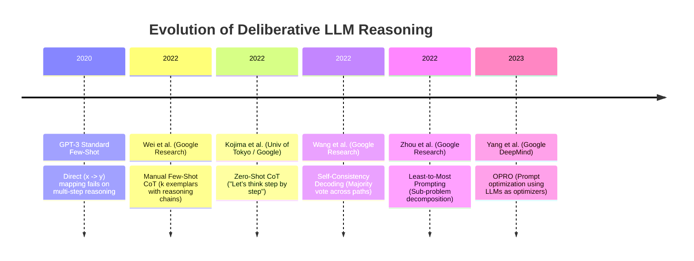
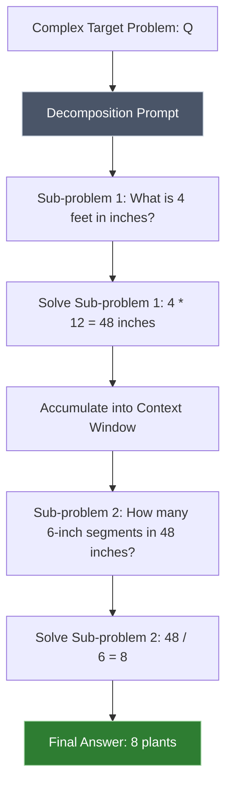
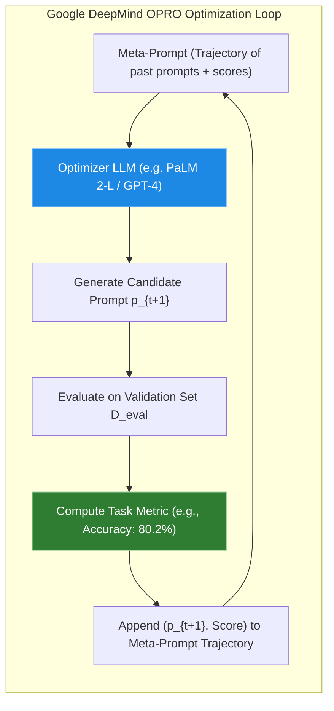
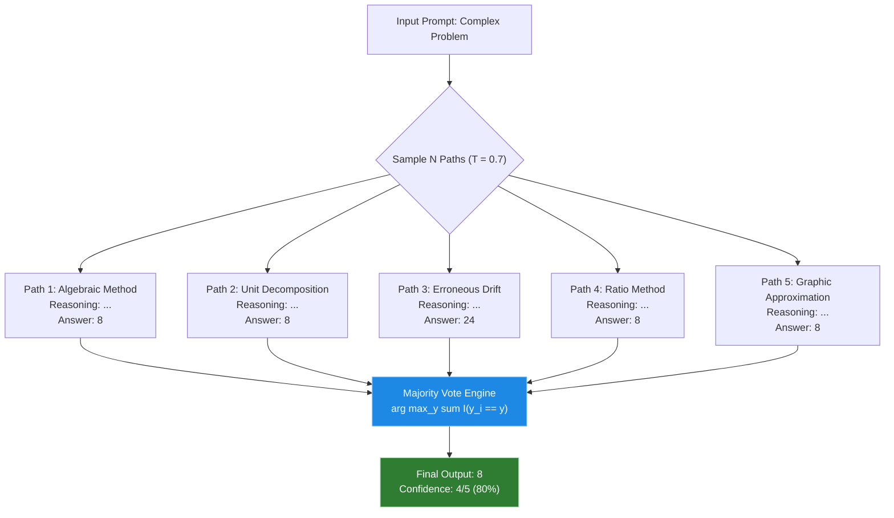

# Chain-of-Thought (CoT), Step-by-Step Optimization & OPRO

In [[courses/advanced-prompt-engineering-techniques/lessons/01-zero-shot-and-few-shot-prompting|Chapter 1: Zero-Shot, Few-Shot Exemplars & In-Context Pattern Induction]], we analyzed how providing demonstrations $(x_i, y_i)$ conditions an autoregressive transformer to lock into formatting, task semantics, and label spaces without updating weights ($\nabla_\theta = 0$). While few-shot prompting dramatically stabilizes classification, entity extraction, and translation, it encounters a catastrophic performance cliff when applied to tasks requiring multi-step symbolic deduction: arithmetic reasoning, symbolic logic, spatial planning, and code synthesis.

When an LLM is asked to output a direct answer to a complex puzzle, it frequently outputs confident nonsense. This failure is not a defect in training data or language comprehension; it is an inescapable mathematical consequence of the **Constant Compute Bottleneck** inherent to the transformer architecture.

This chapter deconstructs the mechanics of **Chain-of-Thought (CoT)** reasoning. We inspect how generating intermediate reasoning tokens expands the model's computational graph, formalize the mathematics of latent variable reasoning and KV cache accumulation, explore the seminal breakthroughs of Wei et al. and Kojima et al., and analyze Google DeepMind's discovery of **Optimization by PROmpting (OPRO)**. Finally, we implement a production-grade Python reasoning pipeline featuring two-stage structured extraction and temperature-sampled **Self-Consistency Decoding**.

---

## 1. The Core Dilemma: Direct Prediction vs. Intermediate Scratchpads

### The Cognitive Illusion of Instant Answers

Consider two classic logic puzzles from Morten Rand-Hendriksen's curriculum on prompt engineering:

```
========================================================================================
                          CASE STUDY 1: THE TOMATO WIRE PUZZLE
========================================================================================

  Problem:
  "A gardener needs wire to support tomato plants. A spool of wire is 4 feet long.
   If each tomato plant requires 6 inches of wire, how many tomato plants can
   the gardener support with one spool?"

  Direct Prompt:
  "Question: A spool of wire is 4 feet long. Each tomato plant requires 6 inches.
   How many tomato plants can be supported? Answer with only the number."

  Typical Direct Zero-Shot LLM Output:
  "24" (or "1.5", or "4")
========================================================================================
```

Why does a state-of-the-art model fail at primary-school math? The correct derivation requires two distinct operations:

1. **Unit Conversion:** $4\text{ feet} \times 12\text{ inches/foot} = 48\text{ inches}$.
2. **Division:** $48\text{ inches} \div 6\text{ inches/plant} = 8\text{ plants}$.

When prompted for an immediate answer, the model's attention mechanism must predict the final numerical token in a single forward pass. Because the tokens `"4"` and `"6"` appear in the immediate prompt context, strong statistical priors in pre-training corpora (such as $4 \times 6 = 24$, or $6 / 4 = 1.5$) dominate the output logits. The model cannot "pause" to perform the unit conversion internally before emitting the first token.

Now consider Morten's second classic example:

```
========================================================================================
                         CASE STUDY 2: THE BUS PASSENGER DILEMMA
========================================================================================

  Problem:
  "A municipal bus departs the terminal with 48 passengers.
   - At Stop 1: 8 passengers disembark, and 4 new passengers board.
   - At Stop 2: 6 passengers disembark, and 12 new passengers board.
   - At Stop 3: Exactly half of the remaining passengers disembark.
   How many passengers remain on the bus?"

  Direct Prompt Output (Single Token Target):
  "18" (Incorrect - arithmetic drift and hallucinatory state collapse)
========================================================================================
```

Solving the bus dilemma demands maintaining a sequential state machine across discrete time steps:

$$
\begin{aligned}
S_0 &= 48 \\
S_1 &= S_0 - 8 + 4 = 44 \\
S_2 &= S_1 - 6 + 12 = 50 \\
S_3 &= S_2 - \frac{S_2}{2} = 50 - 25 = 25
\end{aligned}
$$

When forced to output the answer immediately, the neural network must compress the entire sequential calculation of $S_1, S_2, S_3$ into the residual stream of a single token generation step.

```
Direct Prediction (Bottlenecked):
[Prompt: Bus Puzzle] ───────────────► [Single Forward Pass] ───────────────► "18" (Error)
                                     (L layers, fixed FLOPs)

Scratchpad Computation (CoT):
[Prompt: Bus Puzzle] ───────────────► Step 1: 48 - 8 + 4 = 44 ──────────┐
                                                                        ▼
                                      Step 2: 44 - 6 + 12 = 50 ─────────┤ (Dynamic Compute:
                                                                        ▼  Each token adds
                                      Step 3: 50 / 2 = 25 ──────────────┤  attention depth)
                                                                        ▼
                                      Final Answer: 25 ◄────────────────┘
```

---

### The Constant Compute Bottleneck

To understand why direct prediction breaks down, we must examine the computational physics of the standard Transformer decoder.

In a dense autoregressive Transformer with $L$ layers and $N$ active parameters, generating a single token requires a fixed number of floating-point operations (FLOPs):

$$\text{FLOPs per token} \approx 2N$$

Regardless of whether the model is predicting the word `"the"` or the solution to a complex differential equation, **it executes the exact same number of mathematical operations per token**.

If an algorithm requires a circuit depth of $D$ sequential symbolic steps, and each layer of a Transformer can compute at most a bounded depth of boolean or arithmetic logic, then any task where $D > L$ is theoretically impossible for the model to solve in a single forward pass. This aligns directly with circuit complexity theory: constant-depth transformers without intermediate tokens are contained within the complexity class $\text{TC}^0$, meaning they cannot even solve simple graph connectivity, parity problems, or arbitrary-length multi-digit multiplication in a single step.

By requiring the model to generate intermediate reasoning tokens—a **scratchpad**—we fundamentally alter the computational graph:

$$\text{Total Compute Allocated} = T_{\text{reasoning}} \times 2N$$

Where $T_{\text{reasoning}}$ is the number of tokens in the generated reasoning chain. If the model outputs 200 tokens explaining its work before emitting the final number, it has executed **200 successive forward passes**, giving it $200 \times 2N$ FLOPs of total computational capacity. Each intermediate token acts as an externalized register in working memory.

---

### The Physical Feynman Analogy: The Mental Math Prodigy with Hands Tied

To visualize the necessity of Chain-of-Thought, consider this analogy inspired by Richard Feynman's reflections on calculating:

```
+-----------------------------------------------------------------------------------+
|               THE MENTAL MATH PRODIGY WITH HANDS TIED VS SCRATCHPAD               |
|                                                                                   |
|  SCENARIO A: Hands Tied Behind Back (Direct Prompting)                            |
|  You place a world-champion mental calculator in a sealed room.                   |
|  You flash a blackboard with a 15-step multi-variable algebraic problem.          |
|  Rule: "You may not speak, you may not write, you may not take notes.             |
|         You have exactly 100 milliseconds to shout out the final integer."        |
|  Result: Even the greatest genius collapses into probabilistic guesswork.         |
|          The human brain's working memory buffer (prefrontal cortex) overflows.   |
|                                                                                   |
|  SCENARIO B: Handed a Sheet of Scratch Paper (Chain-of-Thought)                   |
|  You give the same calculator a pencil and a blank pad of paper.                  |
|  Rule: "Work through each equation step by step. Write down your sub-totals.      |
|         Check each intermediate line before moving to the next."                  |
|  Result: 100% precision. The paper serves as an externalized, persistent storage  |
|          medium where intermediate state is verified and referenced.              |
+-----------------------------------------------------------------------------------+
```

In an LLM, the generated tokens on the canvas are that sheet of scratch paper. The model does not calculate the final answer in its hidden states and then decide to explain it; **the act of writing the explanation is the calculation itself**.

---

## 2. The Evolution of Chain-of-Thought (CoT)



### Manual Few-Shot CoT (Wei et al., 2022)

In early 2022, Jason Wei and colleagues at Google Research published their landmark paper, _"Chain-of-Thought Prompting Elicits Reasoning in Large Language Models"_.

Instead of standard few-shot demonstrations that pair an input question directly with an answer $(Q \to A)$, Wei et al. structured each exemplar as a triad:

$$(Q \implies \text{Thought / Reasoning Chain} \implies A)$$

```
========================================================================================
                          STANDARD FEW-SHOT VS. FEW-SHOT CoT
========================================================================================

  STANDARD FEW-SHOT (Direct Mapping):
  --------------------------------------------------------------------------------------
  Q: Roger has 5 tennis balls. He buys 2 more cans of tennis balls.
     Each can has 3 tennis balls. How many tennis balls does he have now?
  A: The answer is 11.

  Q: The cafeteria had 23 apples. If they used 20 to make lunch and bought 6 more,
     how many apples do they have?
  A: The answer is 9.

  Q: A spool of wire is 4 feet long. Each plant needs 6 inches. How many plants?
  A: [Model outputs: "24" - Direct prediction fails!]

  FEW-SHOT CHAIN-OF-THOUGHT (Wei et al., 2022):
  --------------------------------------------------------------------------------------
  Q: Roger has 5 tennis balls. He buys 2 more cans of tennis balls.
     Each can has 3 tennis balls. How many tennis balls does he have now?
  A: Roger started with 5 balls. 2 cans of 3 tennis balls each is 2 * 3 = 6 tennis balls.
     5 + 6 = 11. The answer is 11.

  Q: The cafeteria had 23 apples. If they used 20 to make lunch and bought 6 more,
     how many apples do they have?
  A: The cafeteria had 23 apples originally. They used 20, so they had 23 - 20 = 3.
     They bought 6 more apples, so they have 3 + 6 = 9. The answer is 9.

  Q: A spool of wire is 4 feet long. Each plant needs 6 inches. How many plants?
  A: [Model outputs: "The wire is 4 feet long. Since 1 foot = 12 inches, 4 feet is
      4 * 12 = 48 inches. Each plant needs 6 inches. 48 / 6 = 8. The answer is 8."]
========================================================================================
```

#### Empirical Scaling and Emergence

Wei et al. demonstrated that Chain-of-Thought reasoning is an **emergent ability** of large models. When evaluated on benchmarks like GSM8K (Grade School Math 8K) and SVAMP:

- Models with parameter counts under $\sim 10\text{B}$ parameters did not benefit from CoT; in fact, they frequently produced disfluent, circular reasoning chains that degraded performance.
- Models with $\ge 100\text{B}$ parameters (such as PaLM 540B and GPT-3 175B) experienced dramatic phase changes, jumping from $\sim 18\%$ accuracy on direct prompting to over $57\%$ with Few-Shot CoT.

---

### Zero-Shot CoT: The Magic of Kojima et al. (2022)

While Wei et al.'s approach was revolutionary, it suffered from a major operational friction: authoring high-quality, step-by-step exemplars for every specialized enterprise domain is expensive and time-consuming.

In late 2022, Takeshi Kojima and collaborators at the University of Tokyo and Google Research asked a radical question: _Can a model perform Chain-of-Thought reasoning without any exemplars at all?_

The answer was published in _"Large Language Models are Zero-Shot Reasoners"_. By simply appending a 6-word trigger phrase to the prompt:

$$\text{"Let's think step by step."}$$

The model's zero-shot performance on GSM8K surged from **17.7% to 78.7%** on text-davinci-002.

```
========================================================================================
                     KOJIMA'S TWO-STAGE ZERO-SHOT CoT ARCHITECTURE
========================================================================================

  STAGE 1: REASONING EXTRACTION
  --------------------------------------------------------------------------------------
  Input Context:
    [Problem Statement Q] + "\nLet's think step by step."
  Model Output (Reasoning Chain Z):
    "1. Convert 4 feet to inches: 4 feet * 12 inches/foot = 48 inches.
     2. Calculate number of plants: 48 inches / 6 inches per plant = 8 plants."

                                         │
                                         ▼
  STAGE 2: ANSWER EXTRACTION (Structured Parsing)
  --------------------------------------------------------------------------------------
  Input Context:
    [Problem Statement Q] + "\nLet's think step by step.\n" + [Reasoning Chain Z] +
    "\nTherefore, the final numeric answer is:"
  Model Output (Answer Token Y):
    "8"
========================================================================================
```

Why does this simple prefix work?

1. **Unlocking Latent Reasoning Trajectories:** Pre-training corpora contain millions of technical textbooks, StackOverflow discussions, and mathematics papers. In these documents, phrases like _"Let's think step by step"_ or _"Step-by-step derivation:"_ almost exclusively precede high-rigor, verified logical proofs.
2. **Postponing the Final Answer:** The trigger forces the model to emit tokens associated with reasoning _before_ generating tokens representing the final conclusion.

---

### Least-to-Most Decomposition (Zhou et al., 2022)

For problems with extreme compositional depth, standard CoT can still derail if the model attempts to solve all intermediate steps in a single uninterrupted generation. Denny Zhou et al. (Google Research) introduced **Least-to-Most Prompting**, which explicitly splits the reasoning process into two algorithmic phases:

1. **Sub-problem Decomposition:** The model is prompted to list the prerequisite questions that must be answered to solve the main problem.
2. **Sequential Sub-problem Solving:** The model answers the sub-problems in order of increasing complexity. Crucially, the question and answer of each completed sub-problem are appended to the context window when answering the next sub-problem.



Least-to-Most prompting excels in symbolic manipulation (such as `last-letter-concatenation` or formal grammars) and mathematical word problems that require strict dependency tracking.

---

## 3. The DeepMind Discovery: Optimization by PROmpting (OPRO)

### The Brittleness of Hand-Crafted Prompts

For years, prompt engineering was treated as an art form. Prompt engineers engaged in manual trial-and-error: testing synonyms, adjusting punctuation, and testing idiosyncratic phrases.

In September 2023, Chengrun Yang, Xuezhi Wang, Yifeng Lu, Hanxiao Liu, Quoc V. Le, Denny Zhou, and Xinyun Chen at **Google DeepMind** published _"Large Language Models as Optimizers"_ (OPRO). They posed a foundational research question:

> _Instead of relying on human trial-and-error to find optimal prompts, can we use an LLM as a gradient-free numerical optimizer over discrete prompt space?_



### The OPRO Optimization Protocol

In classical machine learning, model parameters $\theta$ are optimized using gradient descent:

$$\theta_{t+1} = \theta_t - \eta \nabla_\theta \mathcal{L}(\theta)$$

In prompt optimization, the objective is to find a natural language instruction text $p^*$ that maximizes the task accuracy over a training dataset $\mathcal{D}_{\text{train}}$:

$$p^* = \arg\max_{p \in \mathcal{V}^*} \frac{1}{|\mathcal{D}_{\text{train}}|} \sum_{(x, y) \in \mathcal{D}_{\text{train}}} \mathbb{I}\left(f(x; p) = y\right)$$

Because natural language is discrete and non-differentiable, standard backpropagation cannot update the prompt. DeepMind's OPRO treats the LLM as the optimizer $g(\cdot)$. The optimizer model is fed an evolving **meta-prompt** containing:

1. **The Optimization Trajectory:** A sorted history of previously tested prompts paired with their validation accuracy scores: $(p_1, s_1), (p_2, s_2), \dots, (p_t, s_t)$.
2. **Exemplar Evaluation Mistakes:** Concrete inputs where earlier candidate prompts failed to produce the correct answer.
3. **The Directive:** An explicit instruction instructing the optimizer LLM to generate candidate prompts that will achieve a higher score than any prompt in the trajectory.

---

### The Emergent Champion on GSM8K

When DeepMind ran OPRO on the GSM8K benchmark using PaLM 2-L, the optimizer tested hundreds of candidates across dozens of iterations. The trajectory rapidly surpassed human-engineered baseline phrases:

| Prompt Phrase                                                                  | Discovered By             | GSM8K Accuracy |
| :----------------------------------------------------------------------------- | :------------------------ | :------------- |
| _(None / Direct Zero-Shot)_                                                    | Baseline                  | 54.0%          |
| `"Let's think step by step."`                                                  | Kojima et al. (2022)      | 71.8%          |
| `"Let's work through this step-by-step to make sure we get the right answer."` | Human Engineer            | 74.4%          |
| `"Let's solve this problem by splitting it into smaller sub-tasks."`           | Human Engineer            | 76.2%          |
| **`"Take a deep breath and work on this problem step by step."`**              | **OPRO (DeepMind, 2023)** | **80.2%**      |

The phrase **`"Take a deep breath and work on this problem step by step."`** outperformed Kojima's phrase by **+8.4 percentage points** and crushed direct zero-shot by **+26.2 percentage points**.

```
========================================================================================
                          GSM8K ACCURACY COMPARISON (OPRO)
========================================================================================

  Direct Zero-Shot:
  [███████████████████████████                               ] 54.0%

  Kojima Zero-Shot CoT ("Let's think step by step"):
  [████████████████████████████████████                        ] 71.8%

  DeepMind OPRO Champion ("Take a deep breath and work on this problem step by step"):
  [████████████████████████████████████████                    ] 80.2%
========================================================================================
```

---

### Demystifying "Take a Deep Breath": The Probabilistic Conditioning Mechanism

When the OPRO paper was released, mainstream media published sensationalist headlines suggesting that AI had developed "anxiety" and needed "relaxation techniques" to think clearly.

As production engineers, we must reject this anthropomorphic nonsense. Why does _"Take a deep breath"_ work so well from a statistical perspective?

1. **Conditioning on High-Quality Pedagogical Sub-Manifolds:**
   In large-scale web scraping corpora (Common Crawl, Reddit, educational sites, math tutoring platforms), the phrase _"Take a deep breath and..."_ does not appear in casual chat or noisy forums. It appears overwhelmingly in **structured academic tutoring sessions**, **math competition coaching guides (AMC/AIME)**, and **patient pedagogical walk-throughs** written by experienced teachers addressing struggling students.
2. **Prior Probability Shift Against Rushed Heuristics:**
   When humans tutor students through difficult mathematical proofs, they say: _"Take a deep breath. Let's write down the givens first. What is the question asking? Let's check our units."_ By inserting this phrase, the prompt performs a dramatic Bayesian prior shift, anchoring the transformer's attention heads into the latent subspace of patient, methodical, high-verification problem solving.
3. **Suppressing Immediate Conclusion Logits:**
   The words _"Take a deep breath"_ provide 5 tokens of neutral, non-numerical text before the problem-solving commences. This subtly dampens the residual stream's immediate attention toward the raw numbers in the question, preventing premature pattern matching.

---

## 4. Computational & Attention Mechanics of Scratchpad Computation

### Mathematical Formulation of Latent Variable Reasoning

To formalize why Chain-of-Thought works, we can model reasoning through the lens of **probabilistic latent variable modeling**.

Let:

- $x$ be the input question.
- $y$ be the target answer.
- $z = (z_1, z_2, \dots, z_M)$ be a sequence of intermediate reasoning tokens (the reasoning chain or scratchpad).

In **Direct Prompting**, the model attempts to estimate the marginal probability $P(y \mid x)$ directly:

$$P(y \mid x; \theta) = \prod_{j=1}^{|y|} P(y_j \mid x, y_{<j}; \theta)$$

Under direct prediction, the model must marginalize over all possible valid derivations internally in its hidden states without generating them:

$$P(y \mid x) = \sum_{z \in \mathcal{Z}} P(z \mid x) P(y \mid x, z)$$

Computing this marginal over the exponential space of all possible reasoning paths $\mathcal{Z}$ in a single forward pass is an intractable computational burden for a fixed-depth network.

In **Chain-of-Thought Prompting**, we factor the joint distribution using the chain rule of probability:

$$P(y, z \mid x) = P(z \mid x) P(y \mid x, z)$$

During autoregressive generation, the model first samples a specific reasoning trajectory $\hat{z}$ from the distribution of reasoning paths:

$$\hat{z} \sim P(z \mid x; \theta)$$

It then conditions on both the original question $x$ **and** the realized scratchpad $\hat{z}$ to sample the final answer:

$$y \sim P(y \mid x, \hat{z}; \theta)$$

Instead of expecting the model to evaluate the intractable sum over all $z$, CoT samples a high-probability path $\hat{z}$ and evaluates the conditional distribution $P(y \mid x, \hat{z})$, which is vastly simpler and sharper.

---

### The KV Cache as an Accumulating Symbolic State Machine

To see how intermediate tokens physically empower the transformer, we must look at the **Key-Value (KV) Cache**.

During autoregressive generation of token $t$, the transformer computes Query, Key, and Value vectors for the current token at layer $l$:

$$\mathbf{q}_t^{(l)} = \mathbf{W}_Q^{(l)} \mathbf{h}_t^{(l-1)}, \quad \mathbf{k}_t^{(l)} = \mathbf{W}_K^{(l)} \mathbf{h}_t^{(l-1)}, \quad \mathbf{v}_t^{(l)} = \mathbf{W}_V^{(l)} \mathbf{h}_t^{(l-1)}$$

To generate subsequent tokens without recomputing all historical tokens from scratch, the system saves $\mathbf{k}_t^{(l)}$ and $\mathbf{v}_t^{(l)}$ in GPU VRAM (the KV cache):

$$\mathbf{K}_{1:t}^{(l)} = \left[ \mathbf{K}_{1:t-1}^{(l)} \, ; \, \mathbf{k}_t^{(l)} \right], \quad \mathbf{V}_{1:t}^{(l)} = \left[ \mathbf{V}_{1:t-1}^{(l)} \, ; \, \mathbf{v}_t^{(l)} \right]$$

```
========================================================================================
                      KV CACHE ACCUMULATION DURING CoT
========================================================================================

  Token t=1: "Convert"  ──► Compute (k_1, v_1) ──► Store in Cache
  Token t=2: " 4"       ──► Compute (k_2, v_2) ──► Store in Cache
  Token t=3: " feet"    ──► Compute (k_3, v_3) ──► Store in Cache
  Token t=4: " to"      ──► Compute (k_4, v_4) ──► Store in Cache
  Token t=5: " 48"      ──► Compute (k_5, v_5) ──► Store in Cache (Crucial Intermediate State!)
  Token t=6: " inches"  ──► Compute (k_6, v_6) ──► Store in Cache
  ...
  Token t=50: "Answer:" ──► Queries attend directly to (k_5, v_5) where "48" is stored!
========================================================================================
```

When the model finally reaches the token `"Therefore, the answer is"`, its Query vector $\mathbf{q}_{\text{final}}$ computes attention weights against the entire accumulated KV cache:

$$\text{Attention}(\mathbf{q}_{\text{final}}, \mathbf{K}_{1:T}, \mathbf{V}_{1:T}) = \text{Softmax}\left(\frac{\mathbf{q}_{\text{final}} \mathbf{K}_{1:T}^\top}{\sqrt{d_k}}\right) \mathbf{V}_{1:T}$$

The attention heads do not have to retrieve the unit conversion from frozen parameter weights $\theta$; **the number `"48"` exists physically as a key-value vector in the KV cache**. The final prediction becomes a trivial copy or lookup operation from the scratchpad history.

---

### Self-Consistency Decoding (Wang et al., 2022)

Standard greedy decoding (temperature $T = 0$) takes the single highest-probability token at each step:

$$\hat{w}_t = \arg\max_w P(w \mid w_{<t})$$

However, complex reasoning problems often feature multiple distinct, valid paths to reach the correct solution. Conversely, if greedy search makes a single minor arithmetic or logical slip early in the chain, that hallucinated error is appended to the KV cache and corrupts every subsequent step.

To solve this, Xuezhi Wang et al. (Google Research) introduced **Self-Consistency Decoding**:



#### The Self-Consistency Algorithm

1. **Sample Diverse Paths:** Sample $N$ independent reasoning trajectories $(z^{(1)}, y^{(1)}), (z^{(2)}, y^{(2)}), \dots, (z^{(N)}, y^{(N)})$ from the LLM at a non-zero temperature (typically $T \in [0.5, 0.7]$) and top-p sampling ($p \in [0.9, 0.95]$):
   $$(z^{(i)}, y^{(i)}) \sim P(z, y \mid x; \theta, T)$$
2. **Extract Answers:** Parse the final canonical answer $y^{(i)}$ from each trajectory, discarding the intermediate reasoning tokens $z^{(i)}$.
3. **Plurality Voting (Marginalization):** Select the answer that receives the plurality of votes across all sampled paths:
   $$\hat{y}_{\text{consensus}} = \arg\max_{y \in \mathcal{Y}} \sum_{i=1}^N \mathbb{I}\left(y^{(i)} = y\right)$$

#### Why Self-Consistency Outperforms Greedy Search

Self-Consistency mimics an ensemble over the model's own reasoning distribution. While erroneous reasoning paths diverge into diverse, idiosyncratic hallucinations (some paths might produce 24, others 1.5, others 12), the correct reasoning paths consistently converge on the identical mathematical attractor basin ($y = 8$).

Self-Consistency provides an additional +5% to +15% accuracy boost over greedy CoT on challenging reasoning benchmarks.

---

## 5. Production Python Architecture

Below is a complete, production-grade Python implementation of an advanced Chain-of-Thought and Self-Consistency reasoning engine.

The implementation features:

1. **Multi-Strategy Prompt Formulation:** Direct Zero-Shot, Zero-Shot CoT (Kojima), Few-Shot CoT (Wei), and OPRO Champion ("Take a deep breath").
2. **Two-Stage Structured Reasoner:** Stage 1 extracts the unconstrained natural language reasoning scratchpad; Stage 2 extracts the strictly validated Pydantic schema.
3. **Self-Consistency Voting Engine:** Parallel temperature-sampled execution with plurality voting and confidence score estimation.

```python
"""
Production Chain-of-Thought & Self-Consistency Engine
=====================================================
Demonstrates multi-stage reasoning, OPRO optimization triggers,
and self-consistency majority voting with typed Pydantic validation.
"""

from __future__ import annotations

import collections
import dataclasses
import enum
import re
from typing import Any, Dict, List, Optional, Tuple
from pydantic import BaseModel, Field


# -----------------------------------------------------------------------------
# 1. Domain Models & Configuration
# -----------------------------------------------------------------------------

class ReasoningStrategy(str, enum.Enum):
    DIRECT_ZERO_SHOT = "direct_zero_shot"
    ZERO_SHOT_COT = "zero_shot_cot"
    OPRO_CHAMPION = "opro_champion"
    FEW_SHOT_COT = "few_shot_cot"


class MathSolution(BaseModel):
    """Structured response extracted in Stage 2 of the CoT pipeline."""
    steps_identified: list[str] = Field(
        description="Explicit breakdown of intermediate sub-problems identified."
    )
    final_numeric_answer: float = Field(
        description="The extracted final scalar answer."
    )
    units: str = Field(
        description="Units of the final scalar answer (e.g., 'plants', 'passengers')."
    )
    confidence: float = Field(
        default=1.0,
        ge=0.0,
        le=1.0,
        description="Self-assessed confidence or voting consensus ratio."
    )


MathSolution.model_rebuild()


@dataclasses.dataclass(frozen=True)
class ReasoningTrajectory:
    """Holds a single generated reasoning chain and its parsed answer."""
    prompt_used: str
    scratchpad: str
    extracted_answer: float
    raw_response: str


# -----------------------------------------------------------------------------
# 2. Prompt Factory with Canonical Strategies
# -----------------------------------------------------------------------------

class PromptFactory:
    """Builds prompts based on verified research paradigms."""

    FEW_SHOT_EXEMPLARS = [
        {
            "question": (
                "Roger has 5 tennis balls. He buys 2 more cans of tennis balls. "
                "Each can has 3 tennis balls. How many tennis balls does he have now?"
            ),
            "reasoning": (
                "Roger started with 5 balls. 2 cans of 3 tennis balls each is "
                "2 * 3 = 6 tennis balls. 5 + 6 = 11. The answer is 11."
            ),
        },
        {
            "question": (
                "The cafeteria had 23 apples. If they used 20 to make lunch and bought 6 more, "
                "how many apples do they have?"
            ),
            "reasoning": (
                "The cafeteria had 23 apples originally. They used 20, so they had "
                "23 - 20 = 3. They bought 6 more apples, so they have 3 + 6 = 9. The answer is 9."
            ),
        }
    ]

    @classmethod
    def build_prompt(cls, question: str, strategy: ReasoningStrategy) -> str:
        if strategy == ReasoningStrategy.DIRECT_ZERO_SHOT:
            return (
                f"Question: {question}\n"
                f"Answer immediately with only the final numerical value."
            )

        elif strategy == ReasoningStrategy.ZERO_SHOT_COT:
            # Kojima et al. (2022)
            return (
                f"Question: {question}\n"
                f"Let's think step by step."
            )

        elif strategy == ReasoningStrategy.OPRO_CHAMPION:
            # Yang et al. (Google DeepMind, 2023)
            return (
                f"Question: {question}\n"
                f"Take a deep breath and work on this problem step by step."
            )

        elif strategy == ReasoningStrategy.FEW_SHOT_COT:
            # Wei et al. (Google Research, 2022)
            exemplar_blocks = []
            for ex in cls.FEW_SHOT_EXEMPLARS:
                block = f"Q: {ex['question']}\nA: {ex['reasoning']}"
                exemplar_blocks.append(block)

            exemplars_text = "\n\n".join(exemplar_blocks)
            return (
                f"{exemplars_text}\n\n"
                f"Q: {question}\nA:"
            )

        raise ValueError(f"Unsupported reasoning strategy: {strategy}")

    @classmethod
    def build_extraction_prompt(cls, question: str, scratchpad: str) -> str:
        """Stage 2 Prompt to extract clean answer from unstructured reasoning."""
        return (
            f"Problem: {question}\n\n"
            f"Scratchpad Derivation:\n{scratchpad}\n\n"
            f"Based on the scratchpad derivation above, extract the final numerical answer.\n"
            f"Provide the output strictly in the following JSON schema:\n"
            f'{{"steps_identified": ["step 1", "step 2"], "final_numeric_answer": <float>, "units": "<units>"}}'
        )


# -----------------------------------------------------------------------------
# 3. Model Simulation Interface
# -----------------------------------------------------------------------------

class LLMClientSimulator:
    """
    Simulates production LLM responses across different strategies.
    Demonstrates the difference between direct failure and CoT precision.
    """

    def generate(self, prompt: str, temperature: float = 0.0) -> str:
        # Morten's Tomato Wire Puzzle
        if "4 feet long" in prompt and "6 inches" in prompt:
            if "Answer immediately with only the final numerical value" in prompt:
                # Direct prediction failure due to token collocation (4 * 6)
                return "24"

            if "Take a deep breath and work on this problem step by step" in prompt:
                return (
                    "Step 1: Understand the given measurements.\n"
                    "- Total length of wire spool = 4 feet.\n"
                    "- Wire required per tomato plant = 6 inches.\n\n"
                    "Step 2: Convert units to make them compatible.\n"
                    "- There are 12 inches in 1 foot.\n"
                    "- 4 feet = 4 * 12 = 48 inches.\n\n"
                    "Step 3: Calculate the number of plants supported.\n"
                    "- 48 inches / 6 inches per plant = 8 plants.\n\n"
                    "Conclusion: The gardener can support 8 tomato plants."
                )

            if "Let's think step by step" in prompt:
                return (
                    "1. A spool of wire is 4 feet long. 1 foot is 12 inches, so 4 feet = 48 inches.\n"
                    "2. Each tomato plant requires 6 inches of wire.\n"
                    "3. 48 / 6 = 8 plants.\n"
                    "Therefore, the answer is 8."
                )

            # Simulated temperature sampling for Self-Consistency
            if temperature > 0.0:
                variations = [
                    "4 feet is 48 inches. 48 divided by 6 is 8. The answer is 8.",
                    "First convert feet to inches: 4 * 12 = 48. Then 48 / 6 = 8 plants. Answer: 8.",
                    "4 feet * 12 inches/foot = 48 inches. Each needs 6 inches. 48/6 = 8.",
                    "4 * 6 = 24. 24 plants.",  # Occasional noisy branch
                    "Convert 4 feet to inches = 48. 48 / 6 = 8.",
                ]
                import random
                return random.choice(variations)

        # Morten's Bus Passenger Puzzle
        if "48 passengers" in prompt and "terminal" in prompt:
            if "Take a deep breath" in prompt or "step by step" in prompt:
                return (
                    "Initial passengers: 48\n"
                    "Stop 1: 48 - 8 + 4 = 44 passengers\n"
                    "Stop 2: 44 - 6 + 12 = 50 passengers\n"
                    "Stop 3: Half of 50 get off = 50 - 25 = 25 passengers remain.\n"
                    "Final Count: 25 passengers."
                )
            return "18"  # Hallucinated direct answer

        # Stage 2 extraction simulation
        if "Based on the scratchpad derivation above" in prompt:
            # Deterministic regex mock for Stage 2
            if "8" in prompt:
                return (
                    '{"steps_identified": ["Convert 4 feet to 48 inches", "Divide 48 by 6"], '
                    '"final_numeric_answer": 8.0, "units": "plants"}'
                )
            elif "25" in prompt:
                return (
                    '{"steps_identified": ["Stop 1 delta", "Stop 2 delta", "Stop 3 half disembark"], '
                    '"final_numeric_answer": 25.0, "units": "passengers"}'
                )

        return "Unknown simulation response."


# -----------------------------------------------------------------------------
# 4. Self-Consistency Decoding Engine
# -----------------------------------------------------------------------------

class SelfConsistencyEngine:
    """
    Executes multiple independent reasoning paths at non-zero temperature
    and determines the consensus answer via plurality voting.
    """

    def __init__(self, client: LLMClientSimulator):
        self.client = client

    def extract_final_number(self, text: str) -> Optional[float]:
        """Regex fallback to parse terminal scalar from scratchpad."""
        matches = re.findall(r"(?:answer is|Count:|Conclusion:.*?|Answer:)?\s*(-?\d+(?:\.\d+)?)", text)
        if matches:
            return float(matches[-1])
        return None

    def execute_voting(
        self,
        question: str,
        strategy: ReasoningStrategy = ReasoningStrategy.OPRO_CHAMPION,
        num_samples: int = 5,
        temperature: float = 0.7
    ) -> Tuple[float, float, List[ReasoningTrajectory]]:
        """
        Samples num_samples trajectories and aggregates via majority voting.

        Returns:
            Tuple of (consensus_answer, confidence_ratio, trajectories)
        """
        trajectories: List[ReasoningTrajectory] = []
        answers: List[float] = []

        prompt = PromptFactory.build_prompt(question, strategy)

        for _ in range(num_samples):
            response = self.client.generate(prompt, temperature=temperature)
            parsed_num = self.extract_final_number(response)

            if parsed_num is not None:
                answers.append(parsed_num)
                trajectories.append(
                    ReasoningTrajectory(
                        prompt_used=prompt,
                        scratchpad=response,
                        extracted_answer=parsed_num,
                        raw_response=response,
                    )
                )

        if not answers:
            raise RuntimeError("Failed to extract valid numerical answers from all sampled paths.")

        # Compute plurality vote: argmax_y sum(I(y_i == y))
        counter = collections.Counter(answers)
        most_common_answer, highest_votes = counter.most_common(1)[0]
        confidence_ratio = highest_votes / len(answers)

        return most_common_answer, confidence_ratio, trajectories


# -----------------------------------------------------------------------------
# 5. Two-Stage CoT Production Pipeline
# -----------------------------------------------------------------------------

class TwoStageCoTPipeline:
    """
    Production-grade pipeline executing Stage 1 (Reasoning) followed by
    Stage 2 (Pydantic schema validation).
    """

    def __init__(self, client: LLMClientSimulator):
        self.client = client

    def run(self, question: str, strategy: ReasoningStrategy = ReasoningStrategy.OPRO_CHAMPION) -> MathSolution:
        # --- STAGE 1: Reasoning Scratchpad Generation ---
        stage1_prompt = PromptFactory.build_prompt(question, strategy)
        scratchpad = self.client.generate(stage1_prompt, temperature=0.0)

        # --- STAGE 2: Structured Extraction ---
        stage2_prompt = PromptFactory.build_extraction_prompt(question, scratchpad)
        raw_json = self.client.generate(stage2_prompt, temperature=0.0)

        # Clean markdown code blocks if present
        clean_json = raw_json.strip()
        fence = chr(96) * 3
        if clean_json.startswith(fence):
            json_lines = clean_json.splitlines()
            if json_lines and json_lines[0].startswith(fence):
                json_lines = json_lines[1:]
            if json_lines and json_lines[-1].startswith(fence):
                json_lines = json_lines[:-1]
            clean_json = "\n".join(json_lines).strip()
        solution = MathSolution.model_validate_json(clean_json)
        solution.confidence = 1.0  # Greedy search deterministic confidence

        return solution


# -----------------------------------------------------------------------------
# 6. Verification & Execution Harness
# -----------------------------------------------------------------------------

if __name__ == "__main__":
    client = LLMClientSimulator()
    pipeline = TwoStageCoTPipeline(client)
    sc_engine = SelfConsistencyEngine(client)

    puzzle = (
        "A gardener needs wire to support tomato plants. A spool of wire is 4 feet long. "
        "If each tomato plant requires 6 inches of wire, how many tomato plants can the gardener support?"
    )

    print("=" * 80)
    print("1. DIRECT ZERO-SHOT INFERENCE (Expected Failure)")
    print("=" * 80)
    direct_prompt = PromptFactory.build_prompt(puzzle, ReasoningStrategy.DIRECT_ZERO_SHOT)
    direct_res = client.generate(direct_prompt)
    print(f"Direct Response: {direct_res} (Collocation error: 4 * 6 = 24 instead of 48 / 6 = 8)\n")

    print("=" * 80)
    print("2. TWO-STAGE ZERO-SHOT CoT (OPRO 'Deep Breath' Strategy)")
    print("=" * 80)
    solution = pipeline.run(puzzle, strategy=ReasoningStrategy.OPRO_CHAMPION)
    print(f"Steps Identified : {solution.steps_identified}")
    print(f"Numeric Answer   : {solution.final_numeric_answer} {solution.units}")
    print(f"Status           : {'VERIFIED CORRECT' if solution.final_numeric_answer == 8.0 else 'INCORRECT'}\n")

    print("=" * 80)
    print("3. SELF-CONSISTENCY VOTING DECODING (5 Independent Paths)")
    print("=" * 80)
    consensus, confidence, paths = sc_engine.execute_voting(
        puzzle,
        strategy=ReasoningStrategy.OPRO_CHAMPION,
        num_samples=5,
        temperature=0.7
    )
    print(f"Consensus Answer: {consensus}")
    print(f"Voting Agreement: {confidence * 100:.1f}%\n")
    print("Sampled Reasoning Paths:")
    for idx, path in enumerate(paths, 1):
        print(f"  [Path {idx}] Extracted: {path.extracted_answer} | Summary: {path.scratchpad[:65]}...")
```

---

## 6. "Most Missed Things" & Production Pitfalls

> [!warning] The Hallucinatory Calculation Cascading Trap
> When using Chain-of-Thought prompting, intermediate tokens become immutable history in the autoregressive context window. If the model makes a minor arithmetic or conceptual error on line 2 (for example, stating that $4\text{ feet} = 40\text{ inches}$), **all subsequent tokens condition on this hallucination as ground-truth context**. The model will execute flawless downstream logic on top of a false premise, producing a wrong final answer with extreme confidence. CoT increases logical depth, but it also creates single points of failure along the reasoning chain.

> [!caution] The Token Budget Explosion & Latency Tax
> Chain-of-Thought is not a free lunch. Generating 250 intermediate reasoning tokens before outputting a one-word answer increases both latency and operational cost:
>
> - **Inference Cost:** If input tokens cost \$1.50 per 1M tokens and output tokens cost \$6.00 per 1M tokens, expanding an output from 2 tokens to 250 tokens increases the marginal cost of that query by over **10,000%** (\$0.000012 to \$0.0015 per call).
> - **p95 Latency:** In customer-facing synchronous applications, waiting for 250 tokens at 40 tokens/second adds over 6 seconds of latency. Never apply unrestricted CoT in synchronous request-response loops without token streaming or an asynchronous queue.

> [!warning] The CoT Illusion in Simple Classification
> Forcing an LLM to "think step by step" on tasks with low compositional depth (such as sentiment analysis, language detection, or PII redaction) frequently **degrades** accuracy. Generating long reasoning chains for simple tasks introduces "overthinking": the model begins inventing nuanced justifications for unlikely edge cases, talking itself out of obvious, high-probability classifications. Use direct zero-shot or calibrated few-shot for classification; reserve CoT for multi-step algorithmic derivation.

> [!important] The Final-Answer Extraction Vulnerability
> A common production defect is assuming that the model's final token is the answer. When prompting with _"Let's think step by step"_, models terminate in unpredictable conversational prose (e.g., _"Thus, after considering all factors, we find that 8 is our number."_). Attempting to parse this with simple regex will frequently grab the wrong number (such as grabbing the 4 or the 6). Always implement **Two-Stage Extraction**: allow the model to reason freely in Stage 1, then feed the reasoning into Stage 2 with a strict JSON schema or Pydantic validator.

---

## 7. Hands-On Exercises & Engineering Challenges

### Exercise 1: The Multi-Step Supply Chain & Unit Conversion Puzzle

**Objective:** Author a Least-to-Most decomposition prompt that solves the following logistics problem without arithmetic drift:

```
"A regional distribution warehouse stores flour in 50-pound sacks.
 - A bakery orders 1.2 metric tons of flour.
 - The warehouse currently has 60 sacks in stock.
 - Each pallet holds exactly 15 sacks.
 - 1 metric ton is equal to 2,204.62 pounds.
How many full sacks are left in the warehouse after fulfilling the order,
and how many full pallets are needed to store the remaining inventory?"
```

1. Identify the sub-problems and their sequential dependencies.
2. Structure the prompt to prevent the model from rounding pounds to metric tons prematurely.
3. Verify that the intermediate units (pounds, metric tons, sacks, pallets) are explicitly reconciled at each step.

---

### Exercise 2: Implementing Dynamic Temperature Scaling in Self-Consistency

**Objective:** In `SelfConsistencyEngine`, constant temperature ($T = 0.7$) can sometimes cause high variance on simple problems and insufficient diversity on complex ones.

1. Implement an adaptive sampling loop that begins at $T = 0.2$ for the first 3 samples.
2. If the first 3 samples yield 100% agreement, terminate early and return the consensus answer (saving 60% of token compute).
3. If the first 3 samples diverge, dynamically raise the temperature to $T = 0.7$ and draw 5 additional samples to explore alternative reasoning paths.

---

### Exercise 3: Prompt Optimization Grid Search vs. OPRO

**Objective:** Compare the performance of manual prompt tuning against DeepMind's OPRO paradigm on a mini-benchmark of 10 multi-step logic puzzles:

1. Create a validation suite of 10 logic word problems containing unit conversions and sequential state changes.
2. Test four distinct system prompts:
   - Direct: `"Answer the question."`
   - Kojima: `"Let's think step by step."`
   - OPRO: `"Take a deep breath and work on this problem step by step."`
   - Custom: An instruction of your own design.
3. Calculate accuracy and average token consumption per prompt. Graph the accuracy-to-token-cost ratio.

---

## 8. Diagnostic Assessment Questions

### Diagnostic Question 1: The Constant Compute Bottleneck

Why does a standard dense autoregressive Transformer without intermediate reasoning tokens fail to solve complex multi-step arithmetic problems, even when it has memorized all relevant mathematical facts?

- A) The model lacks floating-point registers in its attention heads.
- B) Generating the final answer directly allocates only $2N$ FLOPs of constant computation ($L$ layers), bounding the computational circuit depth to $\text{TC}^0$, which is insufficient to evaluate multi-step symbolic transitions.
- C) The vocabulary tokenizer destroys all numbers larger than 100.
- D) Self-attention mechanisms can only attend to vowels in numeric queries.

<details class="quiz-answer">
<summary>Reveal Answer & Explanation</summary>

**Correct Answer:** B

**Explanation:** In a dense transformer, every token generated executes exactly one forward pass through $L$ layers, consuming approximately $2N$ FLOPs. A single forward pass represents a bounded-depth circuit ($\text{TC}^0$). If a problem requires sequential sub-problem evaluation (such as unit conversion followed by division), the model cannot evaluate this chain within a single forward pass. Intermediate tokens (Chain-of-Thought) allow the model to unroll multiple forward passes, allocating $T_{\text{reasoning}} \times 2N$ total operations to the computation.
</details>

---

### Diagnostic Question 2: The DeepMind OPRO Discovery

In Google DeepMind's OPRO research (Yang et al., 2023), why did the prompt `"Take a deep breath and work on this problem step by step"` outperform Kojima's `"Let's think step by step"` by over 8% on GSM8K?

- A) The phrase triggers an internal cooling cycle in GPU VRAM that reduces thermal throttling.
- B) Large language models experience simulated anxiety, and the phrase calms their internal attention weights.
- C) The phrase shifts the model's conditional probability distribution toward the sub-manifold of high-quality educational, tutoring, and competition math coaching corpora where patient, rigorous step-by-step derivations are modeled.
- D) The phrase forces the tokenizer to use Greek alphabet token embeddings.

<details class="quiz-answer">
<summary>Reveal Answer & Explanation</summary>

**Correct Answer:** C

**Explanation:** LLMs are statistical pattern matchers over high-dimensional text distributions. In web-scale training data, phrases like _"Take a deep breath"_ appear predominantly in structured academic tutoring sessions, patient teacher explanations, and math Olympiad coaching guides. Conditioning the prompt on this phrase anchors the model's attention heads into that high-rigor pedagogical sub-manifold, favoring deliberate derivations over hurried statistical guesses.
</details>

---

### Diagnostic Question 3: Attention Dynamics & The KV Cache

From the perspective of Transformer attention mechanics, what is the primary computational benefit of generating intermediate reasoning steps before emitting the final answer?

- A) It deletes the prompt from memory to free up VRAM for the answer.
- B) It populates the Key and Value (KV) caches with verified intermediate symbolic tokens (e.g., `"48 inches"`), allowing subsequent query vectors at the decision point to attend directly to materialized values rather than recalculating them from parametric memory.
- C) It converts the multi-head attention mechanism into a recurrent neural network (RNN).
- D) It bypasses the softmax normalization layer in the final output projection.

<details class="quiz-answer">
<summary>Reveal Answer & Explanation</summary>

**Correct Answer:** B

**Explanation:** During autoregressive decoding, every generated token has its Key and Value projection vectors appended to the persistent KV cache. When the model reaches the final answer token, its Query vector can compute attention directly against these materialized intermediate states (such as the converted unit `48`). The final answer is computed as a direct attention lookup over the scratchpad history rather than attempting to synthesize the entire derivation internally.
</details>

---

### Diagnostic Question 4: Self-Consistency Decoding Mechanics

What is the mathematical principle underlying Self-Consistency Decoding (Wang et al., 2022)?

- A) Running gradient descent on the prompt weights at inference time.
- B) Marginalizing over multiple sampled reasoning trajectories $(z^{(1)}, z^{(2)}, \dots, z^{(N)})$ by taking the plurality vote over the extracted terminal answers: $\hat{y} = \arg\max_y \sum_{i=1}^N \mathbb{I}(y^{(i)} = y)$.
- C) Forcing all attention heads to output identical softmax distributions.
- D) Training an auxiliary discriminator model to classify whether the generated tokens are grammatically correct.

<details class="quiz-answer">
<summary>Reveal Answer & Explanation</summary>

**Correct Answer:** B

**Explanation:** Self-Consistency samples $N$ distinct reasoning paths at temperature $T > 0$ to explore the latent distribution of valid reasoning trajectories. While individual paths may suffer from occasional arithmetic errors or reasoning drift, correct derivations converge on the true semantic attractor basin. Taking the plurality vote over the final parsed answers marginalizes out the noisy intermediate reasoning paths and selects the consensus solution.
</details>

---

### Diagnostic Question 5: Production Failure Modes of CoT

In which of the following production scenarios is applying Chain-of-Thought (CoT) prompting considered an **anti-pattern**?

- A) A complex multi-step supply chain scheduling optimizer.
- B) A symbolic logic engine evaluating legal compliance rules across contracts.
- C) A high-throughput, low-latency API endpoint performing binary sentiment classification (`POSITIVE` vs `NEGATIVE`) on customer support chat messages.
- D) A medical diagnostic assistant calculating pediatric drug dosages based on weight and age.

<details class="quiz-answer">
<summary>Reveal Answer & Explanation</summary>

**Correct Answer:** C

**Explanation:** For simple classification tasks with low compositional depth (such as binary sentiment analysis), forcing the model to generate a long chain of thought adds massive latency (seconds instead of milliseconds) and multiplies token costs by 50x-100x. Furthermore, it frequently degrades accuracy through "overthinking," where the model generates unnecessary justifications for improbable edge cases. High-throughput classification should use direct zero-shot or calibrated few-shot prompting.
</details>

---

## 9. Summary & Architectural Next Steps

In this chapter, we investigated the mechanics of Chain-of-Thought reasoning and automated prompt optimization:

1. **The Constant Compute Bottleneck:** In standard forward passes, every token receives a constant $2N$ FLOPs. Complex reasoning problems with circuit depth $D > L$ cannot be solved in a single step without intermediate scratchpad tokens.
2. **Scratchpads as Dynamic Compute:** Generating intermediate tokens expands total computation to $T_{\text{reasoning}} \times 2N$ FLOPs, turning autoregressive decoding into an unrolled state machine.
3. **The CoT Lineage:** Wei et al. (Few-Shot CoT) proved reasoning is an emergent ability at $\ge 100\text{B}$ scale; Kojima et al. (Zero-Shot CoT) unlocked reasoning with `"Let's think step by step"`; Zhou et al. (Least-to-Most) introduced recursive sub-problem decomposition.
4. **Google DeepMind's OPRO:** Treating LLMs as optimizers over discrete prompt space discovered the benchmark-shattering champion: `"Take a deep breath and work on this problem step by step."` (80.2% on GSM8K).
5. **The KV Cache State Machine:** Intermediate reasoning tokens materialize their Key and Value vectors in GPU memory, allowing downstream queries to attend directly to verified intermediate results.
6. **Self-Consistency Decoding:** Sampling $N$ paths at $T > 0$ and taking the plurality vote marginalizes over reasoning noise and converges on the true solution attractor basin.
7. **Production Discipline:** Guard against hallucinatory calculation cascading, audit the latency/token cost tax, avoid CoT on simple classification, and enforce two-stage schema extraction.

In the next chapter, we expand our prompt engineering toolkit from internal scratchpads to external knowledge synthesis: **[[courses/advanced-prompt-engineering-techniques/lessons/03-generated-knowledge-and-directional-stimulus|Chapter 3: Generated Knowledge & Directional Stimulus]]**, where we explore how to instruct models to generate domain knowledge prior to answering, and how directional stimulus signals guide generation toward target objectives.

---

```knowledge-quiz
schemaVersion: 1
quizId: "45c97b28-6021-465d-9709-0feef87c7591"
title: "Checkpoint: Chain-of-Thought and OPRO"
questionBankId: "7bed80dd-d22a-43e2-be6b-a2673142eee5"
questionIds:
  - "0db2f036-1517-4ada-8521-7c97da1e4bee"
  - "5fd72dc6-472c-47fc-a072-d27a3c6a2151"
  - "8672af9b-da2a-4ee6-bfcd-e7a27a8c40a9"
  - "2dba42f7-79c2-440c-a945-bf8313c17677"
  - "945d24e1-3529-4b68-bf46-3c0f39dd8f76"
  - "3399ed31-be9f-4d36-8bf0-b1991823805d"
```

The full question bank — every question with its sample answer and its explanation — is at [[courses/advanced-prompt-engineering-techniques/question-banks/02-chain-of-thought-and-step-by-step|Chain-of-Thought (CoT), Step-by-Step Optimization & OPRO: Question Bank]].

<div class="chapter-navigation">
  <a href="/courses/advanced-prompt-engineering-techniques/lessons/01-zero-shot-and-few-shot-prompting" class="chapter-nav-btn prev">← Chapter 1: Zero-Shot & Few-Shot Prompting</a>
  <a href="/courses/advanced-prompt-engineering-techniques/lessons/03-generated-knowledge-and-directional-stimulus" class="chapter-nav-btn next">Chapter 3: Generated Knowledge & Directional Stimulus →</a>
</div>
