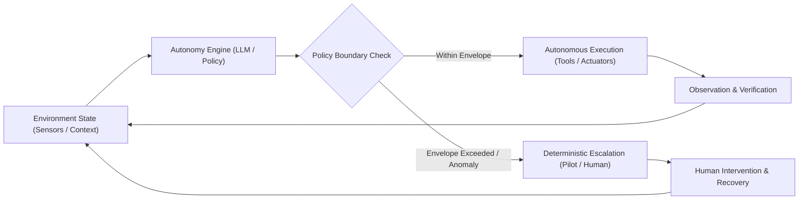
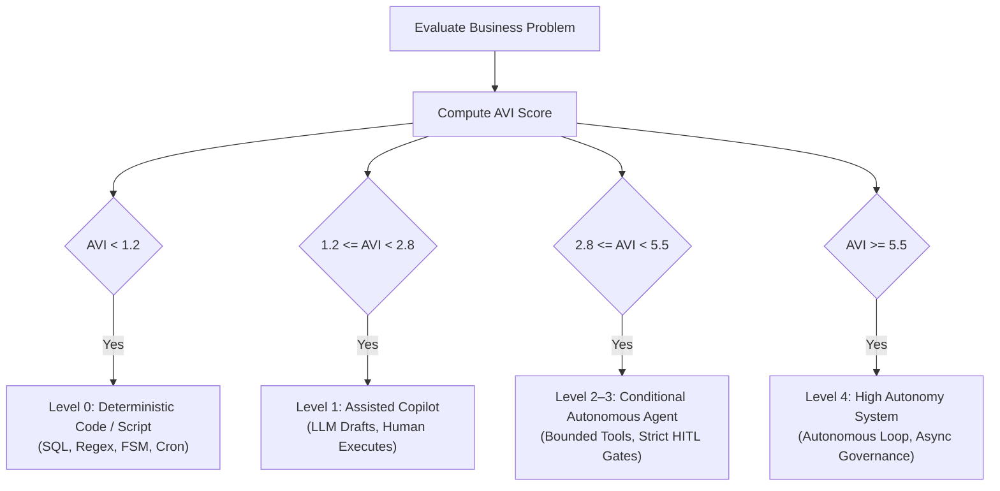
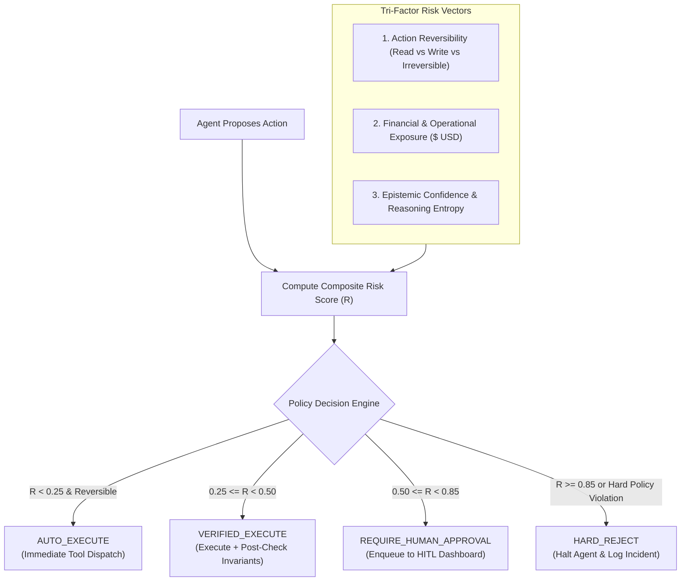

# Foundations of Agentic AI & The 5 Levels of Autonomy

The initial era of enterprise generative AI was dominated by the **Passive Oracle**: a user submits a prompt, an autoregressive large language model executes a forward pass across its transformer weights, and it emits a static stream of tokens. If a customer inquires about an erroneous billing charge, the passive model generates an empathetic explanation of how refund policies work. The actual labor—verifying the transaction ID in PostgreSQL, calculating pro-rated refunds in Stripe, updating ledger balances in SAP, and emailing confirmation to the customer—remains entirely on the human operator.

**Agentic AI fundamentally breaks this paradigm.** An agent transforms the language model from an isolated text generator into an **engine of action and state transformation**. Rather than merely discussing an objective in prose, an agentic system perceives its environment, formulates sub-plans, selects and invokes external tools, observes operational results, self-corrects upon failure, and persists through multi-step execution graphs until an objective is verified.

```
========================================================================================
             PASSIVE GENERATION VS. CLOSED-LOOP AGENTIC EXECUTION
========================================================================================

  PASSIVE ORACLE (Zero State, Zero Environment Mutation)
  ───────────────────────────────────────────────────────
  [ User Prompt ] ───▶ [ Transformer Forward Pass ] ───▶ [ Static Text Output ]
                                                                 │
                                                       (Human must do all work)

  CLOSED-LOOP AGENTIC SYSTEM (Stateful, Tool-Equipped, Self-Correcting)
  ─────────────────────────────────────────────────────────────────────
  [ Objective ] ──▶ [ State & Memory ]
                          │
                          ▼
                  [ Reasoning Policy ] ◀──────────────┐
                          │ (Decide Action)           │
                          ▼                           │ (Feedback Loop:
                  [ Tool Invocation ]                 │  Observation & Error)
                          │ (API, DB, Shell)          │
                          ▼                           │
               [ Environment Mutation ] ──▶ [ Observation ]
                          │
                          ├──► [ Goal Verified ] ──▶ [ Objective Resolution ]
                          └──► [ Error / Ambiguity ] ──▶ [ Loop or Escalate ]
========================================================================================
```

However, deploying agency in production environments introduces systemic risks that do not exist in stateless chatbots:

1. **Compounding probabilistic failure:** A model with 95% step accuracy collapses to near coin-flip reliability across a 10-step autonomous workflow.
2. **Irreversible blast radius:** Unchecked tool actions can corrupt databases, trigger unauthorized financial disbursements, or leak customer records.
3. **The illusion of determinism:** Wrapping an LLM in a rigid JSON schema guarantees syntactic adherence, not semantic or business logic validity.

To engineer production-ready agentic architectures, we must formalize the **5 Levels of Autonomy**, quantify the **reliability decay curve**, evaluate use-case viability using a rigorous **Opportunity Evaluation Matrix**, and enforce deterministic **Human-in-the-Loop (HITL) escalation boundaries**.

---

## The Physical Feynman Analogy: The Medical Residency Hierarchy & Flight Deck Autonomy

To understand how autonomy should be delegated in software, consider how human society delegates high-stakes authority in environments where failure results in loss of life or capital.

### The Medical Residency Hierarchy

Modern healthcare does not grant a freshly graduated medical student unconditional authority to perform open-heart surgery. Instead, medicine utilizes a strictly calibrated, multi-tier progression of autonomy based on verified competency, procedure reversibility, and the severity of clinical failure:

```
========================================================================================
                    THE CLINICAL AUTONOMY ESCALATION SPECTRUM
========================================================================================

  [ L1: Medical Student ] ──▶ Observational drafting only.
                              Zero tool/prescription rights.
                              Attending physician must countersign and review 100%.

  [ L2: Clinical Intern ] ──▶ Executes routine, pre-approved orders (e.g., standard blood tests).
                              Actions executed under direct, contemporaneous supervision.
                              No unreviewed state modifications permitted.

  [ L3: Senior Resident ] ──▶ Autonomous routine clinical care during overnight shifts.
                              Authorized to titrate medications and manage standard admissions.
                              MANDATORY ESCALATION: If blood pressure drops < 80 mmHg or acute
                              decompensation occurs, policy mandates immediately paging the attending.

  [ L4: Subspecialty Fellow ] ──▶ Executes complex procedures (e.g., organ retrieval, microsurgery).
                                  Formulates autonomous multi-stage interventions.
                                  Attending provides asynchronous governance, spot audits,
                                  and systemic hospital coordination.

  [ L5: Attending Physician ] ──▶ Sovereign, unrestricted clinical and legal authority.
                                  Accountable for total patient outcome across all departments.
========================================================================================
```

In software, attempting to build a fully autonomous enterprise agent on Day 1 is the architectural equivalent of handing an unmonitored surgical scalpel to an intern.

### The Flight Deck Analogy: Pilot-in-Command vs. Autopilot

In commercial aviation, the autopilot system can manipulate flight control surfaces, track radio navigation fixes, and even execute automated landings (**CAT III Autoland**) in dense fog.

Yet, the autopilot is never the **Pilot-in-Command (PIC)**:

- If a sensor disagrees (e.g., iced pitot tubes reporting conflicting airspeed), the flight computer does not "hallucinate" an arbitrary airspeed; it sounds a master warning, disconnects servo motors, and transfers control to the human crew.
- The flight computer's operational envelope is bounded by hard aerodynamic laws. It is granted high **action autonomy** (micro-adjusting trim tabs every 10 milliseconds) but zero **unbounded policy autonomy** (it cannot decide on its own to divert from Frankfurt to Munich because weather looks nicer).



Production agentic engineering is the discipline of building software flight envelopes: enabling the agent to execute high-speed, multi-step actions autonomously while ensuring that edge cases, policy violations, and high-impact mutations trip deterministic circuit breakers.

---

## The Mathematical Fragility of Autonomous Agency: Reliability Decay

Why do autonomous agents fail in production when their benchmark scores in single-prompt evaluations appear extraordinary? The answer lies in **probabilistic compounding**.

### The Multi-Step Reliability Collapse

An autoregressive language model is a probabilistic distribution over tokens. When an agent executes a multi-step task involving planning, parameter extraction, tool execution, and output synthesis, it behaves as a sequence of $n$ discrete, interdependent stochastic steps.

If step $i$ has an independent probability of success $p_i$, the overall probability $P_{\text{total}}$ of the agent successfully completing an $n$-step workflow without a single catastrophic error is the product of each individual step's reliability:

$$
P_{\text{total}} = \prod_{i=1}^n p_i
$$

Assuming a uniform average step reliability $p_i = p$, this simplifies to:

$$
P_{\text{total}} = p^n
$$

Consider an enterprise support agent with an impressive single-step accuracy of $p = 0.95$ (95% precision on isolated tool parameter formatting and tool selection). Let us calculate the end-to-end task completion rate as the execution horizon $n$ increases:

$$
P_{\text{total}}(n=1) = 0.95^1 = 0.9500 \quad (95.0\%)
$$

$$
P_{\text{total}}(n=3) = 0.95^3 \approx 0.8574 \quad (85.7\%)
$$

$$
P_{\text{total}}(n=5) = 0.95^5 \approx 0.7738 \quad (77.4\%)
$$

$$
P_{\text{total}}(n=10) = 0.95^{10} \approx 0.5987 \quad (59.9\%)
$$

$$
P_{\text{total}}(n=20) = 0.95^{20} \approx 0.3585 \quad (35.9\%)
$$

$$
P_{\text{total}}(n=30) = 0.95^{30} \approx 0.2146 \quad (21.5\%)
$$

```
========================================================================================
               MULTI-STEP TASK RELIABILITY COLLAPSE (P_total = p^n)
========================================================================================
  End-to-End Success Rate (%)
  100% ┼───■ (p = 0.99)
   90% │   └───■───────■
   80% │               └───■───────■
   70% │                           └───■───────■ (74.0% at n=30)
   60% │       ■ (p = 0.95)                    └───■ (60.5% at n=50)
   50% │       │
   40% │       └───■ (59.9% at n=10)
   30% │           │
   20% │           └───■ (35.9% at n=20)
   10% │               │
    0% ┼───────────────┴───■ (21.5% at n=30) ──────────────────────────
       1       5       10      15      20      25      30      35   (Steps n)
========================================================================================
```

At $n = 10$, an agent with 95% step accuracy fails more than 40% of the time. At $n = 20$, the agent fails nearly two out of every three missions.

Even if we deploy a state-of-the-art frontier model fine-tuned to achieve $p = 0.99$ (99% single-step accuracy):

- Over 10 steps: $0.99^{10} \approx 0.9044$ (90.4% success)
- Over 30 steps: $0.99^{30} \approx 0.7397$ (74.0% success)
- Over 50 steps: $0.99^{50} \approx 0.6050$ (60.5% success)

> [!IMPORTANT]
> **The First Law of Agentic Architecture:**  
> An open-loop agent operating without deterministic verification and rollback mechanisms is mathematically guaranteed to fail as task complexity increases. Reliability is an emergent property of the **system architecture**, not the underlying foundation model.

### The Verified Closed-Loop Recovery Model

To prevent exponential decay, production architectures transform open-loop chains into **verified closed-loop state machines**.

Let:

- $p$ be the raw baseline step accuracy of the LLM policy.
- $p_v \in [0, 1]$ be the probability that a deterministic validator (schema parser, SQL linter, unit test, or invariant checker) catches an erroneous step.
- $p_r \in [0, 1]$ be the probability that the agent corrects the error when re-prompted with the structured error trace.

The effective step success probability $p_{\text{step}}^{\text{effective}}$ becomes:

$$
p_{\text{step}}^{\text{effective}} = p + (1 - p) \cdot p_v \cdot p_r
$$

Suppose our baseline agent has $p = 0.95$. We introduce a strict deterministic validator that catches 98% of hallucinations and bad parameter schemas ($p_v = 0.98$), and our re-prompt reflection loop fixes the mistake 90% of the time ($p_r = 0.90$):

$$
p_{\text{step}}^{\text{effective}} = 0.95 + (1 - 0.95) \cdot 0.98 \cdot 0.90 = 0.95 + 0.05 \cdot 0.882 = 0.95 + 0.0441 = 0.9941
$$

Now let us recalculate the 10-step task completion probability:

$$
P_{\text{total}}^{\text{verified}} = (0.9941)^{10} \approx 0.9426 \quad (94.3\%)
$$

Through deterministic verification and automated recovery loops, task reliability over 10 steps surges from **59.9% to 94.3%**.

| Workflow Horizon ($n$) | Open-Loop ($p = 0.95$) | Open-Loop ($p = 0.99$) | Verified Closed-Loop ($p_{\text{step}}^{\text{effective}} = 0.9941$) |
| ---------------------- | ---------------------- | ---------------------- | -------------------------------------------------------------------- |
| **1 Step**             | 95.00%                 | 99.00%                 | 99.41%                                                               |
| **5 Steps**            | 77.38%                 | 95.10%                 | 97.09%                                                               |
| **10 Steps**           | 59.87%                 | 90.44%                 | 94.26%                                                               |
| **20 Steps**           | 35.85%                 | 81.79%                 | 88.85%                                                               |
| **50 Steps**           | 7.69%                  | 60.50%                 | 74.37%                                                               |

---

## The Opportunity Evaluation Matrix: Quantifying Agentic Viability

A critical error in enterprise engineering is **over-agentizing** deterministic problems. If a task can be solved using an API integration, a SQL query, or a static finite state machine (FSM), building an LLM agent introduces unnecessary latency, non-deterministic failure modes, and quadratic token expenses.

To determine whether an operational problem warrants an agentic architecture, we utilize the **Agentic Viability Index ($AVI$)**.

### The Agentic Viability Index ($AVI$) Formulation

$$
AVI = \frac{\mathcal{F}_{\text{entropy}} \cdot \mathcal{V}_{\text{business}} \cdot \mathcal{R}_{\text{reversibility}}}{\mathcal{B}_{\text{blast\_radius}} \cdot \mathcal{C}_{\text{latency}} + \epsilon}
$$

Where $\epsilon = 0.001$ prevents division by zero, and each dimension is evaluated on a standardized 1 to 5 integer scale:

```
========================================================================================
                  DIMENSIONS OF THE AGENTIC VIABILITY INDEX (AVI)
========================================================================================

  [ NUMERATOR: INCENTIVES FOR AGENCY ]
  ────────────────────────────────────
  1. Input & Path Entropy (F_entropy ∈ [1, 5])
     • 1: Perfectly structured, predictable inputs (CSV, static REST payload).
     • 3: Semi-structured forms with free-text customer notes.
     • 5: Unstructured, ambiguous, multimodal data with branching paths (e.g., legal discovery).

  2. Business Value (V_business ∈ [1, 5])
     • 1: Trivial task; saves < 1 minute of human labor; negligible economic return.
     • 3: Standard repetitive operational workflow (e.g., routine invoice categorization).
     • 5: High-value strategic workflow; resolves multi-hour bottlenecks or unlocks 24/7 revenue.

  3. Action Reversibility (R_reversibility ∈ [1, 5])
     • 1: Irreversible mutation (cryptographic wire transfer, hard database DROP).
     • 3: Compensating transactions available (e.g., refund charge, draft email pending outbox).
     • 5: Zero-risk read-only queries or sandboxed staging mutations.

  [ DENOMINATOR: FRICTIONS & HAZARDS ]
  ────────────────────────────────────
  4. Catastrophic Blast Radius (B_blast_radius ∈ [1, 5])
     • 1: Isolated sandbox; local ephemeral cache; zero customer exposure.
     • 3: Single customer account impact (e.g., incorrect customer email sent).
     • 5: Systemic enterprise failure: regulatory breach, data wipeout, legal exposure.

  5. Latency & Resource Cost Sensitivity (C_latency ∈ [1, 5])
     • 1: Asynchronous batch job; 5-minute execution time is completely acceptable.
     • 3: Interactive desktop tool; user tolerates 5–10 seconds of reasoning.
     • 5: Hard real-time requirement (e.g., high-frequency trading, sub-100ms checkout flow).
========================================================================================
```

### Strategic Architectural Tiers Based on $AVI$

Based on the calculated score, the engineering team routes the problem to the appropriate architectural pattern:



### Enterprise Scenario Evaluations

Let us evaluate three real-world enterprise engineering proposals using the $AVI$ framework:

#### Scenario A: Automated Monthly Payroll Disbursement

- $\mathcal{F}_{\text{entropy}} = 1$ (Fixed employee rosters, standardized timesheet tables).
- $\mathcal{V}_{\text{business}} = 4$ (Critical business function).
- $\mathcal{R}_{\text{reversibility}} = 1$ (Direct ACH bank transfers are extremely costly to recall).
- $\mathcal{B}_{\text{blast\_radius}} = 5$ (Regulatory penalties, severe employee backlash, tax violations).
- $\mathcal{C}_{\text{latency}} = 2$ (Batch job runs over hours).

$$
AVI_{\text{Payroll}} = \frac{1 \cdot 4 \cdot 1}{5 \cdot 2 + 0.001} = \frac{4}{10.001} \approx 0.40
$$

**Verdict ($AVI = 0.40 < 1.2$): REJECT AGENT.** Implement via deterministic relational databases, ACID transactions, and double-entry accounting scripts. Using an LLM agent here is architectural malpractice.

#### Scenario B: Tier-1 E-Commerce Returns & Exchange Triage

- $\mathcal{F}_{\text{entropy}} = 4$ (Messy customer emails, ambiguous return reasons, attached photos of damaged goods).
- $\mathcal{V}_{\text{business}} = 3$ (Reduces support ticket backlog by 70%).
- $\mathcal{R}_{\text{reversibility}} = 4$ (Refunds $\le 50\text{ USD}$ can be voided; merchandise return labels can be canceled).
- $\mathcal{B}_{\text{blast\_radius}} = 2$ (Individual transaction cap prevents widespread treasury drainage).
- $\mathcal{C}_{\text{latency}} = 2$ (Customer expects reply within 2–5 minutes).

$$
AVI_{\text{Support}} = \frac{4 \cdot 3 \cdot 4}{2 \cdot 2 + 0.001} = \frac{48}{4.001} \approx 12.00
$$

**Verdict ($AVI = 12.00 \ge 5.5$): HIGH CANDIDACY FOR L3/L4 AGENT.** High unstructured input entropy paired with high reversibility and capped blast radius makes this an ideal agentic workload.

#### Scenario C: Multi-Cloud Infrastructure FinOps Cost Optimizer

- $\mathcal{F}_{\text{entropy}} = 4$ (Unstructured billing logs, fluctuating spot prices, complex cross-region network topologies).
- $\mathcal{V}_{\text{business}} = 5$ (Potential to save hundreds of thousands of dollars monthly).
- $\mathcal{R}_{\text{reversibility}} = 3$ (Spinning down compute nodes can disrupt traffic if misconfigured, but Terraform rollbacks exist).
- $\mathcal{B}_{\text{blast\_radius}} = 4$ (Misconfigured network routing can take down production services).
- $\mathcal{C}_{\text{latency}} = 1$ (Asynchronous hourly audit).

$$
AVI_{\text{FinOps}} = \frac{4 \cdot 5 \cdot 3}{4 \cdot 1 + 0.001} = \frac{60}{4.001} \approx 15.00
$$

**Verdict ($AVI = 15.00$ with $\mathcal{B}_{\text{blast\_radius}} = 4$): CONDITIONAL AUTONOMY (L3) WITH HUMAN-IN-THE-LOOP.** While the economic incentive is massive, the high blast radius mandates that the agent generate infrastructure pull requests and dry-runs, requiring human SRE approval before applying terraform state changes.

---

## The Autonomy Taxonomy: Action vs. Planning vs. End-to-End Autonomy

Agency is not a monolithic capability. An AI system can possess superior ability to call APIs while possessing zero ability to formulate a strategic multi-horizon plan. We must decouple agency into three distinct architectural dimensions:

```
========================================================================================
                      THE THREE DIMENSIONS OF AGENT CAPABILITY
========================================================================================

  1. ACTION AUTONOMY (The "Hands")
     • Capability: Translating explicit instructions into valid external tool calls.
     • Focus: Syntactic parameter formatting, API endpoint mapping, JSON serialization.
     • Example: "Execute tool `send_refund_email(user_id='123', amount=50)`."

  2. PLANNING AUTONOMY (The "Brain")
     • Capability: Decomposing an ambiguous, open-ended goal into an execution DAG.
     • Focus: Dependency ordering, resource estimation, sub-goal generation.
     • Example: "Analyze why customer churn jumped 14% in Q3 and propose remedies."

  3. END-TO-END AUTONOMY (The "Conductor")
     • Capability: Closed-loop execution, environmental perception, runtime exception
       handling, backtracking upon dead ends, and autonomous goal verification.
     • Focus: Error recovery, context pruning, state persistence, termination criteria.
     • Example: "Resolve open support tickets in Zendesk; escalate only if refund > \$200."
========================================================================================
```

### The Enterprise L0 to L5 Autonomy Scale

Mapping these three dimensions to operational enterprise engineering yields the standard **6-Level Autonomy Taxonomy**:

```
[L0: Scripted] ──▶ [L1: Copilot] ──▶ [L2: Partial] ──▶ [L3: Conditional] ──▶ [L4: High] ──▶ [L5: Full]
```

#### Level 0: Pure Deterministic Scripting (No AI Autonomy)

- **Role of Model:** None. All control flows, branch points, and string interpolations are authored by human software engineers in Python, Go, or SQL.
- **Role of Human:** Authors and maintains 100% of the code.
- **Tool Access:** Hardcoded API integrations triggered by deterministic cron schedules or webhook events.
- **Failure Mode:** Handled via standard software exceptions (`try/except`, retry backoff).

#### Level 1: Assisted Copilot (AI Generates, Human Executes)

- **Role of Model:** Autoregressive suggestion engine. Generates code completions, draft email responses, or summaries of long documents within a client UI.
- **Role of Human:** Initiates every invocation, reviews every token, manually copies output, and triggers all downstream side effects.
- **Tool Access:** **Zero.** The model has no API tokens, cannot mutate databases, and cannot query external tools dynamically.
- **Failure Mode:** Low risk; human rejects or edits the hallucinated draft text before publication.

#### Level 2: Partial Autonomy (Tool Invocations with Per-Action Human Gate)

- **Role of Model:** Action proposer. Given a user goal, the model reasons about what tool to call, populates the JSON argument schema, and presents a proposed payload to the human operator.
- **Role of Human:** **Synchronous Gatekeeper.** The human must review and click "Approve" for _every single state-modifying action_ before execution.
- **Tool Access:** Sandboxed execution via human-confirmed proxy.
- **Failure Mode:** High latency; human fatigue can lead to rubber-stamping bad parameters.

#### Level 3: Conditional Autonomy (Autonomous Within Bounded Policy Envelopes)

- **Role of Model:** Autonomous execution engine within an approved guardrail boundary. The agent autonomously cycles through perception, tool calling, error recovery, and sub-goal execution.
- **Role of Human:** **Exception Reviewer.** The human is removed from the routine execution path and is paged _only_ when the agent encounters an out-of-bounds parameter, epistemic uncertainty, policy ambiguity, or tool execution failure.
- **Tool Access:** Direct autonomous tool access restricted by strict runtime RBAC, monetary caps, and rate limits.
- **Failure Mode:** Silent failures if policy envelopes are poorly calibrated; edge cases slipping past unvalidated parameter checks.

#### Level 4: High Autonomy (Autonomous Planning & Dynamic Replanning with Asynchronous Governance)

- **Role of Model:** Strategic operator. Formulates its own multi-stage execution DAGs, dynamically spawns sub-agents, writes temporary code scripts to parse novel data schemas, and independently resolves tool outages.
- **Role of Human:** **Asynchronous Auditor.** The human establishes organizational objectives, defines high-level constraints, monitors aggregate telemetry, and conducts post-hoc audits.
- **Tool Access:** Broad autonomous access including shell execution, sandbox compute, dynamic query generation, and external web browsing.
- **Failure Mode:** Unbounded recursive spending, systemic drift from business objectives, multi-agent coordination deadlocks.

#### Level 5: Full Autonomy (Universal Self-Governing Agency — Theoretical)

- **Role of Model:** Operates across unbounded domains, invents its own tools, sets its own sub-goals, and self-optimizes without human intervention under arbitrary novel conditions.
- **Role of Human:** None.
- **Enterprise Status:** **Non-viable and irresponsible in enterprise production.** In regulated industries (finance, healthcare, defense), legal and ethical frameworks mandate human accountability.

### Master Comparison Matrix

| Level  | Taxonomy Class       | Planning Capability | Action Rights     | Human Oversight     | Primary Failure Mode          | Enterprise Example                          |
| ------ | -------------------- | ------------------- | ----------------- | ------------------- | ----------------------------- | ------------------------------------------- |
| **L0** | Deterministic        | None (Static logic) | Hardcoded         | 100% authoring      | Software bugs                 | Payroll calculation batch job               |
| **L1** | Assisted Copilot     | None (Single-turn)  | Read-only / Zero  | 100% review         | Text hallucination            | GitHub Copilot autocomplete                 |
| **L2** | Partial Autonomy     | Single-step tool    | Proposed tools    | Per-action approval | Operator approval fatigue     | CLI tool proposing `kubectl delete pod`     |
| **L3** | Conditional Autonomy | Multi-step linear   | Bounded execution | By exception only   | Policy boundary leakage       | Support agent refunding $\le 50\text{ USD}$ |
| **L4** | High Autonomy        | Dynamic DAGs        | Broad / Sandboxed | Asynchronous audit  | Runaway loops / Goal drift    | SRE agent auto-mitigating incidents         |
| **L5** | Full Autonomy        | Universal unbounded | Unrestricted      | None                | Uncontrolled systemic failure | Science fiction / Theoretical               |

---

## Production "Most Missed Things" in Agentic Engineering

Deploying an agent from a Jupyter notebook to an enterprise Kubernetes cluster reveals dangerous engineering pitfalls that standard software paradigms do not catch.

> [!WARNING]
>
> ### The Autonomy Inflation Trap
>
> The most pervasive anti-pattern in modern AI development is **jumping straight from an L1 prototype to an L4 deployment**.
>
> In a localized development environment, an engineer tests an unconstrained agent against 10 clean prompts. The model performs brilliantly. Impressed by this superficial fluency, the team connects the agent directly to production database write pools and CRM endpoints.
>
> In production, messy real-world inputs (malicious prompt injections, malformed upstream JSON, transient 504 gateway timeouts) trigger catastrophic reasoning cascades. The agent hallucinates missing parameters, attempts to patch its own errors by executing unauthorized mutations, and drains API budgets in recursive death spirals.
>
> **The Architectural Rule:**  
> Never deploy directly to L3 or L4. Always launch new agentic capabilities at **L2 (Synchronous Human Gate)**. Log all proposed tool calls, establish the statistical error distribution over thousands of real production interactions, engineer deterministic validators for observed failure modes, and only then promote the system to **L3 with strict escalation envelopes**. Autonomy must be earned through statistical observability.

> [!CAUTION]
>
> ### The Illusion of Determinism in Tool Calling
>
> Modern LLM providers offer "Structured Outputs" or "Function Calling" with strict JSON Schema enforcement. Many engineers mistakenly believe that because the model's output conforms 100% to a TypeScript or Pydantic schema, the agent's behavior is deterministic.
>
> **This is a dangerous category error:**
>
> - **Syntactic Conformance $\ne$ Semantic Correctness.**
> - If your tool definition expects `{"customer_id": str, "refund_cents": int}`, the schema validator ensures `refund_cents` is an integer. It does **not** stop the LLM from hallucinating `refund_cents: 9999900` instead of `9900`, nor does it verify that `customer_id` belongs to the authenticated session!
> - The tool execution boundary is deterministic; the **argument selection policy remains fundamentally stochastic**. Every tool handler must implement runtime business assertions, authorization checks, and idempotency keys regardless of how strictly the LLM adheres to the schema.

---

## Engineering Human-in-the-Loop Escalation Boundaries

To bridge the gap between fragile stochastic reasoning and mission-critical production systems, we engineer a **Human-in-the-Loop (HITL) Escalation Router**.

### The Tri-Factor Escalation Envelope

An escalation router monitors every proposed action before it reaches the external tool execution layer. The decision to auto-execute, require verified execution, or halt for human sign-off is governed by three vectors:



1. **Operational Reversibility:**
   - **Tier 1 (Read-Only):** `GET` endpoints, SQL `SELECT`, vector database similarity searches. Zero side effects.
   - **Tier 2 (Compensatable Mutation):** Inserting a pending draft, staging a git commit, issuing a refund within standard operational limits.
   - **Tier 3 (Irreversible State Change):** Hard record deletion (`DELETE FROM users`), production infrastructure teardown, wire transfers, public customer broadcasts.

2. **Financial & Compliance Exposure:**
   - Hard currency caps enforced at the gateway layer (e.g., automated actions cannot exceed `100.00 USD` under any circumstance without two-tier human authorization).

3. **Epistemic Confidence & Reasoning Entropy:**
   - Tracking model log-probabilities, token perplexity, or validator failure counts. If an agent attempts to execute an action after two failed tool retries in the same session, its reasoning entropy is elevated, triggering mandatory human escalation.

---

## Production Implementation: Autonomy Decision Engine & Escalation Router

The following production-ready Python 3.11+ implementation demonstrates an **Autonomy Decision Engine and HITL Escalation Router** built with **Pydantic v2**. It quantitatively evaluates proposed agent actions, calculates composite risk scores, and routes actions through deterministic policy gates.

```python
"""
Autonomy Decision Engine & Human-in-the-Loop Escalation Router.

Production-grade implementation utilizing Python 3.11+ and Pydantic v2.
Evaluates agent action proposals against enterprise autonomy policies,
quantifying risk across reversibility, financial exposure, and model confidence.
"""

from __future__ import annotations

import logging
from enum import Enum
from typing import Any, Dict, List, Optional
from pydantic import BaseModel, Field

logging.basicConfig(level=logging.INFO, format="%(asctime)s [%(levelname)s] %(message)s")
logger = logging.getLogger("AutonomyEngine")


class AutonomyLevel(str, Enum):
    """The enterprise 6-level autonomy taxonomy."""
    L0_MANUAL = "L0_MANUAL"
    L1_ASSISTED = "L1_ASSISTED"
    L2_PARTIAL = "L2_PARTIAL"
    L3_CONDITIONAL = "L3_CONDITIONAL"
    L4_HIGH = "L4_HIGH"
    L5_FULL = "L5_FULL"


class ActionReversibility(str, Enum):
    """Classification of action side-effect permanence."""
    READ_ONLY = "READ_ONLY"
    REVERSIBLE_WRITE = "REVERSIBLE_WRITE"
    IRREVERSIBLE_MUTATION = "IRREVERSIBLE_MUTATION"


class DecisionVerdict(str, Enum):
    """Routing verdict issued by the autonomy decision engine."""
    AUTO_EXECUTE = "AUTO_EXECUTE"
    VERIFIED_EXECUTE = "VERIFIED_EXECUTE"
    REQUIRE_HUMAN_APPROVAL = "REQUIRE_HUMAN_APPROVAL"
    HARD_REJECT = "HARD_REJECT"


class ActionProposal(BaseModel):
    """Structured action emitted by an agent reasoning loop."""
    action_id: str = Field(description="Unique deterministic UUID for the action")
    tool_name: str = Field(description="External tool or API to invoke")
    parameters: Dict[str, Any] = Field(default_factory=dict, description="Tool invocation payload")
    reversibility: ActionReversibility = Field(description="Operational reversibility tier")
    confidence_score: float = Field(ge=0.0, le=1.0, description="Model self-reported or logprob confidence")
    financial_exposure_usd: float = Field(ge=0.0, default=0.0, description="Estimated direct financial exposure in USD")
    blast_radius: int = Field(ge=1, le=5, description="Catastrophic blast radius tier from 1 (isolated) to 5 (critical)")
    rationale: str = Field(description="Chain-of-thought justification for the action")


class ExecutionPolicy(BaseModel):
    """Enterprise policy constraints governing autonomous action dispatch."""
    autonomy_level: AutonomyLevel
    max_auto_financial_usd: float = Field(default=100.0, description="Ceiling for autonomous financial actions")
    min_auto_confidence: float = Field(default=0.85, description="Minimum confidence required for unassisted execution")
    max_auto_blast_radius: int = Field(default=2, description="Maximum blast radius permitted for unassisted execution")
    allow_irreversible_autonomous: bool = Field(default=False, description="Whether irreversible mutations can run without approval")
    hard_financial_ceiling_usd: float = Field(default=5000.0, description="Absolute ceiling; actions above this are hard-rejected")


class AgentContext(BaseModel):
    """Runtime telemetry and session history."""
    session_id: str
    cumulative_spend_usd: float = 0.0
    step_count: int = 0
    consecutive_failures: int = 0


class RoutingDecision(BaseModel):
    """Deterministic routing decision emitted by the escalation engine."""
    verdict: DecisionVerdict
    risk_score: float = Field(ge=0.0, le=1.0)
    reasons: List[str]
    action_proposal: ActionProposal
    required_reviewer_role: Optional[str] = None


class AutonomyDecisionEngine:
    """
    Evaluates proposed agent actions against operational policies,
    calculating composite risk metrics and enforcing HITL escalation boundaries.
    """

    def __init__(self, policy: ExecutionPolicy) -> None:
        self.policy = policy

    def calculate_risk_score(self, action: ActionProposal) -> float:
        """
        Quantifies composite risk on a normalized [0.0, 1.0] scale.

        Risk Formulation:
        R = 0.35 * W_rev + 0.25 * W_blast + 0.25 * W_exposure + 0.15 * W_uncertainty
        """
        reversibility_weights = {
            ActionReversibility.READ_ONLY: 0.05,
            ActionReversibility.REVERSIBLE_WRITE: 0.45,
            ActionReversibility.IRREVERSIBLE_MUTATION: 1.00,
        }
        w_rev = reversibility_weights[action.reversibility]
        w_blast = action.blast_radius / 5.0
        w_exposure = min(action.financial_exposure_usd / 1000.0, 1.0)
        w_uncertainty = 1.0 - action.confidence_score

        composite_risk = (
            0.35 * w_rev +
            0.25 * w_blast +
            0.25 * w_exposure +
            0.15 * w_uncertainty
        )
        return round(composite_risk, 4)

    def route_action(self, action: ActionProposal, context: AgentContext) -> RoutingDecision:
        """
        Evaluates an action proposal against the active policy envelope.
        """
        risk = self.calculate_risk_score(action)
        reasons: List[str] = []

        # Rule 1: Hard financial ceiling violation
        if action.financial_exposure_usd > self.policy.hard_financial_ceiling_usd:
            reasons.append(
                f"Financial exposure {action.financial_exposure_usd:,.2f} USD exceeds absolute ceiling "
                f"{self.policy.hard_financial_ceiling_usd:,.2f} USD"
            )
            return RoutingDecision(
                verdict=DecisionVerdict.HARD_REJECT,
                risk_score=risk,
                reasons=reasons,
                action_proposal=action,
            )

        # Rule 2: Invariant enforcement for L0 and L1
        if self.policy.autonomy_level in (AutonomyLevel.L0_MANUAL, AutonomyLevel.L1_ASSISTED):
            reasons.append(f"Autonomy policy {self.policy.autonomy_level.value} prohibits all autonomous tool execution")
            return RoutingDecision(
                verdict=DecisionVerdict.REQUIRE_HUMAN_APPROVAL,
                risk_score=risk,
                reasons=reasons,
                action_proposal=action,
                required_reviewer_role="Operations_Engineer",
            )

        # Rule 3: L2 Partial Autonomy requires human review for all state-modifying actions
        if self.policy.autonomy_level == AutonomyLevel.L2_PARTIAL:
            if action.reversibility != ActionReversibility.READ_ONLY:
                reasons.append("L2 Partial Autonomy mandates human approval for all state mutations")
                return RoutingDecision(
                    verdict=DecisionVerdict.REQUIRE_HUMAN_APPROVAL,
                    risk_score=risk,
                    reasons=reasons,
                    action_proposal=action,
                    required_reviewer_role="Support_Specialist",
                )

        # Rule 4: Evaluate L3 / L4 Escalation Envelopes
        escalate = False
        reviewer_role = "Tier_2_Support"

        if action.confidence_score < self.policy.min_auto_confidence:
            escalate = True
            reasons.append(
                f"Model confidence ({action.confidence_score:.2f}) falls below required threshold "
                f"({self.policy.min_auto_confidence:.2f})"
            )

        if action.financial_exposure_usd > self.policy.max_auto_financial_usd:
            escalate = True
            reasons.append(
                f"Financial exposure {action.financial_exposure_usd:.2f} USD exceeds autonomous ceiling "
                f"{self.policy.max_auto_financial_usd:.2f} USD"
            )
            reviewer_role = "Finance_Manager" if action.financial_exposure_usd > 500.0 else "Tier_2_Support"

        if action.blast_radius > self.policy.max_auto_blast_radius:
            escalate = True
            reasons.append(
                f"Blast radius tier ({action.blast_radius}) exceeds safe envelope "
                f"({self.policy.max_auto_blast_radius})"
            )
            reviewer_role = "Lead_SRE"

        if action.reversibility == ActionReversibility.IRREVERSIBLE_MUTATION and not self.policy.allow_irreversible_autonomous:
            escalate = True
            reasons.append("Irreversible state mutations strictly require explicit human authorization")
            reviewer_role = "Security_Admin"

        if context.consecutive_failures >= 2:
            escalate = True
            reasons.append(f"Agent session triggered {context.consecutive_failures} consecutive execution failures")

        if escalate:
            return RoutingDecision(
                verdict=DecisionVerdict.REQUIRE_HUMAN_APPROVAL,
                risk_score=risk,
                reasons=reasons,
                action_proposal=action,
                required_reviewer_role=reviewer_role,
            )

        # Rule 5: Verified vs Pure Autonomous Execution
        if risk >= 0.30 or action.reversibility == ActionReversibility.REVERSIBLE_WRITE:
            return RoutingDecision(
                verdict=DecisionVerdict.VERIFIED_EXECUTE,
                risk_score=risk,
                reasons=["Action permitted under L3/L4 with mandatory post-execution invariant verification"],
                action_proposal=action,
            )

        return RoutingDecision(
            verdict=DecisionVerdict.AUTO_EXECUTE,
            risk_score=risk,
            reasons=["Action falls strictly within safe autonomous envelope"],
            action_proposal=action,
        )


# ======================================================================================
# EXECUTION SIMULATION & TEST HARNESS
# ======================================================================================

def simulate_environment() -> None:
    """Demonstrates runtime action evaluation across diverse enterprise scenarios."""

    policy = ExecutionPolicy(
        autonomy_level=AutonomyLevel.L3_CONDITIONAL,
        max_auto_financial_usd=100.0,
        min_auto_confidence=0.88,
        max_auto_blast_radius=2,
        allow_irreversible_autonomous=False,
        hard_financial_ceiling_usd=2500.0,
    )
    engine = AutonomyDecisionEngine(policy)
    context = AgentContext(session_id="sess_prod_99182")

    proposals = [
        ActionProposal(
            action_id="act_001",
            tool_name="query_invoice_status",
            parameters={"invoice_id": "inv_88219"},
            reversibility=ActionReversibility.READ_ONLY,
            confidence_score=0.98,
            financial_exposure_usd=0.0,
            blast_radius=1,
            rationale="Verify invoice payment status prior to customer response",
        ),
        ActionProposal(
            action_id="act_002",
            tool_name="issue_courtesy_credit",
            parameters={"account_id": "acc_411", "amount_usd": 35.0},
            reversibility=ActionReversibility.REVERSIBLE_WRITE,
            confidence_score=0.92,
            financial_exposure_usd=35.0,
            blast_radius=2,
            rationale="Issue 35.00 USD credit for shipping delay under standard retention policy",
        ),
        ActionProposal(
            action_id="act_003",
            tool_name="authorize_wire_refund",
            parameters={"account_id": "acc_772", "amount_usd": 850.0},
            reversibility=ActionReversibility.IRREVERSIBLE_MUTATION,
            confidence_score=0.89,
            financial_exposure_usd=850.0,
            blast_radius=4,
            rationale="Customer requested immediate bank wire refund for enterprise order cancellation",
        ),
        ActionProposal(
            action_id="act_004",
            tool_name="drop_database_table",
            parameters={"table_name": "legacy_audit_logs"},
            reversibility=ActionReversibility.IRREVERSIBLE_MUTATION,
            confidence_score=0.95,
            financial_exposure_usd=10000.0,
            blast_radius=5,
            rationale="Attempting to clear disk space on database cluster",
        ),
    ]

    print("\n" + "=" * 80)
    print("      AUTONOMY DECISION ENGINE: ENTERPRISE ROUTING SIMULATION")
    print("=" * 80)

    for prop in proposals:
        decision = engine.route_action(prop, context)
        print(f"\n[ACTION PROPOSAL]: {prop.action_id} -> Tool: '{prop.tool_name}'")
        print(f"  - Rationale: {prop.rationale}")
        print(f"  - Exposure: {prop.financial_exposure_usd:,.2f} USD | Reversibility: {prop.reversibility.value}")
        print(f"  - Confidence: {prop.confidence_score:.2f} | Blast Radius: {prop.blast_radius}/5")
        print(f"  >> VERDICT: {decision.verdict.value} (Calculated Risk: {decision.risk_score:.4f})")
        if decision.required_reviewer_role:
            print(f"  >> ESCALATION TARGET: Role '{decision.required_reviewer_role}'")
        for reason in decision.reasons:
            print(f"    - Note: {reason}")

    print("\n" + "=" * 80)


if __name__ == "__main__":
    simulate_environment()
```

### Execution Output & Behavioral Telemetry

When executed, the engine demonstrates deterministic safety routing:

```
================================================================================
      AUTONOMY DECISION ENGINE: ENTERPRISE ROUTING SIMULATION
================================================================================

[ACTION PROPOSAL]: act_001 -> Tool: 'query_invoice_status'
  - Rationale: Verify invoice payment status prior to customer response
  - Exposure: 0.00 USD | Reversibility: READ_ONLY
  - Confidence: 0.98 | Blast Radius: 1/5
  >> VERDICT: AUTO_EXECUTE (Calculated Risk: 0.0705)
    - Note: Action falls strictly within safe autonomous envelope

[ACTION PROPOSAL]: act_002 -> Tool: 'issue_courtesy_credit'
  - Rationale: Issue 35.00 USD credit for shipping delay under standard retention policy
  - Exposure: 35.00 USD | Reversibility: REVERSIBLE_WRITE
  - Confidence: 0.92 | Blast Radius: 2/5
  >> VERDICT: VERIFIED_EXECUTE (Calculated Risk: 0.2783)
    - Note: Action permitted under L3/L4 with mandatory post-execution invariant verification

[ACTION PROPOSAL]: act_003 -> Tool: 'authorize_wire_refund'
  - Rationale: Customer requested immediate bank wire refund for enterprise order cancellation
  - Exposure: 850.00 USD | Reversibility: IRREVERSIBLE_MUTATION
  - Confidence: 0.89 | Blast Radius: 4/5
  >> VERDICT: REQUIRE_HUMAN_APPROVAL (Calculated Risk: 0.7790)
  >> ESCALATION TARGET: Role 'Finance_Manager'
    - Note: Financial exposure 850.00 USD exceeds autonomous ceiling 100.00 USD
    - Note: Blast radius tier (4) exceeds safe envelope (2)
    - Note: Irreversible state mutations strictly require explicit human authorization

[ACTION PROPOSAL]: act_004 -> Tool: 'drop_database_table'
  - Rationale: Attempting to clear disk space on database cluster
  - Exposure: 10,000.00 USD | Reversibility: IRREVERSIBLE_MUTATION
  - Confidence: 0.95 | Blast Radius: 5/5
  >> VERDICT: HARD_REJECT (Calculated Risk: 0.8575)
    - Note: Financial exposure 10,000.00 USD exceeds absolute ceiling 2,500.00 USD
================================================================================
```

---

## Architectural Summary: The 6 Rules of Agent Autonomy

Before advancing to the Continuous Calibration and Continuous Development (**CC/CD**) lifecycle in Chapter 1, commit these six foundational invariants to memory:

1. **Autonomy is a Spectrum, Not a Toggle:** Never architect an agent as purely autonomous or purely manual. Model agency across the explicit L0–L5 taxonomy.
2. **Open-Loop Systems Collapse:** Because errors compound exponentially ($P = p^n$), multi-step agent systems require deterministic assertion checks and automated reflection loops.
3. **Entropy Dictates Architecture:** If input and state entropy are low, reject the agent and write deterministic code. High $AVI$ scores indicate genuine agentic viability.
4. **Syntactic JSON Schema is Not Semantic Truth:** Function-calling tools enforce data formats, not business logic or transactional safety. All side effects must be validated independently.
5. **Autonomy Must Be Earned:** Launch systems at Level 2 with synchronous human sign-off. Transition to Level 3 only after real-world distribution data proves that failure modes are captured by deterministic guardrails.
6. **Hard Ceilings Fail Closed:** Financial caps, irreversible database mutations, and low-confidence decisions must trip deterministic circuit breakers that escalate to human operators.

---

<div class="chapter-navigation">
  <a class="chapter-nav-btn prev" href="/courses/agentic-ai-build-your-first-agentic-ai-system/">← Course Overview</a>
  <a class="chapter-nav-btn next" href="/courses/agentic-ai-build-your-first-agentic-ai-system/lessons/01-agentic-lifecycle-cc-cd">Chapter 1: The Agentic AI Lifecycle (CC/CD) →</a>
</div>
