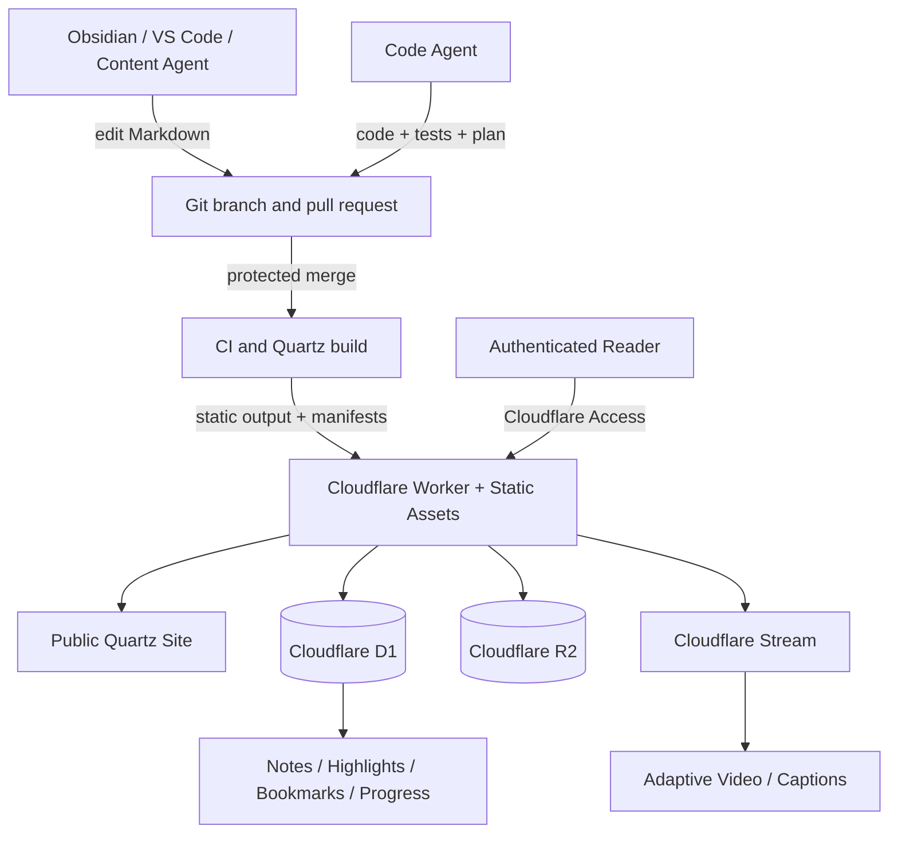
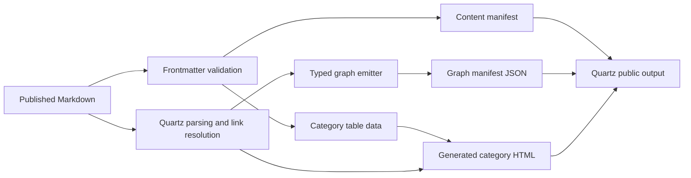

# Product Requirements Document

# Quartz 5 + Cloudflare Knowledge Publishing and Personal Notes Platform

| Field | Value |
|---|---|
| Status | Superseded by `../PRD.md` version 1.1 before implementation |
| PRD version | 1.0 |
| Last verified | 2026-08-22 |
| Primary framework | Quartz 5 |
| Runtime platform | Cloudflare |
| Content source of truth | Markdown files in Git |
| Dynamic-data source of truth | Cloudflare D1 |
| Intended implementers | Human engineers, Codex, and other coding agents |

---

## 0. How this document must be used

This PRD is an implementation contract, not a loose brainstorm. An agent must not interpret it as permission to invent APIs, file paths, packages, data models, or framework behavior.

Before changing code for any phase, the implementer must:

1. Read the repository-root `AGENTS.md`, this PRD, the nearest nested `AGENTS.md`, and the active execution plan.
2. Inspect the currently checked-out Quartz source and installed plugin source.
3. Verify every material framework or Cloudflare assumption against official documentation that matches the pinned versions.
4. Create `docs/exec-plans/active/phase-<number>-<short-name>.md` using the supplied plan template.
5. Record the exact versions, commits, documentation URLs, relevant source-code locations, affected files, tests, migration steps, risks, and rollback.
6. Stop and create an ADR when the proposed implementation changes an architectural decision in this PRD.
7. Implement only the approved phase or vertical slice. Do not opportunistically build later phases.

The hierarchy of authority is:

1. Security and data-integrity requirements in this PRD.
2. Approved ADRs created after this PRD.
3. This PRD.
4. Root and nested `AGENTS.md` instructions.
5. The active execution plan.
6. Official documentation matching pinned versions.
7. Installed source code.

When documentation and installed source disagree, the implementer must not guess. Record the conflict in the active plan, inspect release notes, and resolve it with an ADR or a narrowly scoped spike.

---

## 1. Executive summary

Build a public, Obsidian-style knowledge website on Quartz 5. Published articles remain plain Markdown files under Quartz's `content/` directory and are versioned in Git. Folders define primary categories, nested folders define subcategories, category `index.md` files provide curated wiki-style introductions, tags provide cross-category classification, and authored internal links provide explicit knowledge relationships.

Each published Markdown page receives an immutable UUID in its own frontmatter. Its path, filename, title, category, slug, and permalink may change; its ID may not. Generated category tables, search indexes, graph manifests, and the future personal-note database reference the ID but never become competing sources of identity.

Category pages render an automatically generated, sortable table of all published descendant articles. The table reads title, short description, tags, dates, category path, and immutable ID from article metadata. It is rendered as navigation after Markdown relationship extraction, so its links do not create false graph edges.

The knowledge graph is generated from Markdown at build time and rendered interactively in the browser:

- solid connection: explicit authored internal link between pages;
- dotted connection: page-to-tag membership;
- folder/category: visual cluster or nested region, never an edge;
- semantic/embedding similarity: reserved for a later, separately approved phase.

The public site and API run on Cloudflare. The baseline deployment target is Cloudflare Workers Static Assets, with a Worker API for authenticated features. Cloudflare Access handles human and service authentication. D1 stores private notes, highlights, bookmarks, reading progress, and timestamped video notes. R2 stores general uploaded binary assets and originals when required. Cloudflare Stream is the preferred native-video platform when adaptive playback, captions, signed playback, or creator uploads are required.

Published Markdown never moves into D1. A personal note never edits the Markdown article or triggers a Quartz rebuild. Browser-based article authoring, if later approved, must still create a Git branch and pull request rather than writing to the deployed filesystem or treating D1 as a CMS.

---

## 2. Product vision

Create a knowledge publication system that feels like a polished public personal wiki while preserving four distinct kinds of meaning:

1. **Where content lives** — folder/category hierarchy.
2. **What topics content belongs to** — tags.
3. **What the author explicitly says is related** — internal links.
4. **What a reader privately records while learning** — notes, highlights, bookmarks, and video timestamps.

The system must remain understandable as the repository grows and as human or automated agents reorganize content. A file move must not sever private annotations. A generated category listing must not pretend that every listed article is a conceptual relationship. A shared tag must not be converted into a page-to-page clique. An AI-generated similarity score must not be presented as an authored relationship.

The result should support:

- public long-form Markdown articles;
- wiki-like categories and subcategories;
- automatic category content tables;
- Obsidian-compatible wikilinks, backlinks, tags, callouts, images, and video embeds;
- local and global interactive graphs;
- clear graph semantics and controls;
- private reader annotations tied to stable content IDs;
- timestamped notes on video;
- Git-based human and agent publishing;
- Cloudflare-hosted delivery, data, media, authentication, and observability.

---

## 3. Product principles and non-negotiable decisions

### 3.1 Quartz remains the publishing framework

Quartz 5 is the static publishing foundation. Do not replace it with Next.js, Astro, a custom React site, a headless CMS, or a bespoke Markdown pipeline without an approved ADR that demonstrates a blocking requirement and migration plan.

Prefer, in order:

1. Quartz configuration;
2. Quartz page-frame or component override;
3. local Quartz plugin;
4. custom CSS/SCSS;
5. a narrowly scoped upstream patch isolated behind tests.

Direct modifications to Quartz core are a last resort. A core patch requires an ADR, upstream source references, upgrade impact analysis, and a regression test.

### 3.2 Markdown and Git own published knowledge

Published article text, metadata, categories, tags, authored relationships, and media references live in Git-tracked source files. D1 must never become the canonical article database.

### 3.3 Cloudflare owns runtime infrastructure

The runtime architecture uses Cloudflare services:

- Workers Static Assets for the generated Quartz site;
- Workers for API and authenticated runtime behavior;
- Access for human and service authentication;
- D1 for private structured interaction data;
- R2 for binary objects and originals where appropriate;
- Stream for managed video when adaptive playback or captions are required;
- Workers observability for logs and traces.

GitHub remains permitted as source control, review, and pull-request infrastructure. “Cloudflare-only” in this PRD means application hosting, runtime, authentication, data, and media infrastructure—not replacing Git as the publication source of truth.

### 3.4 Identity is not location

Every content entity has an immutable ID. Folder path, slug, URL, title, alias, and permalink are mutable attributes.

### 3.5 Generated navigation is not authored meaning

Generated category tables, explorer links, breadcrumbs, table-of-contents links, tag listing pages, recent-content widgets, and footers must never produce explicit knowledge edges.

### 3.6 No embeddings in the initial graph

The first graph is deterministic and explainable. It uses authored links, tags, and folder cluster metadata only. Embeddings, vector databases, semantic-neighbor edges, AI-generated links, and automated relationship rewriting are out of scope until a separate PRD and ADR are approved.

### 3.7 No custom password authentication

Do not create a username/password table, password-reset flow, session-cookie implementation, or bespoke identity provider. Use Cloudflare Access and validate the authenticated identity through the currently supported official Worker mechanism.

### 3.8 Agents do not deploy or publish directly to production

Content and code agents work on branches and open pull requests. Production deployment occurs only after protected checks and merge to the protected production branch.

---

## 4. Goals

### 4.1 Public knowledge publishing

- Publish Markdown content from `content/` through Quartz.
- Preserve Obsidian-compatible authoring for wikilinks, tags, callouts, images, and supported media embeds.
- Provide an Obsidian-inspired, three-column reading experience without copying Obsidian branding or proprietary assets.
- Support desktop and mobile layouts.

### 4.2 Structured categories

- Treat folders as primary categories and nested folders as subcategories.
- Treat each meaningful folder's `index.md` as a real curated wiki landing page.
- Automatically render a table of all published descendant articles in that category.
- Render subcategories separately from article rows.
- Keep generated table links out of the explicit graph relationship set.

### 4.3 Stable identity

- Give every published article, category page, and standalone page a UUID.
- Prevent duplicate IDs and accidental ID changes in CI.
- Include IDs in generated indexes and manifests.
- Keep future personal notes attached after file renames, moves, retitles, or permalink changes.

### 4.4 Explainable graph

- Build graph data at Quartz build time.
- Render graph interactions in the browser.
- Show solid explicit-link edges.
- Show dotted page-to-tag edges.
- Show folders as clusters/regions with no folder edges.
- Offer local and global views, legend, filters, and an accessible non-canvas relationship list.

### 4.5 Video and private learning interactions

- Support article video embedding.
- Give managed video an immutable media ID.
- Allow private timestamped notes, transcript quotations, bookmarks, highlights, and reading progress without rebuilding Quartz.
- Keep private data in D1 and binary media in appropriate Cloudflare storage.

### 4.6 Agent-safe implementation

- Make phase scope and acceptance gates explicit.
- Require source references and repository reconnaissance before implementation.
- Require tests and evidence for every phase.
- Prevent agents from introducing alternate frameworks, duplicate sources of truth, unreviewed dependencies, or invented APIs.

---

## 5. Non-goals

The following are not part of the initial product unless a later phase explicitly adds them:

- a general-purpose multi-tenant SaaS CMS;
- public comments or social networking;
- real-time collaborative Markdown editing;
- direct production editing of deployed files;
- storing public article bodies in D1;
- semantic graph edges or automatic AI linking;
- a vector database for the initial graph;
- a full Obsidian desktop replacement;
- support for arbitrary Obsidian community plugins;
- exact reproduction of Obsidian's logo, trademark, proprietary illustrations, or inaccessible pixel-level quirks;
- direct agent pushes to the protected production branch;
- silent content deletion after private notes reference an article;
- reliance on third-party script CDNs for graph runtime dependencies;
- public access to private notes or private media by obscurity alone.

---

## 6. Personas and primary jobs

### 6.1 Owner/editor

Needs to:

- write in Obsidian or another Markdown editor;
- organize articles by moving files and folders;
- create category landing-page introductions;
- add tags and authored links;
- preview and review changes;
- merge approved pull requests;
- sign in to private features through Cloudflare Access;
- make personal notes while reading or watching video.

### 6.2 Content agent

Needs to:

- create or update Markdown using the canonical schema;
- use existing category and tag taxonomies;
- preserve immutable IDs;
- move content safely;
- identify and repair broken links;
- create a branch and pull request with validation evidence;
- never infer that generated table membership is an authored relationship.

### 6.3 Code agent

Needs to:

- read the PRD and active execution plan;
- inspect pinned Quartz and plugin source;
- reference official current documentation;
- implement one phase or vertical slice;
- add tests and documentation;
- stop for an ADR when crossing a boundary.

### 6.4 Reader

Needs to:

- browse category tables and folder explorer;
- read articles comfortably;
- follow explicit links and backlinks;
- inspect local or global graph relationships;
- distinguish explicit links, tag membership, and folder grouping;
- optionally authenticate to save private notes and progress.

### 6.5 Automated service principal

Needs to:

- authenticate through a dedicated Cloudflare Access service token when calling protected operational APIs;
- have least-privilege access;
- be individually identifiable in audit logs;
- never share a human credential or a production-wide secret.

---

## 7. Glossary and semantic model

| Term | Meaning |
|---|---|
| Content entity | A published Markdown article, category page, or standalone page with an immutable ID. |
| Immutable ID | UUID stored in the entity's own frontmatter. It never changes after publication. |
| Path | Current repository location under `content/`; mutable. |
| Slug | Current Quartz-resolved route segment or route; mutable. |
| Permalink | Optional author-selected public URL intended to remain stable across path moves. It is not identity. |
| Alias | Alternate title or prior route/name used for link resolution or redirects. |
| Category | A folder represented by a category `index.md` and a graph cluster. |
| Subcategory | A nested category folder. |
| Category page | The real `index.md` content entity that provides the folder's curated introduction. |
| Category table | Generated navigation table of descendant articles. It is not authored Markdown and creates no explicit graph edges. |
| Tag | Controlled cross-category classification. Represented as a graph node and dotted membership edge. |
| Explicit relationship | Authored internal link in Markdown body content. Represented as a solid graph edge. |
| Generated navigation | Links produced by the site framework rather than authored in source text. |
| Graph manifest | Build-time JSON contract consumed by the browser graph component. |
| Content manifest | Build-time JSON mapping stable content IDs to current metadata and routes. |
| Personal note | Private D1 record linked to a stable content ID. It is not written into article Markdown. |
| Highlight | Private anchored selection using durable text selectors. |
| Media ID | Immutable UUID for a video or other note-addressable media item. |
| ADR | Architecture Decision Record required for a material change to an approved decision. |
| Execution plan | Phase- or PR-specific, source-referenced plan written before coding. |

---

## 8. System architecture

### 8.1 Context diagram



### 8.2 Build-time content flow



### 8.3 Browser runtime flow

```mermaid
flowchart LR
  PAGE[Static article HTML] --> UI[Quartz client behavior]
  GM[Graph manifest] --> GRAPH[D3/Pixi graph loaded on demand]
  USER[Authenticated reader] --> API[/api/v1/private/*]
  API --> D1[(D1)]
  API --> STREAM[Stream]
  API --> R2[(R2)]
```

### 8.4 Relationship discovery versus rendering

- Relationship discovery occurs during the Quartz build.
- The browser does not fetch and parse every Markdown file.
- The browser fetches generated graph/index data and dynamically performs layout, filtering, dragging, zooming, and navigation.
- A production content change therefore requires a new Quartz build and deployment.
- A personal note change is an API/D1 operation and must not require a Quartz rebuild.

---

## 9. Approved technology stack

### 9.1 Publishing and frontend

| Concern | Decision |
|---|---|
| Static knowledge framework | Quartz 5, pinned to an exact reviewed commit/tag during Phase 0 |
| Language | TypeScript |
| Authoring | Markdown with Quartz's Obsidian-compatible processing |
| UI rendering | Quartz's Preact/component/page-frame architecture |
| Styling | Quartz theme variables and project-owned SCSS/CSS overrides |
| Graph | Project-owned extension/fork of the Quartz community graph implementation, retaining D3 force simulation and PixiJS rendering unless a measured blocker is documented |
| Search | Quartz ContentIndex/search baseline |
| Package manager | npm with committed lockfile |
| Minimum runtime | Node.js 22 or later as required by the pinned Quartz version; exact Node and npm versions recorded in a version matrix |
| Browser tests | Playwright |
| Unit/integration tests | Existing Quartz-compatible test runner plus focused project tests; exact scripts confirmed in Phase 0 |

### 9.2 Cloudflare platform

| Concern | Decision |
|---|---|
| Public static hosting | Workers Static Assets, SSG 404 behavior, Quartz `public/` output |
| API | Cloudflare Worker using TypeScript and Hono after Phase 0 verification |
| Human authentication | Cloudflare Access |
| Machine authentication | Dedicated Cloudflare Access service tokens |
| Private structured data | D1 |
| Binary files and originals | R2 |
| Managed video | Stream when adaptive playback/captions/signed access are required |
| Secrets | Cloudflare secrets; never committed variables or browser-exposed values |
| Logs/traces | Workers Observability |
| Environments | Local, preview, production with separate bindings and data resources |

### 9.3 Deployment decision requiring Phase 0 proof

Quartz's official hosting guide currently documents Cloudflare Pages, while Cloudflare recommends Workers Static Assets for new projects and documents SSG routing and custom 404 handling. This product chooses Workers Static Assets as the target.

Phase 0 must produce a deployed compatibility spike proving:

- Quartz builds successfully to `public/`;
- clean URLs and trailing-slash behavior match Quartz routes;
- nested `index.html` routes work;
- Quartz's custom 404 returns HTTP 404;
- static assets, SPA navigation if enabled, search, backlinks, and graph data load;
- `/api/*` can run Worker-first without causing public page navigation to route incorrectly;
- Access can protect private API/admin paths without protecting public article assets unintentionally;
- preview and production bindings are isolated.

Cloudflare Pages may be used only as a temporary fallback if the spike finds a documented blocker that cannot be resolved within the phase. Such a fallback requires an ADR and must preserve a migration path back to Workers Static Assets.

### 9.4 Prohibited stack substitutions

Without an approved ADR, do not add or substitute:

- Next.js, Astro, Remix, Nuxt, Gatsby, or a parallel SSG;
- React as a second app framework for the public site;
- Tailwind solely to restyle Quartz;
- PostgreSQL, Supabase, Firebase, MongoDB, or another article database;
- a custom password/authentication system;
- a second graph rendering library;
- a vector database for graph V1;
- a CMS that writes article bodies into D1;
- a remote CDN dependency for D3, PixiJS, or security-critical runtime code.

---

## 10. Version pinning and source verification

Phase 0 must create `docs/architecture/VERSION_MATRIX.md` containing:

- Quartz commit/tag and repository URL;
- each Quartz community plugin commit/package version;
- Node version;
- npm version;
- Wrangler version;
- Hono version, if used;
- Cloudflare compatibility date and flags;
- Playwright version;
- D3 and PixiJS versions inherited or bundled by the graph plugin;
- build and deployment commands proven by the spike.

Rules:

- Commit `package-lock.json`.
- Do not use floating Git dependencies in production configuration.
- Pin community plugins to reviewed releases or commits.
- Do not update the Cloudflare compatibility date automatically.
- A dependency update is its own reviewed change with tests and release-note review.
- An agent must cite both the official documentation and the installed source location for nontrivial framework behavior.
- Blog posts, copied snippets, AI memory, and Stack Overflow are not authoritative sources for implementation contracts.

---

## 11. Target repository organization

The following is the intended logical layout. Phase 0 may adjust exact plugin/package paths only when required by the pinned Quartz plugin system; any material change requires documentation in the execution plan and, when architectural, an ADR.

```text
/
├── AGENTS.md
├── README.md
├── package.json
├── package-lock.json
├── quartz.config.yaml
├── quartz.ts
├── wrangler.jsonc
├── content/
│   ├── AGENTS.md
│   ├── index.md
│   ├── AI/
│   │   ├── index.md
│   │   ├── RAG/
│   │   │   ├── index.md
│   │   │   ├── embeddings.md
│   │   │   └── chunking.md
│   │   └── Local-LLM/
│   │       ├── index.md
│   │       └── quantization.md
│   └── About/
│       └── index.md
├── config/
│   └── content-taxonomy.yaml
├── scripts/
│   ├── content-new.ts
│   ├── content-move.ts
│   ├── validate-content.ts
│   └── verify-immutable-ids.ts
├── packages/
│   ├── quartz-plugin-category-index/
│   ├── quartz-plugin-relationship-graph/
│   └── quartz-plugin-knowledge-video/
├── worker/
│   └── src/
│       ├── index.ts
│       ├── auth/
│       ├── api/
│       ├── data/
│       └── media/
├── migrations/
├── tests/
│   ├── fixtures/content/
│   ├── unit/
│   ├── integration/
│   └── e2e/
└── docs/
    ├── product/PRD.md
    ├── architecture/
    │   ├── VERSION_MATRIX.md
    │   └── SYSTEM_DESIGN.md
    ├── contracts/
    │   ├── CONTENT_MODEL.md
    │   ├── GRAPH_MANIFEST.md
    │   ├── CONTENT_MANIFEST.md
    │   ├── API.md
    │   └── MEDIA.md
    ├── decisions/
    └── exec-plans/
        ├── active/
        └── completed/
```

Repository rules:

- Generated Quartz output under `public/` is a build artifact and is not manually edited.
- Generated manifests are tested from build output; they are not hand-maintained source files.
- Cloudflare Worker code remains separate from Quartz's client code even if both are packaged from the same repository.
- Content rules live in `content/AGENTS.md`; service-specific rules may be added in nested `AGENTS.md` files when those directories exist.
- Do not create a monorepo workspace merely for aesthetics. Phase 0 must prove whether local Quartz plugins require a workspace or can use Quartz's local plugin mechanism.

---

## 12. Content information architecture

### 12.1 Folder rules

- `content/` is the only root for publishable knowledge content.
- A folder is a primary category; a nested folder is a subcategory.
- Folder names use lower-case kebab-case ASCII for stable filesystem behavior unless an ADR establishes a Unicode policy.
- Display names come from the folder's `index.md` title, not from filename capitalization.
- Every meaningful category folder must have an `index.md` before production publication.
- `content/index.md` is the site home page and has `type: page`, not `type: category`.
- Published root-level Markdown files other than explicitly approved standalone pages are prohibited. Knowledge articles must have a category home.
- Folder depth should normally be no more than four category levels. A deeper tree requires an information-architecture review because it harms navigation and cluster readability.
- One article has one physical home. Do not duplicate the same article into multiple folders to simulate multiple categories; use tags and explicit links.

### 12.2 Category page rules

A category `index.md` is a real Markdown entity with:

- its own immutable ID;
- `type: category`;
- title and description;
- optional curated introduction, learning path, key concepts, images, and authored links;
- generated subcategory navigation;
- generated descendant-article table.

The generated table is not authored into the Markdown file. Agents must not maintain a manual duplicate table.

### 12.3 Article rules

An article is a Markdown file with `type: article`. It must:

- have a unique immutable ID;
- have a human title and concise description;
- be stored below a category folder;
- use a controlled set of tags;
- declare publish and lifecycle state;
- pass link and frontmatter validation;
- not rely on filename as its only title;
- not expose secrets or private source material.

### 12.4 Standalone page rules

A standalone page uses `type: page`, for example the home, about, privacy, or legal page. Standalone pages:

- have immutable IDs;
- are excluded from category tables by default;
- are excluded from the global knowledge graph by default unless a future explicit frontmatter switch is approved;
- may still contain ordinary web navigation links.

---

## 13. Canonical frontmatter contract

### 13.1 Required fields for a published article

```yaml
---
id: "7cd1f739-d876-4556-a5d8-2b4b602d3728"
title: "Embeddings"
description: "How text and other data become vectors for semantic retrieval."
type: article
publish: true
status: active
created: "2026-08-22"
tags:
  - semantic-search
  - retrieval
order: 20
aliases:
  - "Vector Embeddings"
---
```

### 13.2 Required fields for a category page

```yaml
---
id: "1d772d1f-bfec-43a1-bf4b-d4ad411f96db"
title: "Retrieval-Augmented Generation"
description: "Guides and research covering retrieval, context construction, and grounded generation."
type: category
publish: true
status: active
created: "2026-08-22"
listingScope: descendants
tags: []
---
```

### 13.3 Required fields for a standalone page

```yaml
---
id: "a50eabef-9551-4280-8b4b-2b345cfb5f5d"
title: "About"
description: "About this knowledge site and how its content is maintained."
type: page
publish: true
status: active
created: "2026-08-22"
tags: []
---
```

### 13.4 Field definitions

| Field | Required | Contract |
|---|---:|---|
| `id` | Yes | Lower-case canonical UUID string generated once. UUIDv4 is the baseline because it can be generated with the platform cryptographic API without a new ID dependency. Never edited after publication. |
| `title` | Yes | Non-empty human-readable title. Duplicate titles are allowed only when links remain unambiguous through path or alias policy. |
| `description` | Yes | Plain-text summary, target 40–180 characters. Used in category tables, previews, search, and manifests. It must not contain Markdown links or relationship semantics. |
| `type` | Yes | `article`, `category`, or `page`. Category files must be `index.md`; ordinary articles must not declare `category`. |
| `publish` | Yes for public content | Must be `true` for public output. Explicit-publish filtering is the baseline. Missing or false content is excluded from production. |
| `status` | Yes | `active` or `archived`. Archived content is handled through a tombstone/redirect policy and is excluded from ordinary listings. |
| `created` | Yes | ISO `YYYY-MM-DD`; preserved across moves. |
| `tags` | Yes | Array, possibly empty. Values must exist in the controlled taxonomy and use normalized lower-case kebab-case. |
| `order` | No | Integer used as the first deterministic category-table sort key. Equal or missing values fall back to title. |
| `listingScope` | Category only, optional | `descendants` by default or `direct`. Controls generated article table scope. |
| `permalink` | Optional | Custom public URL. It is not identity. Must be globally unique and pass route-collision validation. |
| `aliases` | Optional | Alternate titles or historical routes. Must not collide ambiguously with another canonical page. |
| `lang` | Optional | BCP 47 language code if multilingual content is introduced. |
| `socialImage` | Optional | Valid approved asset reference. |

### 13.5 Fields and combinations that are forbidden

- `publish: true` with `draft: true`.
- A missing ID on any content proposed for publication.
- A non-UUID or uppercase/noncanonical UUID.
- Duplicate IDs.
- `type: category` outside an `index.md`.
- `type: article` on a category `index.md`.
- A manually edited `updated` value used as the only source of modification truth.
- Unknown tag values.
- Multiple canonical permalinks resolving to the same path.
- Secrets, access tokens, private media credentials, or user data in frontmatter.

### 13.6 Modification date

The rendered `updated` value should be derived from Git history using a full clone in CI. If Git metadata is unavailable in local development, the system may fall back to `created` and visibly mark the value as a fallback in debug output. It must not use an unstable deployment-time timestamp that makes every article appear modified on every build.

### 13.7 Frontmatter schema implementation

Phase 1/2 must implement a machine-readable schema and validator. The implementation may use a currently maintained validation library already compatible with the toolchain, but adding the dependency requires source review and inclusion in the version matrix. The schema is authoritative; TypeScript types must be derived from or checked against it rather than manually drifting apart.

---

## 14. Immutable content ID contract

### 14.1 Source of truth

The immutable ID stored in each Markdown file's frontmatter is the only canonical ID definition. Generated category tables, manifests, D1 projections, logs, and API records may reference it but must not generate or redefine a competing ID.

### 14.2 Creation

New content must be created through a repository command such as:

```text
npm run content:new -- --type article --category ai/rag --title "Embeddings"
```

The exact CLI syntax is finalized in Phase 2, but it must:

- generate a UUID using a cryptographically secure platform API;
- create canonical frontmatter;
- normalize the filename safely;
- refuse path or title collisions;
- require an existing category for articles;
- set `publish: false` initially unless an explicit reviewed option is supplied;
- never regenerate an ID when rerun against an existing file.

Agents must not invent IDs manually when the helper exists.

### 14.3 Immutability validation

CI must perform both snapshot and diff-based checks:

1. Validate that all published IDs are present, canonical, and unique in the current tree.
2. Compare the pull-request base and head content manifests.
3. Detect Git renames/moves and confirm the moved entity retains the same ID.
4. For an existing ID, allow title, path, category, slug, aliases, and permalink changes subject to their own validation.
5. Reject an ID change unless the pull request contains an approved data-migration ADR and migration plan.
6. Reject reuse of a previously archived/deleted ID for a different entity.

### 14.4 ID display and generated indexes

The generated category table must include the ID:

- desktop default: compact first eight characters plus a copy action for the full UUID;
- accessible name/title: full UUID;
- HTML data attribute: full UUID;
- content manifest: full UUID;
- administrative views: full UUID available without truncation;
- mobile: ID may move into an expandable metadata row but must remain available.

The visible compact ID is a presentation only. It must never be accepted as a unique database key.

### 14.5 Moves and renames

A move changes the path and normally the URL. It does not change the ID. The content move tool must:

- retain the ID;
- update resolvable authored links where safe;
- add an alias or redirect from the old route when the configured link policy requires it;
- regenerate manifests;
- report personal-data impact using the ID rather than path;
- refuse case-only moves that are unsafe across filesystems unless performed through a validated two-step operation.

### 14.6 Archival and deletion

Before private interaction data exists, permanent deletion is allowed only through a reviewed pull request and a tombstone record in an ID history file or generated release artifact.

After Phase 5:

- ordinary removal uses `status: archived`;
- archived content keeps its ID and a stable tombstone/redirect page or a documented gone response;
- D1 notes remain retrievable in an “archived source” state;
- hard deletion requires an approved data retention/migration plan;
- an ID is never assigned to a new article.

---

## 15. Controlled tag taxonomy

### 15.1 Purpose

Tags group related content across folder categories. They answer “what topic or property does this content share?” They do not define the article's physical home.

### 15.2 Taxonomy source

`config/content-taxonomy.yaml` is the controlled vocabulary. A representative shape is:

```yaml
tags:
  semantic-search:
    label: "Semantic Search"
    description: "Retrieval based on meaning rather than exact tokens."
  beginner:
    label: "Beginner"
    description: "Suitable as an introductory resource."
```

The exact schema is finalized in Phase 2. Tag keys are normalized lower-case kebab-case. Hierarchical slash tags are deferred unless an ADR establishes a concrete need and graph behavior.

### 15.3 Agent rules

- Reuse an existing tag whenever its definition fits.
- Do not create a synonym, plural variant, capitalization variant, or one-off tag.
- Adding or renaming a tag requires updating the taxonomy and all affected content in the same pull request.
- Tag aliases, if later supported, must be explicit and validated.
- A folder name does not automatically become a tag.
- Articles may use a tag matching a category concept only when the tag has useful cross-category meaning.

### 15.4 Graph representation

A tag is a deterministic node with an ID such as `tag:<normalized-key>`. Each tagged page creates one page-to-tag edge of type `tag`. Pages sharing a tag do not receive pairwise edges.

---

## 16. Category index and generated content table

### 16.1 Category page composition

Each category route renders in this order:

1. breadcrumbs;
2. category title and description;
3. curated Markdown body from `index.md`;
4. subcategory section;
5. generated article table;
6. optional category-local graph/backlinks according to layout;
7. standard page footer.

### 16.2 Generated table scope

The default `listingScope` is `descendants`, because a category wiki should include all articles within its nested tree. A category may set `listingScope: direct` when it should list only immediate child articles.

The table must:

- include published, active articles in scope;
- exclude the current category `index.md`;
- exclude descendant category `index.md` files from article rows;
- exclude standalone pages, drafts, unpublished files, ignored files, archived articles, and system files;
- include descendants with a “Category” column or breadcrumb when recursive;
- list subcategories separately, including their description and article count;
- gracefully show an empty state when no article exists;
- avoid duplicate rows when aliases or permalinks exist;
- use stable IDs as row keys, never path or title alone.

### 16.3 Columns

Required desktop columns:

| Column | Source | Notes |
|---|---|---|
| Article | `title` and current route | Primary navigation link. |
| Description | `description` | Short plain-text description; no relationship extraction. |
| Category | derived folder path | Shown when recursive or useful. |
| Tags | `tags` | Links to tag listing pages; these are navigation in the table, not new graph records. |
| Updated | Git-derived date | Deterministic and sortable. |
| ID | `id` | Compact display with full copy/accessibility value. |

Optional later columns may include content type, difficulty, duration, or media presence only after adding them to the canonical schema through an ADR or schema revision.

### 16.4 Sorting and filtering

Build-time default ordering:

1. explicit `order` ascending, with missing values after explicit values;
2. title using locale-aware deterministic comparison;
3. immutable ID as the final tie-breaker.

Client enhancements may support:

- sort by title, category, updated, or ID;
- filter by text or tag;
- pagination or windowing for large categories;
- copy ID;
- responsive card representation on narrow screens.

The base table must remain readable and navigable without JavaScript.

### 16.5 Critical graph isolation requirement

The generated table must be created at a page-rendering/component stage that does not mutate the authored Markdown relationship set. It must not inject Markdown links before Quartz link crawling or add its links to the graph manifest.

Acceptance test:

- Given `rag/index.md` with no authored internal link and three generated rows, the category page contains three working navigation links, but the graph manifest contains zero explicit edges from the category page to those rows.
- If the author writes `Start with [[Embeddings]]` in the category body, exactly one explicit edge from the category page to Embeddings exists.

### 16.6 Selection of implementation approach

The preferred implementation is a local Quartz page-type/component plugin that extends or replaces the folder listing presentation while consuming already parsed metadata. Obsidian Bases may be used later for separate database-style pages, but it is not the canonical V1 category index because this product requires exact ID display, descendant/category behavior, and graph isolation.

An agent must inspect the pinned `FolderPage`, page-frame, and plugin APIs before choosing the exact hook. Do not build a parallel Markdown scanner if Quartz's parsed data can provide the contract.

### 16.7 Large category behavior

For categories exceeding the Phase 0 benchmark threshold:

- render the first useful page of results server-side;
- provide client-side filtering/pagination without blocking article reading;
- preserve a no-JavaScript path to all rows, such as paginated static routes or expandable sections;
- lazy-load enhancement code;
- test keyboard and screen-reader operation.

Exact thresholds are set from the Phase 0/2 performance fixture, not guessed during implementation.

---

## 17. Authored links and backlink semantics

### 17.1 Links that create explicit graph edges

A solid graph edge is created only by a successfully resolved internal relationship authored in Markdown body content, including:

- Obsidian wikilinks such as `[[Embeddings]]`;
- aliased wikilinks such as `[[Embeddings|vector representations]]`;
- heading/block links, normalized to the target page entity;
- ordinary Markdown links to another internal content page;
- page transclusions, recorded with an `embed` subtype while visually using the explicit-link family.

### 17.2 Links that do not create explicit graph edges

- external URLs;
- image, PDF, audio, and video asset references;
- generated category-table links;
- explorer links;
- breadcrumbs;
- tag chips generated from frontmatter;
- search results;
- table-of-contents anchor links;
- footnote backlinks;
- pagination controls;
- recent-content widgets;
- previous/next navigation generated by the theme;
- links inside descriptions, aliases, or generated property panels unless a future contract explicitly adds a relationship field.

### 17.3 Directionality

The graph manifest preserves source-to-target direction for explicit links. The default visual may draw an undirected line for readability, but hover/details and the accessible list must distinguish:

- outgoing links;
- incoming backlinks;
- bidirectional links.

### 17.4 Self-links and circular links

- Self-links resolve for navigation but are omitted from graph edges.
- Circular links are valid.
- Duplicate references from one source page to the same target create one graph edge with a reference count, not parallel duplicate lines.
- The manifest may include occurrence count and source locations for diagnostics, but source text is not exposed if it contains private/unpublished content.

### 17.5 Broken links

- Published internal links must resolve in CI.
- Unpublished draft content may contain unresolved links in local development, reported as warnings.
- A production build fails on unresolved published links unless an approved exception mechanism exists.
- The validator must detect case collisions and shortest-link ambiguity.
- Agents must not “fix” ambiguity by silently linking to the first title match.

---

## 18. Graph data and visual contract

### 18.1 Build-time graph pipeline

The graph pipeline must use Quartz's parsed and resolved content data rather than rescanning rendered HTML in the browser.

```text
Markdown source
  -> Quartz frontmatter and Markdown transformers
  -> Quartz internal-link resolution
  -> project relationship adapter/emitter
  -> static/relationship-graph.v1.json
  -> lazy-loaded browser graph
```

The existing Quartz graph implementation and ContentIndex are reference implementations. The project may consume ContentIndex or parsed plugin data, but the final manifest must use stable IDs and typed relationships. The implementation decision is documented in Phase 3 after inspecting the pinned source.

### 18.2 Manifest shape

The exact TypeScript/JSON schema is finalized in Phase 3 and versioned. It must be semantically equivalent to:

```json
{
  "schemaVersion": 1,
  "buildId": "git-sha-or-build-id",
  "generatedAt": "2026-08-22T00:00:00Z",
  "nodes": [
    {
      "id": "7cd1f739-d876-4556-a5d8-2b4b602d3728",
      "kind": "article",
      "title": "Embeddings",
      "slug": "ai/rag/embeddings",
      "folderPath": "ai/rag",
      "tags": ["semantic-search"],
      "status": "active"
    },
    {
      "id": "tag:semantic-search",
      "kind": "tag",
      "title": "Semantic Search",
      "slug": "tags/semantic-search"
    }
  ],
  "edges": [
    {
      "source": "7cd1f739-d876-4556-a5d8-2b4b602d3728",
      "target": "another-content-uuid",
      "kind": "wikilink",
      "directed": true,
      "referenceCount": 1
    },
    {
      "source": "7cd1f739-d876-4556-a5d8-2b4b602d3728",
      "target": "tag:semantic-search",
      "kind": "tag",
      "directed": false
    }
  ],
  "clusters": [
    {
      "id": "folder:ai/rag",
      "path": "ai/rag",
      "title": "Retrieval-Augmented Generation",
      "parentId": "folder:ai",
      "categoryContentId": "1d772d1f-bfec-43a1-bf4b-d4ad411f96db"
    }
  ]
}
```

Additional fields require schema versioning and tests. Consumers must reject unsupported major schema versions rather than guessing.

### 18.3 Node types

- `article`: ordinary knowledge article.
- `category`: real category `index.md` page. This is distinct from the folder cluster.
- `page`: standalone page, normally excluded from global knowledge graph.
- `tag`: deterministic taxonomy node.

Every published Markdown file is scanned, including category `index.md`. Category pages may have explicit authored edges. Folder membership still creates no edge.

### 18.4 Folder clusters

Folder categories are represented as nested cluster metadata and a visual enclosure, region, hull, or equivalent grouped background. They must not be represented as a star-shaped category node connected to every child.

Required semantics:

- article membership in a folder changes cluster placement only;
- moving an article changes its cluster metadata but creates no relationship edge;
- nested folders are nested or clearly parented clusters;
- category labels remain legible;
- cross-category solid and dotted edges may cross cluster boundaries;
- the visual can be toggled off without changing graph data.

Phase 3 includes a measured design/technical spike comparing feasible PixiJS/D3 approaches, such as nested bounds, convex hulls, or grouped background regions. The selected technique must be documented in an ADR. An agent must not choose an algorithm solely because it is familiar.

### 18.5 Visual language

| Relationship | Visual | Meaning |
|---|---|---|
| Explicit internal link | Solid line | The author intentionally linked one content page to another. |
| Tag membership | Dotted line from page to tag node | The page declares membership in a controlled topic. |
| Folder membership | Cluster/region, no line | The file is physically organized in a category. |
| Semantic similarity | Not implemented | Reserved for a later PRD. |

Nodes must also differ by accessible shape/icon or labeling, not color alone.

### 18.6 Graph views

#### Local graph

- centers on the current content entity;
- defaults to one hop but supports configured depth;
- includes incoming and outgoing explicit links;
- includes relevant tag nodes;
- shows the current folder cluster context;
- updates on Quartz navigation without a full page reload if SPA behavior is enabled;
- provides a text relationship list.

#### Global graph

- represents all active published graph-eligible content;
- supports pan, zoom, drag, search, folder filter, tag filter, and edge-type toggles;
- supports showing/hiding category-page nodes, tags, and clusters;
- uses progressive detail for large graphs;
- does not block initial article rendering.

### 18.7 Legend and explanation

Every graph view must expose a visible legend or help control that states:

- solid = authored link;
- dotted = tag membership;
- surrounding region = folder/category;
- no semantic similarity is being inferred.

### 18.8 Runtime dependency policy

The graph implementation must bundle its production D3/Pixi dependencies through the repository build. It must not load them from unpinned third-party CDNs. This supports content security policy, reproducible builds, offline preview, and supply-chain review.

### 18.9 Graph failure behavior

If graph JSON fails to load, has an unsupported schema, or graph JavaScript fails:

- the article remains fully readable;
- a concise graph-unavailable state is shown;
- the accessible relationship list uses server-rendered or separately available data when possible;
- errors include build ID and schema version in diagnostics without exposing secrets;
- the app does not retry in a tight loop.

### 18.10 Performance requirements

- Graph runtime is lazy-loaded only when the graph enters the viewport or the user opens it.
- Article content does not wait for graph initialization.
- Local graph enforces node/depth limits.
- Global graph includes a large-dataset strategy established from Phase 3 benchmarks.
- Force simulation stops or cools after convergence and respects reduced-motion preferences.
- No unbounded animation loop remains active while the graph is hidden.
- Performance tests include representative 100, 1,000, and stretch 10,000-content manifests, with thresholds recorded after the Phase 0 baseline.

---

## 19. Content manifest contract

### 19.1 Purpose

The build emits `static/content-manifest.v1.json` so static UI, private APIs, migration tooling, and diagnostics can resolve an immutable content ID to its current route and metadata.

### 19.2 Required data

```json
{
  "schemaVersion": 1,
  "buildId": "git-sha",
  "items": [
    {
      "id": "7cd1f739-d876-4556-a5d8-2b4b602d3728",
      "type": "article",
      "title": "Embeddings",
      "description": "How text and other data become vectors for semantic retrieval.",
      "slug": "ai/rag/embeddings",
      "permalink": null,
      "aliases": ["Vector Embeddings"],
      "folderPath": "ai/rag",
      "categoryId": "1d772d1f-bfec-43a1-bf4b-d4ad411f96db",
      "tags": ["semantic-search", "retrieval"],
      "created": "2026-08-22",
      "updated": "2026-08-22",
      "status": "active"
    }
  ]
}
```

### 19.3 Rules

- IDs are unique.
- Slugs and permalinks are collision-free.
- Unpublished/private Markdown is omitted.
- Sensitive source paths outside the public content tree are never included.
- The manifest's `generatedAt` timestamp, if present, must not be used as article modification time.
- API code may maintain a D1 projection of this manifest for validation and archival behavior, but Markdown remains canonical.
- A failed manifest generation fails the build.

---

## 20. Public frontend requirements

### 20.1 Layout

Desktop baseline:

```text
┌────────────────┬──────────────────────────────┬──────────────────────┐
│ Explorer       │ Article / Category          │ Context              │
│                │                              │                      │
│ Categories     │ Markdown content             │ On this page         │
│ and folders    │ Generated category table     │ Backlinks            │
│                │ Embedded media               │ Local graph          │
└────────────────┴──────────────────────────────┴──────────────────────┘
```

- Left: folder explorer, search entry, and site navigation.
- Center: readable article or category page.
- Right: table of contents, backlinks, metadata, and local graph according to screen size.
- Global graph opens as a dedicated route, dialog, or full-screen view selected in Phase 3.

Mobile baseline:

- center article is primary;
- explorer opens from a drawer or sheet;
- context tools open from a drawer/tabbed panel;
- category tables become accessible stacked rows/cards without losing fields;
- graph opens intentionally rather than running by default;
- video controls remain usable without horizontal overflow.

### 20.2 Visual direction

- Obsidian-inspired information density and hierarchy;
- neutral, readable typography;
- light and dark theme support;
- flat surfaces with restrained borders and shadows;
- clear active navigation state;
- no use of Obsidian logos, proprietary icons, or copied brand assets;
- use project-owned CSS variables and Quartz customization surfaces.

### 20.3 Article page

Required components:

- breadcrumbs;
- title;
- description and selected metadata;
- body content;
- embedded images/video;
- tags;
- backlinks;
- local graph;
- authenticated note/highlight affordances after Phase 5.

### 20.4 Category page

Required components:

- category title and description;
- curated introduction;
- subcategory cards/list;
- generated article table;
- filters/sort when enhanced;
- category context in graph.

### 20.5 Accessibility

Target WCAG 2.2 AA for the authored application UI.

Required:

- semantic headings and landmarks;
- semantic table markup and captions;
- keyboard-operable sort/filter controls;
- visible focus states;
- sufficient contrast;
- reduced-motion behavior;
- graph legend and text alternative;
- no meaning conveyed by color alone;
- video captions when available;
- controls with accessible names;
- automated accessibility checks plus manual keyboard review.

### 20.6 JavaScript resilience

- Articles, category descriptions, category rows, and navigation remain useful without JavaScript.
- Search, advanced table interaction, graph, and private notes may require JavaScript.
- A failed optional enhancement must not blank the page.

### 20.7 Content security policy

Phase 1/4 must define a CSP appropriate to enabled features. Default posture:

- bundle same-origin scripts/styles;
- no `unsafe-eval` in production unless a reviewed library requirement is documented and contained;
- allow only explicitly configured image/media/frame providers;
- update CSP in the same pull request that adds a provider;
- protect private Stream video with signed playback when required;
- never place secrets or signed master credentials in static HTML.

---

## 21. Video and media architecture

### 21.1 Media tiers

#### Tier A: standard Quartz embeds

Used first for:

- YouTube embeds where external hosting is intentionally accepted;
- local/public MP4 or WebM files suitable for direct playback;
- ordinary images and attachments.

This validates authoring and page layout but does not yet provide stable media identity or timestamp notes.

#### Tier B: managed knowledge video

Used when the platform needs:

- immutable media IDs;
- adaptive bitrate playback;
- captions/transcripts;
- direct creator uploads;
- private/signed playback;
- stable timestamp-note integration;
- video processing status and metadata.

Cloudflare Stream is the preferred provider for this tier. R2 is not treated as an automatic substitute for a streaming/transcoding service.

### 21.2 Storage roles

- **Stream**: encoded on-demand video, adaptive delivery, player/captions, signed access where required.
- **R2**: images, PDFs, audio, downloadable files, optional original video preservation, transcript source files, and non-streaming assets.
- **Git/content**: small site-owned static assets only when appropriate and intentionally public.

Quartz warns that non-Markdown files can be emitted publicly even when pages are filtered. Therefore private or restricted media must never be placed casually in the public `content/` tree.

### 21.3 Immutable media identity

A note-addressable media item has:

- `mediaId`: project UUID, immutable;
- `provider`: `cloudflare-stream`, `r2`, or explicitly approved external provider;
- `providerAssetId`: provider-specific identifier, replaceable through migration;
- `contentId`: owning/embedding article ID where applicable;
- title, duration, caption languages, and lifecycle metadata.

Private notes reference `mediaId`, not a raw provider URL.

### 21.4 Canonical managed-video authoring block

Phase 4 must implement and document one validated syntax. The approved target syntax is a fenced data block:

````markdown
```knowledge-video
mediaId: "cfe59c45-99d7-4d44-a02f-68ec6861f8a7"
provider: "cloudflare-stream"
assetId: "provider-asset-id"
title: "RAG Retrieval Walkthrough"
```
````

Rules:

- a custom Quartz transformer validates and renders this block;
- unknown fields fail validation in strict mode;
- the browser never receives a Stream API token;
- the block is readable as source even in an editor without the custom renderer;
- alternative syntax requires an ADR before implementation;
- ordinary Tier A embeds remain supported but cannot receive private timestamp notes unless migrated to a media ID.

### 21.5 Upload flow

For owner uploads:

1. authenticated browser requests an upload intent from the Worker;
2. Worker verifies Access identity, permissions, size/duration constraints, content type, and rate limit;
3. Worker creates a direct upload using the current official Stream binding/API or an R2 presigned upload where appropriate;
4. browser uploads directly to the provider;
5. provider/webhook status is recorded;
6. admin receives `mediaId` and a canonical authoring block;
7. article update is submitted through Git/PR.

Large/resumable Stream uploads use the currently documented resumable protocol rather than buffering the entire file through the Worker.

### 21.6 Captions and transcripts

- WebVTT is the baseline caption interchange format for Stream.
- Captions are associated with the immutable media record.
- Transcript text used for timestamp notes must include timing data.
- Transcript display, search, and click-to-seek are Phase 5 or a Phase 4 vertical slice with explicit acceptance criteria.
- Caption generation, if used, must visibly indicate language and generated status.
- The system must not claim generated captions are human-verified.

### 21.7 Video failure behavior

- show poster/title and a meaningful unavailable state;
- preserve article text and notes;
- distinguish processing, missing, unauthorized, and provider error states;
- do not expose provider IDs or signatures unnecessarily in user-facing errors;
- retry processing/status requests with bounded backoff;
- allow notes to remain visible even if media is archived, subject to authorization.

---

## 22. Private notes, highlights, bookmarks, and progress

### 22.1 Separation from Markdown

Private interactions are dynamic D1 records. They do not:

- modify article Markdown;
- create Git commits;
- create public graph edges;
- appear in public search;
- trigger a Quartz build.

### 22.2 Phase 5 feature set

- create, edit, soft-delete, and restore a personal note;
- highlight selected article text and attach a note;
- bookmark an article;
- store reading position/progress;
- create a note at a video timestamp;
- attach a transcript quote when available;
- list all notes for the authenticated principal;
- navigate from a note to the current article route through immutable content ID;
- handle archived or moved source content.

### 22.3 Annotation anchors

Text highlights must store durable selectors, not DOM element IDs alone. Baseline anchor payload:

- exact selected quote;
- prefix text;
- suffix text;
- text-position start/end where available;
- article content ID;
- optional heading/block context;
- source content revision/build ID.

On article changes:

1. try exact position against the same revision;
2. try exact quote with prefix/suffix disambiguation;
3. mark as orphaned if no reliable match exists;
4. show the note in an orphaned annotations panel;
5. allow manual reattachment without data loss.

### 22.4 Timestamp notes

A video note stores:

- note ID;
- owner/principal ID;
- content ID;
- media ID;
- `timestampMs` integer, non-negative and not beyond known duration plus an allowed tolerance;
- body Markdown or constrained rich text;
- optional transcript quote and cue range;
- created/updated/deleted timestamps;
- optimistic revision/version.

Clicking the note seeks to the timestamp after the player is ready. It must not autoplay with sound unless initiated by the user.

### 22.5 Private data ownership

Initial release is single-owner/allowlisted principals, but every row still carries a principal/owner ID. Every query and mutation enforces ownership. The implementation must not rely on “only one user exists” as authorization.

### 22.6 Offline and failure behavior

Offline-first note syncing is not required initially. However:

- failed saves must preserve unsent text in the browser until retry or explicit discard;
- the UI must distinguish saved, saving, failed, and conflict states;
- mutations use idempotency keys where duplicate submission is plausible;
- API outages do not prevent public article reading;
- no note is reported saved before D1 confirms the write.

---

## 23. D1 data model

The exact SQL is produced in Phase 5 through D1 migration files. The logical model must include the following entities.

### 23.1 `principals`

| Field | Notes |
|---|---|
| `id` | Internal immutable principal UUID. |
| `access_subject` | Stable Access identity subject/service identity when available; unique. |
| `email` | Human identity where available; not the primary authorization key by itself. |
| `display_name` | Optional. |
| `principal_type` | `human` or `service`. |
| `created_at` | Server timestamp. |
| `last_seen_at` | Server timestamp. |

### 23.2 `content_registry`

A derived projection of the latest successful content manifest:

| Field | Notes |
|---|---|
| `content_id` | Immutable Markdown ID; primary key. |
| `type` | Article/category/page. |
| `current_slug` | Current route. |
| `title` | Cached display title. |
| `status` | Active/archived. |
| `build_id` | Manifest/build that supplied this row. |
| `updated_at` | Projection update time. |

This table is not canonical article storage. It may be rebuilt from a successful content manifest.

### 23.3 `personal_notes`

- UUID primary key;
- principal ID;
- content ID;
- optional highlight ID;
- body;
- created/updated/deleted timestamps;
- revision integer;
- idempotency key when applicable.

### 23.4 `highlights`

- UUID primary key;
- principal ID;
- content ID;
- selector JSON validated against a versioned schema;
- exact quote and normalized hash;
- source build ID;
- orphaned state;
- created/updated/deleted timestamps;
- revision integer.

### 23.5 `bookmarks`

- principal ID + content ID unique pair;
- created timestamp;
- optional user label deferred unless approved.

### 23.6 `reading_progress`

- principal ID + content ID unique pair;
- normalized progress;
- versioned position JSON;
- updated timestamp.

### 23.7 `media`

- immutable media ID;
- provider;
- provider asset ID;
- owning content ID where applicable;
- title;
- duration;
- processing/lifecycle state;
- caption metadata;
- created/updated timestamps.

### 23.8 `video_notes`

- UUID primary key;
- principal ID;
- content ID;
- media ID;
- timestamp in milliseconds;
- body;
- optional transcript selector/quote;
- created/updated/deleted timestamps;
- revision integer.

### 23.9 Database rules

- Use prepared statements/bindings.
- Add indexes for principal + content, principal + updated time, and media lookups based on measured query plans.
- Enable foreign keys where supported and useful, while accounting for the derived registry lifecycle.
- Migrations are append-only and sequential.
- Never edit an applied production migration.
- Test migrations locally and against a preview database.
- Back up/export or use available D1 recovery controls before destructive production migrations.
- Soft deletion is the default for user-authored notes.
- Store timestamps in UTC.
- Validate JSON payloads at API boundaries.

---

## 24. Authentication and authorization

### 24.1 Human access

Cloudflare Access protects private application paths, initially:

- `/admin/*`;
- `/api/v1/private/*`;
- private media management routes;
- protected preview environments when configured.

Public Quartz articles, search assets, and public graph data remain public.

### 24.2 Worker identity verification

The Worker must use the currently supported official Access identity interface for the pinned runtime. As of the verification date, Cloudflare documents Access identity context in Workers and JWT validation. Phase 5 must confirm the correct mechanism under Workers Static Assets and selective Worker-first routing.

Rules:

- never trust an email or identity header supplied directly by the client;
- validate Access context/JWT and audience;
- use stable subject identity where available;
- deny by default when Access did not run or identity cannot be validated;
- do not treat possession of a public article cookie as API authorization;
- record principal identity and request correlation ID in structured audit logs without logging secrets or note bodies.

### 24.3 Service principals

Automated systems use dedicated Access service tokens. Requirements:

- one token per agent/service purpose;
- least-privilege Access policy;
- expiration and rotation date recorded outside the repository secret material;
- revocable independently;
- never share a human Access session;
- never commit client secrets;
- log principal identity and operation type;
- content agents ordinarily use GitHub branches/PRs and do not need the private site API unless performing an approved media/operations task.

### 24.4 Authorization model

Roles for initial implementation:

- `owner`: private notes, media administration, content operations dashboard;
- `reader`: own notes/highlights/bookmarks/progress;
- `service-media`: limited media intent/status operations;
- `service-ops`: narrowly approved operational endpoints.

Role mapping is configured through Access policy/group claims or a reviewed server-side mapping. A role is not accepted from client JSON.

### 24.5 Browser mutation security

For state-changing requests:

- same-origin requests by default;
- deny unexpected CORS origins;
- validate `Origin`/`Sec-Fetch-Site` as appropriate;
- use a CSRF defense compatible with the Access session model;
- set explicit JSON content types;
- cap body sizes;
- validate all fields;
- apply idempotency where needed;
- rate-limit abusive mutation routes;
- do not perform sensitive changes through GET.

### 24.6 No custom auth scope creep

An agent encountering a limitation must not respond by adding JWT issuance, password storage, magic links, OAuth token storage, or a parallel session system. It must document the limitation and open an ADR/spike around Cloudflare Access configuration.

---

## 25. Worker API contract

### 25.1 API principles

- Base path: `/api/v1`.
- Public health/build metadata may exist under `/api/v1/public`.
- Private data routes live under `/api/v1/private` and require Access.
- JSON response envelope and error format are versioned and documented.
- Mutation endpoints support optimistic concurrency.
- Never return stack traces, D1 SQL, Access tokens, provider credentials, or private records belonging to another principal.
- OpenAPI may be generated or maintained, but it must match runtime tests.

### 25.2 Representative routes

The exact route names are finalized in Phase 5, but scope is equivalent to:

```text
GET    /api/v1/public/build
GET    /api/v1/private/me
GET    /api/v1/private/content/:contentId/notes
POST   /api/v1/private/content/:contentId/notes
PATCH  /api/v1/private/notes/:noteId
DELETE /api/v1/private/notes/:noteId
POST   /api/v1/private/notes/:noteId/restore

GET    /api/v1/private/content/:contentId/highlights
POST   /api/v1/private/content/:contentId/highlights
PATCH  /api/v1/private/highlights/:highlightId
DELETE /api/v1/private/highlights/:highlightId

PUT    /api/v1/private/content/:contentId/bookmark
DELETE /api/v1/private/content/:contentId/bookmark
PUT    /api/v1/private/content/:contentId/progress

GET    /api/v1/private/media/:mediaId/notes
POST   /api/v1/private/media/:mediaId/notes
PATCH  /api/v1/private/video-notes/:noteId
DELETE /api/v1/private/video-notes/:noteId

POST   /api/v1/private/admin/media/upload-intents
GET    /api/v1/private/admin/media/:mediaId/status
```

### 25.3 Content ID validation

Before creating a record linked to content:

- validate canonical UUID shape;
- resolve against the current content registry/manifest;
- allow active content;
- define explicit behavior for archived content;
- reject unknown IDs rather than attaching notes to arbitrary strings.

### 25.4 Error contract

Representative error envelope:

```json
{
  "error": {
    "code": "CONTENT_NOT_FOUND",
    "message": "The referenced content is unavailable.",
    "requestId": "...",
    "details": null
  }
}
```

Stable machine codes are required. Human messages must not reveal protected details.

### 25.5 Concurrency

Mutable records carry a revision or updated version. A client PATCH includes the expected revision. Conflicts return an explicit conflict response and the current server version; the client must not silently overwrite newer text.

### 25.6 API tests

Every route requires tests for:

- unauthenticated request;
- wrong audience/invalid identity;
- authorized owner;
- cross-owner access attempt;
- invalid payload;
- unknown/archived content ID;
- conflict/revision mismatch;
- D1 failure;
- idempotent retry where supported;
- redacted error logging.

---

## 26. Cloudflare deployment topology

### 26.1 Baseline topology

A single logical Worker deployment serves:

- Quartz static assets from `public/`;
- SSG 404 handling;
- API routes under `/api/*` through selective Worker-first routing;
- optional admin shell/assets;
- D1, R2, and Stream bindings.

The code remains modular so the API can later move behind a service binding without changing public contracts.

### 26.2 Static asset routing

Required intent:

- `assets.directory` points to Quartz `public/` output;
- SSG—not SPA—404 handling;
- HTML handling matches Quartz clean URLs and trailing-slash output;
- Worker-first routing is limited to API/authenticated operational paths;
- ordinary article navigations are served as static assets and do not incur unnecessary API behavior;
- Quartz `404.html` is served with HTTP 404;
- asset binding is available to the Worker only where required.

The exact `wrangler.jsonc` syntax must be copied from official documentation matching the pinned Wrangler version and proven in Phase 0. Do not reuse a React SPA example's fallback settings for Quartz.

### 26.3 Environments

#### Local

- local Quartz build/serve;
- `wrangler dev` for Worker runtime;
- local D1 database and migrations;
- local/mock Access identity only through officially supported development configuration;
- local R2/Stream behavior mocked or isolated as documented.

#### Preview

- separate Worker name/environment;
- preview URLs enabled;
- separate preview D1 database;
- separate R2 bucket/prefix and Stream metadata policy;
- protected with Access when private content or admin functionality is exposed;
- no production service token or binding reuse.

#### Production

- protected production branch;
- production D1/R2/Stream bindings;
- deployment only after all checks;
- compatibility date and dependency versions pinned;
- production secrets stored in Cloudflare.

### 26.4 Build and deployment flow

```text
Pull request
  -> full Git checkout
  -> install pinned dependencies/plugins
  -> content schema + immutable ID validation
  -> unit/integration tests
  -> Quartz build
  -> inspect generated manifests
  -> Worker dry-run/build validation
  -> E2E preview
  -> review and merge
  -> gated D1 migrations when present
  -> production Worker deploy
  -> smoke tests
  -> content registry sync/verification
```

### 26.5 Release atomicity

A release containing content and API changes must avoid a state where private records reference a schema the deployed API cannot understand. The execution plan must specify order:

- backwards-compatible D1 migration;
- compatible Worker deployment;
- static manifest deployment;
- registry synchronization;
- post-deploy verification;
- later cleanup migration if required.

### 26.6 Rollback

Every deployment plan must identify:

- previous Worker deployment/version;
- previous static build ID;
- D1 migration compatibility;
- whether rollback is code-only or data-affecting;
- how content registry is resynchronized;
- how new writes are paused if rollback would corrupt data.

Never promise a database rollback by deleting an applied migration file.

---

## 27. Publishing and editorial workflow

### 27.1 Human editing

The default workflow is:

```text
Obsidian or editor
  -> edit Markdown in content/
  -> local Quartz preview
  -> Git branch
  -> pull request
  -> validation and preview
  -> merge
  -> Cloudflare deployment
```

Obsidian is an editor for the Markdown source; it does not directly edit deployed HTML.

### 27.2 Agent editing

A content agent must:

1. read `content/AGENTS.md`;
2. identify the existing category and taxonomy;
3. use content creation/move tooling;
4. preserve IDs;
5. write a concise description;
6. add only intentional body links;
7. run content validation and Quartz build;
8. include a changed-content inventory and link report in the pull request;
9. never merge or deploy directly.

### 27.3 Browser admin/editor scope

Cloudflare Access provides the login boundary, but a web CMS is not required for the first publishing phases.

A later authenticated publishing console may:

- browse the Git content tree;
- create/edit Markdown with a Markdown-native editor such as CodeMirror 6;
- create/move files through validated operations;
- create a branch and pull request through the source-control API;
- show validation and preview status;
- copy canonical media blocks.

It must not:

- mutate the deployed filesystem;
- write article bodies into D1;
- commit directly to protected production branches;
- bypass schema/ID validation;
- silently rewrite authored relationships;
- display repository or Cloudflare secrets in the browser.

### 27.4 Source-control boundary

All public content changes remain reviewable Git changes. GitHub API integration, if added to the Cloudflare-hosted admin console, is an external source-control integration—not a replacement for the Cloudflare runtime architecture.

---

## 28. CI, quality gates, and required commands

Phase 0 establishes exact scripts. The repository must expose stable commands with equivalent purposes:

```text
npm run check
npm run validate:content
npm run verify:immutable-ids
npm run test
npm run test:integration
npm run test:e2e
npm run build
npm run deploy:preview
```

### 28.1 Required pull-request checks

- dependency install from lockfile;
- formatting and TypeScript checks;
- content schema validation;
- taxonomy validation;
- duplicate ID detection;
- base/head immutable ID comparison;
- path, slug, permalink, alias, and case-collision checks;
- broken/ambiguous link checks;
- graph manifest schema and invariant checks;
- category table graph-isolation tests;
- unit tests;
- integration Quartz build;
- Worker build/dry-run;
- Playwright critical paths;
- accessibility checks;
- generated-output size/performance regression checks where established;
- secret scanning and dependency review.

### 28.2 Branch protection

Production branch requirements:

- pull request required;
- required checks successful;
- no force pushes;
- no direct agent pushes;
- review required for security, migration, dependency, or architecture changes;
- CODEOWNERS or equivalent ownership for PRD, migrations, auth, and graph contracts.

### 28.3 Evidence in pull requests

Each implementation pull request must include:

- linked phase plan;
- exact scope and non-scope;
- official references used;
- screenshots or recordings for UI changes;
- generated manifest excerpts for data-contract changes;
- test commands and results;
- migration and rollback notes;
- accessibility and responsive evidence where relevant;
- known limitations.

“Build passed” alone is not sufficient evidence.

---

## 29. Testing strategy

### 29.1 Fixture corpus

Create a deterministic fixture vault containing:

- home page;
- nested categories;
- category with direct and descendant listing modes;
- category with zero articles;
- duplicate titles in different folders;
- explicit wikilinks and Markdown links;
- backlinks and bidirectional links;
- shared tags;
- unpublished and archived content;
- permalink and aliases;
- file move history fixture;
- video block;
- malformed frontmatter cases;
- case-collision and ambiguous-link cases.

### 29.2 Unit tests

Cover:

- frontmatter parsing/schema;
- UUID canonicalization;
- duplicate/changed ID detection;
- taxonomy normalization;
- table row selection and sorting;
- category scope;
- manifest generation;
- typed edge generation;
- generated-link exclusion;
- self-link deduplication;
- cluster parentage;
- API payload validation;
- annotation re-anchoring logic;
- timestamp validation;
- auth principal mapping.

### 29.3 Integration tests

- run a real Quartz build against fixtures;
- inspect generated category HTML;
- inspect content and graph manifests;
- ensure unpublished content is absent from all public outputs;
- ensure public media filtering assumptions are correct;
- test Worker SSG routing and 404;
- test D1 migrations and API with the Cloudflare test runtime;
- test Access-authenticated and unauthenticated flows through supported local mechanisms.

### 29.4 End-to-end tests

Critical paths:

1. open home and browse explorer;
2. open a category and filter/sort table;
3. copy an immutable ID;
4. follow an explicit link and inspect backlink;
5. open local graph and distinguish edge types;
6. open global graph and filter folder/tag;
7. verify a generated table link did not create an edge;
8. play an embedded video;
9. authenticate and create/edit/delete/restore a note;
10. highlight text, change source fixture, and test re-anchor/orphan behavior;
11. create a timestamped video note and seek to it;
12. verify mobile navigation and drawers;
13. verify keyboard-only graph alternative.

### 29.5 Visual regression

Capture stable views for:

- article desktop/light/dark;
- category table desktop/mobile;
- local graph legend and edge styles;
- nested folder clusters;
- graph empty/error states;
- note/highlight states;
- video processing/unavailable states.

### 29.6 Security tests

- cross-principal record access;
- forged identity headers;
- missing/invalid Access context;
- CSRF and unexpected origin;
- oversized payload;
- Markdown/HTML injection in note body;
- SQL injection attempts;
- signed media expiration;
- service token least privilege;
- secret leakage in static build and logs;
- public discovery of unpublished attachments.

### 29.7 Performance tests

Phase 0 records baseline. Later phases enforce:

- no graph runtime in critical article bundle before graph use;
- category-table interaction remains responsive at agreed fixture size;
- graph lazy load and convergence are bounded;
- D1 API p95 targets are measured in preview/production and documented;
- build time and output size do not regress beyond the approved threshold without explanation;
- a 10,000-node stretch fixture does not crash the browser; graceful filtering/degradation is acceptable.

---

## 30. Observability and operations

### 30.1 Structured logs

Worker logs use structured fields:

- request ID;
- route template, not private raw content;
- principal ID/type when authenticated;
- status code;
- duration;
- D1 operation category;
- build ID;
- graph/content manifest versions where relevant;
- media provider operation category.

Never log:

- Access service secrets;
- authorization headers;
- note bodies or highlighted private text by default;
- signed media URLs;
- raw SQL with user content;
- full provider error payloads without redaction.

### 30.2 Metrics/alerts

Track at minimum:

- Worker error rate and latency;
- private API authorization failures;
- D1 error/conflict rate;
- media upload/processing failures;
- manifest/registry mismatch;
- deployment smoke-test failure;
- client graph load failure through privacy-conscious telemetry if enabled.

### 30.3 Build metadata

Every deployment exposes non-secret build metadata:

- Git commit;
- build timestamp;
- content manifest version;
- graph manifest version;
- Quartz version/commit;
- environment.

### 30.4 Operational runbooks

Before production Phase 5/6, add runbooks for:

- rollback Worker deployment;
- failed D1 migration;
- Access outage/misconfiguration;
- R2/Stream upload failure;
- content manifest mismatch;
- compromised service token;
- archived article with existing notes;
- broken graph build.

---

## 31. Edge-case and failure-mode matrix

| Scenario | Required behavior |
|---|---|
| Published file lacks `id` | Fail validation and production build. Offer creation-tool remediation; never generate silently during build. |
| Two files share an ID | Fail validation with both paths. |
| Existing file's ID changes in a PR | Fail base/head immutability check unless an approved migration ADR is present and explicitly recognized. |
| File is renamed or moved | Preserve ID; update route/manifest; validate links/aliases; private notes continue resolving. |
| Case-only rename | Use validated two-step move or fail on platforms where Git/filesystem behavior is ambiguous. |
| ID is reused after deletion | Fail against the ID history/tombstone registry. |
| Duplicate article titles | Allowed only when links are path-qualified or otherwise unambiguous. Validator reports shortest-link ambiguity. |
| Duplicate permalink or route | Fail build. |
| Alias collides with another canonical title/alias | Fail or require explicit disambiguation; never choose first match silently. |
| Article has `publish: true` and `draft: true` | Fail schema validation. |
| Unpublished article has public attachment in `content/` | Security check warns/fails according to asset policy; filtering Markdown alone is not considered privacy. |
| Unknown tag | Fail taxonomy validation. |
| Tag capitalization/plural variant | Normalize only when unambiguous; otherwise fail and request taxonomy choice. |
| Empty category | Render curated content, subcategories if any, and a meaningful empty table state. |
| Missing category `index.md` | Local warning; fail production once category is intended/published under enforced policy. |
| Category `index.md` contains no authored link | Generated rows work as navigation and create zero explicit edges. |
| Category `index.md` contains authored `[[link]]` | Create the corresponding explicit edge exactly once. |
| Category table recursively includes nested articles | Include category breadcrumb/column and no duplicate rows. |
| Article appears through alias and canonical path | One table row keyed by ID. |
| Generated tag chip is clicked | Navigate to tag page; does not create a new graph edge beyond frontmatter tag membership. |
| Shared tag on 100 pages | Create one tag node and 100 membership edges, not a 4,950-edge page clique. |
| Self-link | Keep page navigation semantics if needed; omit graph self-edge. |
| Same target linked ten times | One edge with reference count 10. |
| Circular links | Valid and represented. |
| Broken published link | Fail CI with source path/location and candidate targets. |
| Link to heading/block | Edge targets page entity; anchor retained for navigation metadata. |
| Embedded page transclusion | Explicit edge with `embed` subtype; asset embeds do not become page edges. |
| Folder move with no authored links | Only cluster membership/route changes; no new relationship edge. |
| Category page versus cluster | Category `index.md` may be a node; folder remains separate cluster metadata. |
| Standalone About/Legal page | Excluded from global knowledge graph by default. |
| Graph JSON missing/corrupt | Article remains readable; graph shows unavailable state; diagnostic includes schema/build ID. |
| Unsupported graph schema version | Reject safely; no best-effort field guessing. |
| JavaScript disabled | Article/category table still usable; graph/private notes unavailable with explanation. |
| Very large graph | Lazy load, filter/progressive detail, bounded simulation; never freeze article page indefinitely. |
| Reduced-motion enabled | Minimize/disable continuous force animation and transitions. |
| D3/Pixi CDN unavailable | Not applicable in production because dependencies are bundled locally. |
| Content manifest and D1 registry differ | Mark registry stale, block writes that cannot be safely validated, alert operations, and resync from successful manifest. |
| Article archived with notes | Route shows archived/tombstone state; owner can still access notes and current metadata. |
| Article permanently removed after notes exist | Requires approved migration/retention decision; no silent cascade delete. |
| Highlight text changes slightly | Re-anchor with quote/prefix/suffix; otherwise mark orphaned without deleting note. |
| Two identical quotes on a page | Use position and prefix/suffix to disambiguate; if uncertain, mark for reattachment. |
| Concurrent note edits | Reject stale revision with conflict response; preserve both versions for user resolution. |
| Duplicate mutation retry | Idempotency prevents duplicate note/upload intent where applicable. |
| D1 write fails | UI retains unsaved text and shows failure; does not claim success. |
| API unavailable | Public article continues to work; private controls degrade gracefully. |
| Forged identity header | Rejected because Access context/JWT is validated. |
| Access missing on protected route | Deny with controlled 401/403; do not create an anonymous principal. |
| Agent uses shared service token | Reject process/review; issue individual least-privilege token. |
| Video still processing | Show processing state and poll with bounded backoff. |
| Video asset missing | Preserve media record/notes; show unavailable state. |
| Stream video is private | Use signed playback/token flow; do not expose API token. |
| Upload over provider threshold or unreliable network | Use current documented resumable/direct-upload method; do not proxy entire large body through Worker. |
| Caption missing | Player remains usable; clearly show no captions rather than fake transcript. |
| Caption language duplicated | Reject according to media contract/provider capability. |
| Timestamp exceeds known duration | Reject or clamp only through explicit user correction; never silently store invalid timestamp. |
| Signed URL expires during playback | Refresh through authenticated endpoint where supported; do not expose master credentials. |
| Preview uses production D1/R2/Stream | Prohibited; environment-isolation check fails deployment. |
| Destructive D1 migration | Requires backup/recovery plan, preview proof, and separate approval. |
| Applied migration edited | Fail migration integrity check. |
| Worker rollback after additive migration | Supported when schema is backward compatible; plan must state compatibility window. |
| Cloudflare Access behavior differs with static assets | Phase spike verifies route/context; use official fallback JWT validation or split route architecture via ADR. |
| Quartz/plugin upgrade changes link data shape | Contract tests fail; update adapter only through dependency-upgrade plan. |
| Agent cannot locate documented API | Stop, inspect pinned source/docs, and record unresolved assumption; do not invent it. |

---

## 32. Security and privacy requirements

### 32.1 Public-versus-private boundary

Public build artifacts include only explicitly published Markdown and intentionally public assets. Private notes, highlights, media tokens, service credentials, unpublished attachments, and Access identity details are never emitted into Quartz's static output.

### 32.2 Content sanitization

- Follow Quartz's supported Markdown/HTML sanitization model and inspect any raw HTML behavior.
- Private note rendering uses a stricter allowlist than trusted repository content.
- No executable script, event handler, dangerous URL scheme, or arbitrary iframe from note text.
- External embed providers are allowlisted.

### 32.3 Dependency security

- Pin dependencies.
- Review community Quartz plugins as source code, not merely package names.
- Run dependency audit/review in CI.
- No install scripts or binary downloads added without review.
- No remote runtime scripts for graph libraries.

### 32.4 Data minimization

- Store only identity fields required for authorization/audit.
- Do not copy Access tokens into D1.
- Do not log private annotation text.
- Define retention for soft-deleted notes and audit events before production.
- Provide an owner export format for notes/highlights/bookmarks before treating the feature as durable.

### 32.5 Backup and recovery

Before Phase 5 exits:

- document D1 backup/export/recovery procedure;
- document R2/Stream inventory and restoration limits;
- export notes in a portable JSON/Markdown format;
- test restoring a preview environment;
- document what cannot be restored, such as an exact original file not retained outside Stream.

---

## 33. Performance and scale targets

Phase 0 records reproducible baselines on CI and a representative desktop/mobile browser. Numeric thresholds may be tightened through an ADR, but the following behavioral budgets are mandatory:

### 33.1 Public reading

- Article text and core navigation render without waiting for graph, notes, or video libraries.
- Graph and private interaction code are lazy-loaded.
- Layout does not shift substantially when the right-side graph loads.
- Images and media use dimensions/placeholders to reduce layout shift.

### 33.2 Category table

- Server-rendered rows are usable without JavaScript.
- Enhancement does not perform quadratic work over rows.
- Recursive listing uses a build-time index rather than repeatedly walking the entire content tree per row.
- Large tables use pagination/windowing or static partitions established from benchmark results.

### 33.3 Graph

- Local graph bounded by depth/node limits.
- Global graph can load a 1,000-node fixture interactively on a representative device.
- A 10,000-node fixture must degrade gracefully through filtering/aggregation and must not crash the page.
- Hidden graphs stop expensive rendering/simulation work.

### 33.4 Build

- Content is parsed once per build stage where possible.
- The custom category and graph emitters reuse Quartz parsed metadata rather than independently reparsing all Markdown.
- Build performance regression threshold is recorded after Phase 0 and enforced in CI for fixture builds.

### 33.5 API

- D1 queries are indexed and measured.
- Notes are paginated.
- No unbounded “all notes for all users” endpoint.
- Media status polling uses bounded intervals/backoff.

---

## 34. Phase execution protocol

Every phase below is independently planned. Before coding, create an active execution plan containing:

- phase objective and non-goals;
- baseline Git commit;
- exact Quartz/plugin/Cloudflare versions;
- official source references with verification date;
- local source-code locations inspected;
- assumptions and unresolved questions;
- proposed files and data contracts;
- incremental implementation steps;
- tests and evidence;
- migration and rollback;
- security/privacy review;
- completion checklist.

At phase completion:

- update the plan's completion log;
- move it from `active/` to `completed/` in the same pull request or a follow-up documentation commit;
- update affected contracts and version matrix;
- record deviations in an ADR;
- do not begin the next phase inside the same pull request unless the plan explicitly defines a reviewed vertical slice.

---

## 35. Phase 0 — Discovery, pinning, and deployment proof

### Objective

Create a verified foundation so later agents work from pinned source and proven commands rather than assumptions.

### Required investigation

- Inspect current Quartz 5 repository structure, page-frame/component/plugin APIs, build commands, output paths, link data, ContentIndex, FolderPage, graph plugin, and local plugin installation behavior.
- Inspect Cloudflare Workers Static Assets SSG routing, custom 404, selective Worker-first routes, preview URLs/environments, Access behavior with static assets, D1/R2/Stream binding patterns, and local testing.
- Confirm Node/npm requirements from the pinned Quartz checkout.
- Confirm whether Hono adds value without interfering with Quartz static routing.

### Deliverables

- pinned Quartz and plugin versions/commits;
- committed lockfile;
- `docs/architecture/VERSION_MATRIX.md`;
- `docs/architecture/SYSTEM_DESIGN.md` reflecting this PRD;
- minimal Quartz site deployed through Workers Static Assets;
- SSG route/404/API compatibility report;
- verified local and CI build commands;
- initial fixture vault;
- baseline build/output/browser measurements;
- ADR for Workers Static Assets topology and any necessary deviation;
- root/nested AGENTS verification evidence.

### Acceptance gates

- `content/index.md` builds and serves.
- nested route serves with expected URL/trailing slash behavior.
- missing route serves custom page with HTTP 404.
- search and a minimal ContentIndex-dependent component load.
- `/api/health` or equivalent runs through the Worker without hijacking article navigation.
- no production dependency loads from an unpinned remote script.
- preview and production resources are demonstrably separate.
- commands in README work from a clean clone.
- agent can report active `AGENTS.md` instruction sources.

### Explicitly out of scope

- custom category table;
- immutable ID migration beyond fixture experiments;
- custom graph visuals;
- D1 note product;
- full media upload;
- browser CMS.

### Rollback

Remove spike Worker and preview resources; retain documentation and pinned findings. No production user data exists.

---

## 36. Phase 1 — Quartz baseline, publication policy, and frontend frame

### Objective

Establish the production-style Quartz site, explicit publication behavior, content layout, and Obsidian-inspired responsive frame without custom graph semantics yet.

### Required references

- pinned Quartz configuration, components/page frames, Frontmatter, ExplicitPublish, Explorer, Search, Backlinks, FolderPage, Obsidian compatibility, and style customization source/docs;
- Phase 0 Worker SSG ADR.

### Implementation scope

- configure Quartz using explicit publish filtering;
- create site home and sample category tree;
- implement three-column desktop and mobile drawers/panels using Quartz surfaces;
- define CSS variables, light/dark theme, typography, article width, focus states;
- enable baseline explorer, search, backlinks, table of contents;
- establish CSP baseline;
- ensure unpublished Markdown and private assets do not leak;
- add first content-schema validation for required basic fields, without full base/head ID history yet.

### Deliverables

- production frame and responsive design;
- sample content hierarchy;
- explicit publish policy documentation;
- initial accessibility baseline;
- public asset policy;
- updated fixtures and visual snapshots.

### Acceptance gates

- public/unpublished fixtures behave correctly in output, search, explorer, backlinks, and baseline graph/index.
- desktop and mobile layouts pass keyboard navigation.
- article remains readable without optional JavaScript.
- no Quartz core modification unless supported by approved ADR.
- no alternate frontend framework introduced.
- static deployment smoke tests pass.

### Out of scope

- generated rich category table;
- ID move-diff enforcement;
- folder cluster graph;
- private notes/media management.

### Rollback

Revert configuration/theme commit; Phase 0 deployed baseline remains available.

---

## 37. Phase 2 — Content schema, immutable IDs, category tables, and manifests

### Objective

Make content identity and category organization reliable enough for agents and future private data.

### Required references

- pinned Quartz Frontmatter and FolderPage source;
- local plugin mechanism;
- Git rename/history behavior used by validation;
- content schema and table isolation requirements in this PRD.

### Implementation scope

#### 2A. Schema and tooling

- machine-readable frontmatter schema;
- controlled taxonomy file;
- `content:new` helper;
- `content:move` helper;
- current-tree validator;
- base/head immutable ID verifier;
- route/permalink/alias/case collision checks;
- broken/ambiguous link reporting;
- ID tombstone/history mechanism.

#### 2B. Category page plugin

- curated `index.md` content;
- generated subcategory section;
- recursive/direct article table;
- required columns and responsive behavior;
- no-JavaScript table usability;
- build-time row data keyed by ID;
- explicit test proving generated links do not create graph relationships.

#### 2C. Content manifest

- versioned content manifest;
- schema tests;
- build ID and deterministic ordering;
- manifest diff tool for pull requests.

### Deliverables

- local Quartz category-index plugin;
- content creation/move/validation tools;
- fixture corpus and golden output;
- content manifest contract documentation;
- nested `content/AGENTS.md` enforced by review/test workflow;
- migration plan for existing Markdown if the repository already contains content.

### Acceptance gates

- every published fixture has one immutable UUID.
- duplicate/missing/changed IDs fail correctly.
- move retains ID and notes-ready identity.
- recursive table contains correct rows, descriptions, tags, dates, categories, and IDs.
- generated table links create zero explicit graph edges.
- authored index-body link creates exactly one edge.
- unpublished/archived items are absent.
- category page and article routes work in deployed preview.
- schema documentation and examples match runtime validator.

### Out of scope

- folder cluster visualization;
- private D1 data;
- managed video.

### Rollback

Revert plugin/config while preserving assigned IDs. Once IDs are merged, do not remove or regenerate them during rollback.

---

## 38. Phase 3 — Typed graph manifest and custom relationship graph

### Objective

Implement the agreed visual semantics using stable IDs and make the graph understandable, accessible, and scalable.

### Required investigation

- inspect pinned Quartz community graph source, ContentIndex shape, link-resolution output, client navigation hooks, D3/Pixi bundling, and current plugin extension points;
- determine whether to adapt ContentIndex or emit a dedicated manifest;
- benchmark cluster-rendering approaches;
- verify graph dependencies can be bundled locally.

### Subphase 3A — Typed data adapter

- emit versioned graph manifest;
- map current slugs to stable content IDs;
- emit explicit directed edges from authored body links only;
- emit tag nodes and membership edges;
- emit folder cluster hierarchy with no folder edges;
- deduplicate repeated links and preserve reference count;
- include build/schema versions;
- provide schema validation and golden tests.

### Subphase 3B — Graph UI

- local and global views;
- solid explicit edges;
- dotted tag edges;
- node shapes/types;
- legend and filters;
- nested folder cluster visualization selected by ADR;
- accessible relationship list;
- lazy loading and performance limits;
- SPA navigation updates where enabled;
- error and unsupported-schema states.

### Deliverables

- local relationship-graph plugin/fork pinned to reviewed upstream;
- graph manifest contract;
- cluster visualization ADR;
- performance benchmark report;
- visual/accessibility snapshots;
- upgrade notes describing divergence from upstream graph plugin.

### Acceptance gates

- every graph line can be explained by manifest data.
- no folder membership edge exists.
- no generated category-table edge exists.
- shared tags use tag hubs, not page cliques.
- page move retains node identity and updates cluster/route.
- legend is visible and keyboard reachable.
- article works when graph fails.
- D3/Pixi are bundled locally.
- representative 1,000-node test meets recorded interaction target.
- 10,000-node fixture degrades without crashing.

### Stop conditions

Stop for ADR/review if:

- Quartz core must be patched;
- graph source no longer exposes needed data;
- cluster approach requires a second rendering engine;
- manifest would need to include unpublished content;
- performance requires changing semantic rules.

### Rollback

Feature flag/custom plugin can revert to baseline Quartz graph while preserving manifest generation and content IDs. Do not delete graph contract tests.

---

## 39. Phase 4 — Video embedding, Cloudflare media, and stable media IDs

### Objective

Support reliable article video and establish the stable media contract needed for timestamp notes without mixing private credentials or mutable provider URLs into content identity.

### Required investigation

- pinned Quartz video/embed transformation behavior;
- Cloudflare Stream Worker binding/direct uploads/resumable uploads/captions/signed playback;
- R2 Worker bindings and presigned uploads;
- CSP and iframe/media requirements;
- cost/retention decision for Stream versus R2 originals.

### Subphase 4A — Article video baseline

- verify YouTube and local MP4/WebM embeds in fixtures;
- responsive media layout;
- captions where source supports them;
- external provider allowlist and CSP;
- unavailable/loading states;
- no private video placed in public static content.

### Subphase 4B — Managed knowledge video

- immutable `mediaId` contract;
- `knowledge-video` fenced block transformer;
- Cloudflare Stream media records and provider mapping;
- Access-protected upload-intent endpoint;
- direct/resumable upload path;
- processing-status handling;
- caption metadata and WebVTT handling;
- signed playback for restricted video;
- optional R2 storage for originals/transcripts according to ADR;
- admin copy action for canonical authoring block.

### Deliverables

- media contract documentation;
- local Quartz media transformer/plugin;
- Worker media module;
- Stream/R2 bindings and isolated environments;
- upload and processing tests;
- cost, retention, original-file, and deletion ADR;
- CSP update;
- operational runbook.

### Acceptance gates

- standard embeds work responsively.
- managed block fails build on malformed or unknown fields.
- `mediaId` remains stable if provider asset is replaced through a migration.
- no API/provider secret appears in browser bundle or static output.
- owner can upload using a provider-direct flow.
- processing/unavailable/private states render correctly.
- caption language and availability are accurately shown.
- private playback cannot be accessed with a bare provider ID when signed playback is required.
- public article remains readable if video fails.

### Out of scope

- private text highlights and timestamp notes UI;
- automatic AI transcript summaries;
- semantic video embeddings.

### Rollback

Disable managed upload/player feature flag and retain media records. Existing standard embeds continue to render. Do not delete Stream/R2 assets until retention impact is reviewed.

---

## 40. Phase 5 — Cloudflare Access, D1 private notes, highlights, and video timestamps

### Objective

Add the private interaction layer while keeping public content static and Markdown canonical.

### Required investigation

- Access protection for Worker/static asset topology;
- current official identity retrieval or JWT validation mechanism;
- service tokens;
- D1 migrations, local testing, query/index behavior, recovery;
- annotation anchor standards/algorithms;
- same-origin/CSRF behavior under Access.

### Subphase 5A — Identity and D1 foundation

- protect private routes with Access;
- map validated identity to principals;
- create append-only D1 migrations;
- implement derived content registry sync;
- add structured audit logging;
- create local/preview/production data separation;
- define export/recovery path.

### Subphase 5B — Article interactions

- notes;
- highlights with durable selectors;
- bookmarks;
- reading progress;
- optimistic concurrency;
- soft delete/restore;
- orphan handling after article updates.

### Subphase 5C — Video interactions

- timestamped notes by `mediaId` and `contentId`;
- transcript quote/cue association when captions exist;
- click note to seek;
- private note list and navigation;
- archived/unavailable video behavior.

### Deliverables

- D1 schema and migrations;
- documented API contract;
- Access policies and role mapping documentation;
- client note/highlight/video-note components;
- export function;
- recovery/security runbooks;
- end-to-end and security tests.

### Acceptance gates

- unauthenticated users can read public articles but cannot access private APIs.
- forged headers and cross-principal access fail.
- moving an article does not orphan records because content ID is unchanged.
- text changes either re-anchor or visibly orphan a highlight without deleting it.
- concurrent note edits produce a conflict, not silent overwrite.
- failed D1 write is not shown as saved.
- timestamp note seeks correctly.
- public graph/search/manifests never contain private note data.
- D1 restore/export procedure is tested in preview.
- service credentials are individual, least privilege, and absent from repository/static output.

### Stop conditions

Stop if implementation would require:

- custom password/session infrastructure;
- trusting unvalidated identity headers;
- making D1 canonical for article text;
- weakening ownership checks because the site is initially single-user;
- exposing private data in static output.

### Rollback

Disable private UI/API routes while preserving D1 data. Roll back Worker only within documented schema compatibility window. Never drop note tables as a rollback shortcut.

---

## 41. Phase 6 — Authenticated operations and Git-based publishing console

### Objective

Provide an Access-protected operator experience for media and optional Markdown publishing while preserving branch/PR review.

### Scope

#### Required operations console

- show current build ID and content/graph manifest versions;
- show content registry sync health;
- show media upload/processing status;
- list own private notes and orphaned annotations;
- expose safe diagnostic status without secrets;
- manage/revoke approved media records subject to retention policy.

#### Optional publishing console vertical slice

Only after its own plan and source-control ADR:

- browse repository content tree;
- edit raw Markdown with Markdown as source of truth;
- create new content through the same schema/ID logic as CLI;
- move files while preserving IDs;
- validate content before submission;
- create a Git branch/commit/pull request;
- show CI and Cloudflare preview links/status;
- never merge or deploy automatically by default.

### Frontend stack constraint

Use Quartz/Preact-compatible components for embedded operator UI. If a dedicated admin bundle is necessary, Phase 6 must justify it through an ADR. CodeMirror 6 is the preferred Markdown editor candidate because it edits source Markdown directly; it is not automatically approved until dependency and bundle review.

### Agent operations

- service-token agents may call narrowly scoped media/ops APIs;
- content agents normally use source-control tooling;
- every machine operation is attributable to a principal;
- no generic “admin token” shared across agents.

### Acceptance gates

- all admin routes are Access-protected;
- public users cannot discover private diagnostics/data;
- publishing console creates reviewable PRs and cannot push protected main;
- same validators run locally, in Worker preflight where feasible, and in CI;
- repository secrets never reach the browser;
- file moves preserve IDs and generate a visible change plan;
- preview status is associated with exact commit/build ID.

### Rollback

Disable admin/publishing routes and revoke service tokens without affecting public site or private-note database.

---

## 42. Phase 7 — Optional semantic relationship layer

### Status

Deferred. This phase cannot start from this PRD alone.

### Required prerequisite

A separate PRD and ADR must define:

- business value;
- embedding model/provider;
- chunking versus whole-document representation;
- update/reindex process;
- vector storage;
- similarity thresholds;
- evaluation corpus and false-positive policy;
- UI semantics distinct from authored links/tags/folders;
- privacy, cost, deletion, and reproducibility;
- whether semantic edges are personal, editorial, or public.

### Immutable semantic rule

Semantic similarity must never be drawn as a solid authored edge or silently written back as a wikilink. It requires its own line style, legend, filter, provenance, score, and ability to disable it.

### Cloudflare candidates

If pursued under the Cloudflare-only runtime decision, the research phase may evaluate Cloudflare-native embedding/vector services, but no product is selected by this PRD and no agent may add one opportunistically.

---

## 43. Agent implementation rules

### 43.1 Mandatory reconnaissance

Before implementation, the agent must record in the execution plan:

- relevant repository files inspected;
- exact installed Quartz/plugin source functions/types inspected;
- official docs read;
- current behavior reproduced;
- assumptions verified or still unresolved.

### 43.2 No invented interfaces

The agent must not invent:

- a Quartz plugin hook;
- ContentIndex field;
- Cloudflare binding syntax;
- Access identity property;
- D1 method;
- Stream/R2 upload limit;
- repository path;
- npm script;
- environment variable;
- graph event lifecycle.

When an interface is unknown, inspect the pinned source and official documentation. If still unknown, create a spike or stop condition.

### 43.3 Plan before code

No phase implementation begins until an execution plan exists and is internally consistent. The plan must be updated when evidence changes the approach; do not leave a stale plan while implementing a different design.

### 43.4 Small reviewable changes

- Prefer one phase or subphase per pull request.
- Separate mechanical content migration from behavior changes when possible.
- Separate dependency upgrades from feature implementation.
- Separate D1 migration from destructive cleanup.
- Do not mix formatting of unrelated files into a feature PR.

### 43.5 Architecture boundaries

An ADR is mandatory before:

- changing Quartz framework strategy;
- patching Quartz core;
- adding a frontend framework;
- introducing a new database/storage/auth provider;
- changing stable ID format;
- changing graph relationship meaning;
- changing managed-video authoring syntax;
- making D1 canonical for published content;
- adding embeddings/AI-generated edges;
- allowing direct production publishing;
- changing deletion/retention semantics;
- introducing a major production dependency.

### 43.6 Completion evidence

An agent may not claim a phase is complete without:

- passing required checks;
- linked test output;
- generated artifact inspection;
- UI evidence where relevant;
- updated contract docs;
- rollback notes;
- known limitation list;
- acceptance-gate checklist.

### 43.7 Adversarial review questions

Before handoff, the implementer must ask:

- Did any generated navigation accidentally become a graph edge?
- Can a file move break notes, media, links, aliases, or URLs?
- Is any ID being regenerated from a path or title?
- Is unpublished content or media emitted publicly?
- Did we trust client identity or authorization fields?
- Can one principal read another's records?
- Did a new dependency bypass version pinning or CSP?
- Is D1 becoming an accidental article CMS?
- Does a failure in graph/video/API break article reading?
- Did the implementation rely on undocumented current behavior?
- Can the change be rolled back without deleting user data?
- Are folder, tag, link, and future semantic meanings still visually distinct?

---

## 44. Definition of done for the complete product baseline

The baseline described by Phases 0–6 is complete only when:

### Content and categories

- published content is valid Markdown under `content/`;
- every published entity has a unique immutable ID;
- categories and subcategories use folders and `index.md`;
- category pages contain curated wiki content and generated descendant tables;
- tables display descriptions and IDs and do not create fake edges;
- controlled tags and link validation are enforced.

### Graph

- graph manifest is typed/versioned and stable-ID based;
- explicit links are solid;
- page-to-tag membership is dotted;
- folders are nested clusters with no folder edges;
- generated UI links are excluded;
- local/global graph, legend, filters, accessible alternative, error behavior, and performance gates pass.

### Cloudflare

- Quartz static output is served by Workers Static Assets with SSG 404 behavior;
- private APIs run in Worker routes without breaking static navigation;
- Access authenticates humans and services;
- D1 migrations and ownership rules are production-ready;
- R2/Stream media boundaries are documented and tested;
- secrets, previews, production bindings, logs, and rollback are controlled.

### Private learning

- notes, highlights, bookmarks, progress, and video timestamp notes are private and durable;
- article moves retain all relationships through immutable IDs;
- changed content can orphan/re-anchor highlights safely;
- note/API failures do not break public reading or falsely report success;
- export and recovery are tested.

### Agent safety

- root and nested `AGENTS.md` are active;
- each completed phase has a source-referenced plan;
- architecture deviations have ADRs;
- CI prevents the documented integrity/security failures;
- protected branch and deployment rules are enforced.

---

## 45. Risk register

| Risk | Impact | Mitigation |
|---|---|---|
| Quartz v5/plugin APIs change | Custom plugins break on upgrade | Pin commits, contract tests, isolated local plugins, upgrade-specific PRs. |
| Category table accidentally affects graph | Misleading relationships | Render after authored-link extraction; golden manifest test. |
| Folder clusters overload graph | Poor readability/performance | Phase 3 spike, toggles, progressive detail, benchmarks. |
| Tags create visual star clutter | Graph becomes noisy | Controlled taxonomy, filters, zoom/detail policy, local graph defaults. |
| Stable IDs are edited manually | Private data detaches | Creation tool, base/head CI check, tombstone registry. |
| Quartz filter hides page but emits attachment | Private data leak | Public asset policy, ignore patterns, static-output scan, R2/Stream for private media. |
| Worker Static Assets routing conflicts with API/Access | Auth or route failures | Phase 0 deployed spike, selective Worker-first rules, ADR fallback/split. |
| D1 registry drifts from static manifest | Notes link to stale routes | Build IDs, sync gate, stale-write protection, alerts/resync. |
| Stream original cannot be recovered exactly | Source loss | Retention ADR; store original in R2 when required. |
| Browser editor bypasses review | Unsafe publication | PR-only Git workflow, protected branch, shared validators. |
| Agent invents API or stale snippet | Fragile code | Mandatory source table and local source inspection in plan. |
| Initial single-user assumption leaks data later | Authorization flaw | Principal ownership on every row/query from first release. |
| Graph runtime blocks reading | Poor UX | Lazy bundle, independent failure boundary, no-JS content. |
| Highlight anchors drift | Lost context | multi-selector anchors, orphan state, reattachment UI. |
| Cloudflare/provider cost surprises | Operational risk | Phase-specific cost/usage ADR, quotas, alerts, upload limits. |

---

## 46. Open decisions that phases must resolve

These are intentionally not left for agents to improvise. The named phase must resolve them through evidence and, where stated, an ADR.

| Decision | Owner phase | Required output |
|---|---:|---|
| Exact Quartz commit and plugin versions | 0 | Version matrix |
| Exact local-plugin directory/install strategy | 0 | Repository layout note/ADR if changed |
| Single Worker versus split Worker after Access/static tests | 0 | Deployment ADR |
| Exact compatibility date/flags | 0 | Version matrix and deployed proof |
| Category page plugin hook | 2 | Plan with inspected source locations |
| ID tombstone/history storage | 2 | Content contract decision |
| Recursive table large-data threshold | 2 | Benchmark and acceptance threshold |
| Graph input: ContentIndex adapter versus dedicated emitter data | 3 | Graph ADR/contract |
| Folder cluster rendering algorithm | 3 | Design/technical ADR |
| Global graph large-data degradation strategy | 3 | Benchmark report |
| Stream versus R2 original retention | 4 | Media retention/cost ADR |
| Managed video player integration details | 4 | Media contract |
| Access identity path under selected topology | 5 | Security plan and tests |
| D1 content registry synchronization mechanism | 5 | API/data contract |
| Highlight anchor algorithm/library | 5 | Annotation ADR if dependency added |
| Browser publishing console | 6 | Separate vertical-slice plan and source-control ADR |
| Semantic graph | 7 | Separate PRD and ADR |

---

## 47. Official source register

Agents must reverify these sources against pinned versions at implementation time. The register documents the architecture evidence used for this PRD; it is not a substitute for source inspection.

### Quartz 5

1. Authoring Content — `https://quartz.jzhao.xyz/getting-started/authoring-content`
2. Obsidian Compatibility — `https://quartz.jzhao.xyz/features/obsidian-compatibility`
3. Private Pages / ExplicitPublish — `https://quartz.jzhao.xyz/features/private-pages`
4. Folder and Tag Listings — `https://quartz.jzhao.xyz/features/folder-and-tag-listings`
5. FolderPage — `https://quartz.jzhao.xyz/plugins/folderpage`
6. Frontmatter — `https://quartz.jzhao.xyz/plugins/frontmatter`
7. ContentIndex — `https://quartz.jzhao.xyz/plugins/contentindex`
8. Graph View — `https://quartz.jzhao.xyz/features/graph-view`
9. Quartz Hosting — `https://quartz.jzhao.xyz/hosting`
10. Quartz plugin CLI — `https://quartz.jzhao.xyz/cli/plugin`
11. Quartz v5 package metadata — `https://github.com/jackyzha0/quartz/blob/v5/package.json`
12. Quartz community graph source — `https://github.com/quartz-community/graph`

### Cloudflare Workers and data

13. Workers Static Assets — `https://developers.cloudflare.com/workers/static-assets/`
14. Static Site Generation and custom 404 — `https://developers.cloudflare.com/workers/static-assets/routing/static-site-generation/`
15. Worker script and selective Worker-first routing — `https://developers.cloudflare.com/workers/static-assets/routing/worker-script/`
16. Workers best practices — `https://developers.cloudflare.com/workers/best-practices/workers-best-practices/`
17. Hono on Workers — `https://developers.cloudflare.com/workers/framework-guides/web-apps/more-web-frameworks/hono/`
18. D1 migrations — `https://developers.cloudflare.com/d1/reference/migrations/`
19. R2 object uploads — `https://developers.cloudflare.com/r2/objects/upload-objects/`
20. R2 presigned URLs — `https://developers.cloudflare.com/r2/api/s3/presigned-urls/`

### Cloudflare Access

21. Self-hosted/public Access application — `https://developers.cloudflare.com/cloudflare-one/access-controls/applications/http-apps/self-hosted-public-app/`
22. Validate Access JWTs — `https://developers.cloudflare.com/cloudflare-one/access-controls/applications/http-apps/authorization-cookie/validating-json/`
23. Access service tokens — `https://developers.cloudflare.com/cloudflare-one/access-controls/service-credentials/service-tokens/`
24. Access changelog/context — `https://developers.cloudflare.com/cloudflare-one/changelog/access/`

### Cloudflare Stream

25. Stream overview — `https://developers.cloudflare.com/stream/`
26. Direct creator uploads — `https://developers.cloudflare.com/stream/uploading-videos/direct-creator-uploads/`
27. Stream captions — `https://developers.cloudflare.com/stream/edit-videos/adding-captions/`
28. Secure Stream playback — `https://developers.cloudflare.com/stream/viewing-videos/securing-your-stream/`
29. Stream Worker bindings — `https://developers.cloudflare.com/stream/manage-video-library/bindings/`
30. Stream pricing — `https://developers.cloudflare.com/stream/pricing/`

### Codex agent guidance

31. AGENTS.md discovery and precedence — `https://developers.openai.com/codex/agent-configuration/agents-md`

---

## 48. Final implementation instruction

Do not ask a coding agent to implement this entire PRD in one task.

The correct first assignment is Phase 0 only:

> Read the root `AGENTS.md`, the complete PRD, and official sources listed for Phase 0. Inspect the current Quartz 5 and Cloudflare tooling. Create a source-referenced Phase 0 execution plan from the repository template. Do not implement product features until the plan identifies pinned versions, verified plugin APIs, exact deployment commands, acceptance tests, and rollback. Then execute only the approved Phase 0 spike and documentation deliverables.
